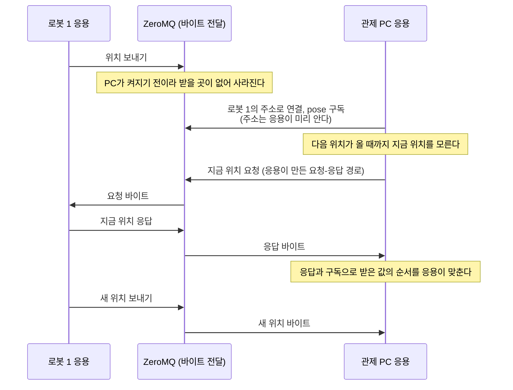
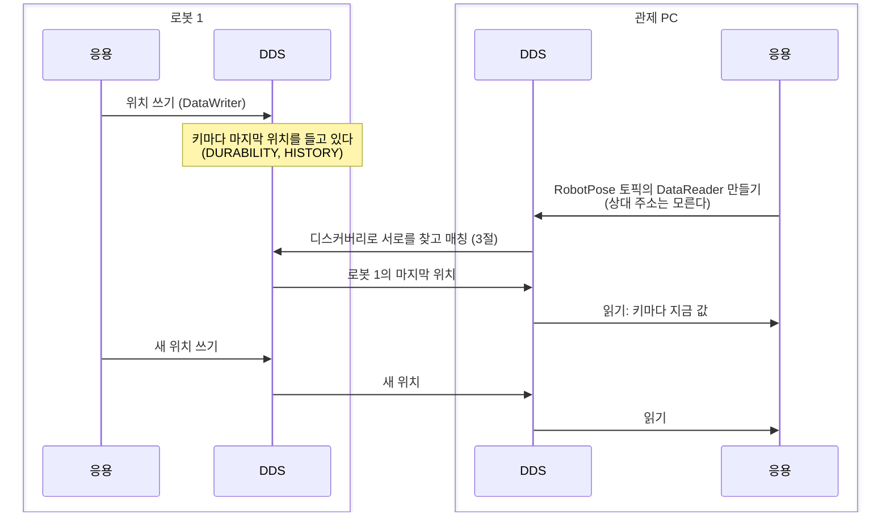
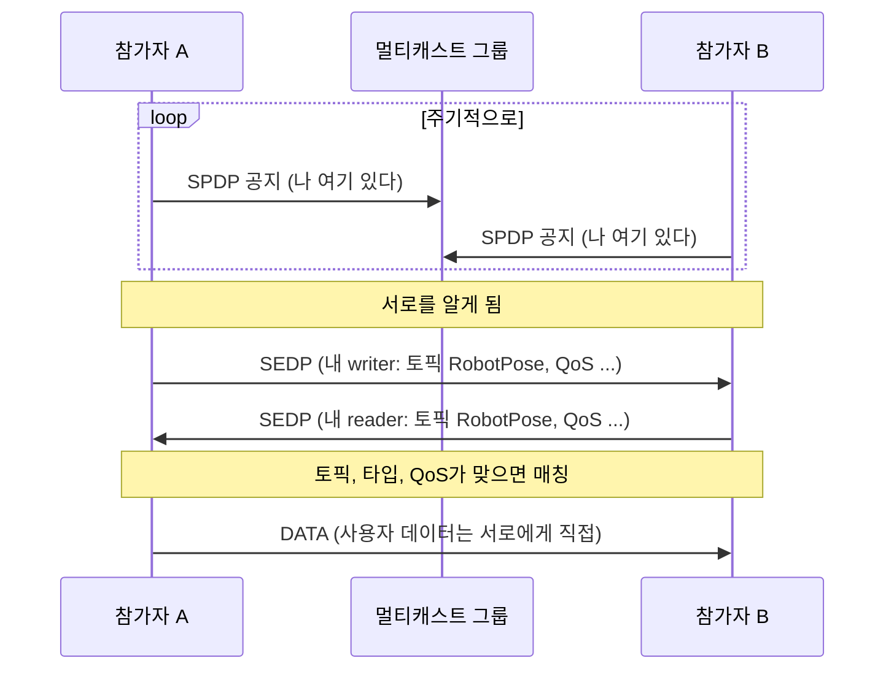

# 00. 들어가며: DDS란 무엇이고 왜 직접 만드는가

[목차](../README.md) | 다음: chapter 01 실습 환경

이 chapter는 코드도 lab도 없다. DDS가 어떤 문제를 풀려고 생겼는지, 비슷한 일을 하는 다른 미들웨어와 무엇이 다른지, 그리고 이 책이 왜 DDS를 직접 만들면서 배우는지를 설명한다. 특히 **디스커버리** (서로를 찾는 과정)를 앞에서 자세히 다룬다. DDS의 가장 큰 장점이 여기서 나오고, 가장 큰 비용도 여기서 나온다. **이 책은 DDS가 가장 좋은 기술이라고 주장하지 않는다.** DDS가 무엇을 잘 풀고 무엇을 대가로 치르는지, 언제 다른 기술이 더 맞는지를 출처와 함께 보이고, 독자가 자기 문제에 맞는 기술을 스스로 고르도록 돕는 것이 목표다. 처음 나오는 용어는 [용어 정리](../glossary.md)에도 모아 두었다.

## 1. DDS가 푸는 문제

이동 로봇 한 대를 생각해 보자. 안에서 여러 프로그램이 동시에 돈다.

- LiDAR 드라이버가 초당 수십 번 point cloud를 낸다.
- 위치 추정 프로그램이 point cloud를 받아 로봇의 현재 위치를 낸다.
- 경로 계획 프로그램이 위치를 받아 속도 명령을 낸다.
- 모터 제어기 (작은 마이크로컨트롤러)가 속도 명령을 받아 바퀴를 돌린다.
- 관제 PC가 무선으로 붙어 위치와 상태를 본다. 켜졌다 꺼졌다 한다.

이 프로그램들 사이에 데이터를 나르려면 몇 가지를 정해야 한다.

1. **누가 누구에게 보내는가.** 위치 추정 프로그램은 point cloud를 누가 내는지, 그 프로그램이 어느 주소에 있는지 알아야 할까? 관제 PC가 새로 켜지면 누가 그것을 알려 주는가?
2. **무엇을 보내는가.** "위치가 바뀌었다"는 메시지를 보내는가, 아니면 "지금 위치는 이것이다"라는 상태를 나누는가? 관제 PC가 늦게 켜졌을 때 지금 위치를 바로 받을 수 있는가?
3. **어떻게 보내는가.** point cloud는 몇 개 빠져도 다음 것이 곧 오니 괜찮다. 속도 명령은 빠지면 안 된다. 위치가 100 ms 넘게 안 오면 이상이 생긴 것이다. 데이터마다 요구가 다르다.

DDS (Data Distribution Service)는 이 세 질문에 표준으로 답하는 미들웨어다. OMG (Object Management Group)가 규격을 만들고, 여러 회사와 오픈소스 프로젝트가 그 규격대로 구현한다. 국방, 산업 자동화, 차량 같은 분산 제어 시스템에서 쓰이고, 요즘 가장 눈에 띄는 사용처는 로봇 운영 체제 ROS 2다. ROS 2의 기본 통신 계층이 DDS다.

## 2. DDS란 무엇인가

### 2.1. 메시지를 나르는가, 데이터를 나누는가

통신 미들웨어는 크게 두 방식으로 나눌 수 있다.

- **message-centric** (메시지 중심): 미들웨어는 바이트 덩어리를 A에서 B로 나른다. 메시지가 무슨 뜻인지, 어떤 상태를 나타내는지는 응용이 안다. 늦게 들어온 수신자는 지난 메시지를 받지 못하므로, 지금 상태를 알려면 응용이 따로 방법을 만들어야 한다. 대표적인 예가 ZeroMQ와 MQTT다 (4절). ZeroMQ는 바이트 프레임을 상대에게 나를 뿐이고, MQTT의 브로커도 payload를 해석하지 않는다. MQTT에는 토픽마다 마지막 메시지 하나를 보관하는 기능 (retained message)이 있지만, 로봇 열 대가 한 토픽에 보내면 마지막 로봇의 것 하나만 남는다. 로봇마다 값을 남기려면 응용이 `robot/3/pose`처럼 토픽 이름에 ID를 넣어야 하고, 그 ID의 뜻은 미들웨어가 아니라 응용만 안다.
- **data-centric** (데이터 중심): 미들웨어가 데이터의 타입과 "어떤 것의 값인가"를 안다. 응용은 공유된 데이터 공간에 값을 쓰고 읽는다. 미들웨어는 누가 무엇에 관심 있는지 보고 값을 전한다. 늦게 들어온 참가자에게 지금 값을 줄지도 미들웨어가 정책으로 처리한다. 로봇 열 대가 RobotPose 토픽 하나에 위치를 보내도, 미들웨어가 타입의 키 (로봇 ID)를 보고 로봇마다 마지막 값을 따로 들고 있다가 늦게 켜진 관제 PC에 열 대의 지금 위치를 준다 (그렇게 하라는 QoS를 정했을 때. 키와 QoS는 아래에서 설명한다).

1절의 늦게 켜진 관제 PC로 두 방식을 견주어 보자. 두 방식 모두 응용은 라이브러리를 불러 쓰므로, 차이는 같은 일을 **응용 계층**과 **미들웨어 계층** 가운데 어디서 하느냐다. 그림은 로봇 한 대만 그렸다. 먼저 message-centric인 ZeroMQ로 만든 경우다. ZeroMQ는 바이트를 나르는 일만 하므로 한 줄로 그렸다.



같은 일을 data-centric인 DDS로 하면 이렇다. 이번에는 미들웨어가 양쪽에서 각자 일을 하므로 (로봇 쪽은 마지막 값을 들고 있고, 양쪽이 서로를 찾는다) 로봇과 관제 PC마다 응용과 DDS를 나눠 그렸다.



ZeroMQ에서 응용 계층이 하던 일 (상대 주소 알기, 지금 값을 따로 요청하고 답하기, 순서 맞추기)을 DDS에서는 미들웨어 계층이 한다. 관제 PC의 응용은 토픽 이름으로 DataReader를 만들고 읽기만 한다. 미들웨어가 이 일을 할 수 있는 것은 데이터의 타입과 키를 알기 때문이다.

DDS는 data-centric이다. 규격 이름의 DCPS가 Data-Centric Publish-Subscribe의 줄임이다. 규격은 이 모델을 모든 응용이 접근하는 **global data space**로 설명한다 (DDS 1.4 Sec. 1.2). 데이터를 넣고 싶은 응용은 publisher가 되고, 데이터의 일부를 보고 싶은 응용은 subscriber가 된다. publisher가 새 값을 넣으면 미들웨어가 관심 있는 subscriber에게 전한다. 응용 안에서 실제로 값을 쓰고 읽는 것은 토픽마다 만드는 DataWriter와 DataReader다 (엔티티 계층은 chapter 05).

### 2.2. 토픽, 타입, 키

global data space는 **토픽** (topic)으로 나뉜다. 토픽은 이름과 타입을 가진다. 예를 들어 "RobotPose"라는 토픽의 타입은 로봇 ID, x, y, 방향을 담는 구조체다. 타입을 미들웨어가 알기 때문에 값을 바이트로 바꾸는 일 (직렬화)도 미들웨어가 하고, 타입이 맞지 않는 상대와는 매칭하지 않는다.

한 토픽 안에 여러 대상의 값이 섞일 수 있다. 로봇이 열 대면 RobotPose 토픽에 열 대의 위치가 다 들어온다. 이것을 구분하는 것이 **키** (key)다. 타입의 필드 가운데 일부 (여기서는 로봇 ID)를 키로 정하면, 키가 같은 값은 같은 대상 (**인스턴스**, instance)의 연속된 값이고 키가 다르면 다른 인스턴스다 (DDS 1.4 Sec. 2.2.1.2.2). 그래서 DDS는 "로봇 3의 지금 위치"를 메시지의 흐름이 아니라 인스턴스의 최신 값으로 다룰 수 있다. 인스턴스가 사라졌다는 것 (dispose)도 표준으로 알린다.

키는 값을 보내는 쪽이 아니라 그 값이 설명하는 대상을 가리킨다. 경로 계획 프로그램 하나가 로봇 열 대에 속도 명령을 보낸다면 키는 명령을 받는 로봇의 ID다. 반대로 한 로봇의 위치를 프로그램 둘이 쓴다면 키는 그대로 로봇 ID 하나이고, 둘 가운데 누구의 값을 믿을지는 키가 아니라 QoS (4.2절의 OWNERSHIP)가 정한다.

모든 데이터가 키로 나뉘는 상태는 아니다. 배터리 잔량이나 비상 정지 버튼이 눌려 있는지처럼 "지금 값"만 의미가 있는 **상태**는 키를 두고 최신 값을 나눈다. 로그 한 줄처럼 하나하나가 의미가 있는 **사건**은 키 없이 흐름으로 보내고 빠짐없이 받는다. 같은 것도 어느 쪽으로 볼지는 설계 선택이다. 비상 정지를 "눌렸다"는 사건으로 보내면 늦게 켜진 프로그램은 그 사건을 놓치지만, "버튼 3이 눌려 있다"는 상태로 두면 켜지자마자 지금 상태를 받는다.

### 2.3. QoS: 데이터마다 다른 요구

1절의 세 번째 질문에 대한 답이 **QoS** (Quality of Service) 정책이다. 쓰는 쪽 (DataWriter)과 읽는 쪽 (DataReader)이 각자 정책을 밝히고, 미들웨어가 둘이 맞는지 보고 매칭한다. RTPS 규격은 이것을 DataWriter와 DataReader 사이의 **QoS 계약**이 정보의 흐름을 조절한다고 표현한다 (RTPS 2.5 Sec. 7.2). 몇 가지 예:

| 정책 | 정하는 것 | 1절의 예 |
|---|---|---|
| RELIABILITY | 빠진 값을 다시 보내는가 | point cloud는 BEST_EFFORT, 속도 명령은 RELIABLE |
| HISTORY | 인스턴스마다 값을 몇 개 들고 있는가 | 위치는 마지막 1개면 된다 |
| DURABILITY | 늦게 들어온 reader에게 지난 값을 주는가 | 관제 PC가 켜지면 지금 위치를 바로 받는다 |
| DEADLINE | 값이 얼마 안에 와야 하는가 | 위치가 100 ms 넘게 안 오면 알린다 |

정책의 정의는 DDS 1.4 Sec. 2.2.3에 있다. 정책은 이 밖에도 많다. 모든 정책과 매칭 규칙은 chapter 05에서 다룬다.

### 2.4. API와 와이어 프로토콜

DDS는 규격이 둘로 나뉜다.

- **DDS (DCPS) 규격**: 응용이 쓰는 API와 동작을 정한다. 이 규격을 따르면 응용을 다른 구현으로 옮기기 쉽다.
- **DDSI-RTPS 규격**: 네트워크에 실제로 오가는 바이트, 즉 와이어 프로토콜을 정한다. 이 규격을 따르면 서로 다른 회사의 구현끼리 통신할 수 있다 (DDS 1.4 Sec. 1.2).

예를 들어 보자.

- 로봇의 응용을 Fast DDS로 만들었다가 Cyclone DDS로 바꾸고 싶다. 이때 기대는 것은 **DCPS 규격**이다. 두 구현이 같은 엔티티 (DomainParticipant, DataWriter, DataReader)와 같은 QoS를 제공하므로 응용의 구조를 그대로 옮길 수 있다. 다만 구현마다 언어 API (C, C++)의 모양은 조금씩 달라서, 코드를 그대로 다시 컴파일하는 수준은 아니다.
- Fast DDS로 만든 로봇과 Cyclone DDS로 만든 관제 PC가 서로 통신해야 한다. 이때 기대는 것은 **RTPS 규격**이다. 두 구현이 같은 바이트를 주고받으므로 응용 코드를 고치지 않아도 서로를 찾고 데이터를 나눈다.

이 책이 검증 기준으로 삼는 것이 두 번째다. 우리가 만드는 구현이 Cyclone DDS, Fast DDS와 실제로 통신하는지로 맞게 만들었는지를 확인한다. 같은 와이어 프로토콜을 지키는 독립 구현이 여럿 있다는 것은 다른 미들웨어와 비교할 때 DDS의 큰 특징이기도 하다 (4절).

## 3. 디스커버리: 브로커 없이 서로를 찾기

### 3.1. 규격의 요구

1절의 첫 번째 질문, "누가 누구에게 보내는가"를 생각해 보자. 가장 쉬운 답은 가운데에 서버를 하나 두는 것이다. 모두가 서버에 접속하고, 서버가 메시지를 받아 나눠 준다. 이런 서버를 **브로커** (broker)라 한다. 간단하지만 브로커가 멈추면 모든 통신이 멈춘다. 이렇게 하나가 멈추면 전체가 멈추는 구성 요소를 **단일 장애점** (single point of failure)이라 한다.

DDS는 이 길을 택하지 않았다. RTPS 규격은 DDS가 이름 서버에 묻지 않고도 publisher와 subscriber가 서로를 계속 발견하는 내장 디스커버리를 요구한다고 쓴다. 또 구현이 단일 장애점을 두지 않아야 하므로 프로토콜이 중앙 이름 서버나 중앙 브로커에 기대면 안 된다고 쓴다 (RTPS 2.5 Sec. 7.2).

### 3.2. 두 단계: SPDP와 SEDP

그래서 RTPS의 디스커버리는 모든 참가자가 스스로 하는 두 단계로 되어 있다 (RTPS 2.5 Sec. 8.5.1).

1. **SPDP** (Simple Participant Discovery Protocol, 참가자 디스커버리): 같은 도메인의 참가자 (participant, DDS를 쓰는 프로세스 하나라고 생각하면 된다)는 "나 여기 있다"는 공지를 미리 정해 둔 주소 (보통 멀티캐스트 주소)로 **주기적으로** 보낸다 (Sec. 8.5.3.1). 주기적으로 보내기 때문에 누가 먼저 켜지든 상관없이 서로를 찾는다. 공지에는 lease 기간이 들어 있고, 그 기간 안에 다시 소식이 없으면 상대가 사라진 것으로 보고 정리한다.
2. **SEDP** (Simple Endpoint Discovery Protocol, 엔드포인트 디스커버리): 상대 참가자를 찾으면, 그 참가자에게 내 DataWriter와 DataReader가 어떤 토픽, 어떤 타입, 어떤 QoS인지 알린다. 이 교환은 빠지면 안 되므로 RELIABLE로 한다 (Sec. 8.5.4.2). 양쪽은 받은 정보로 토픽과 타입과 QoS가 맞는 상대를 골라 매칭한다.



이 구조에는 브로커도, 이름 서버도 없다. 데이터도 writer에서 reader로 바로 간다. 한 참가자가 죽으면 그 참가자와의 통신만 끊기고, 나머지는 lease가 끝날 때 죽은 참가자를 지운다. 새 참가자는 아무 때나 들어와도 된다. 관제 PC를 켜면 설정 없이 로봇의 토픽이 보이는 것이 이 덕분이다.

### 3.3. 대가

공짜는 아니다. 브로커가 없으므로 모든 참가자가 모든 참가자에게 자기를 알려야 하고, 자기의 writer와 reader도 모두 알려야 한다. 참가자가 N개, 참가자마다 엔드포인트가 E개라면 SEDP로 주고받는 양은 대략 N x (N - 1) x E에 비례해 는다. 규격도 SPDP와 SEDP는 작은 규모부터 중간 규모까지의 네트워크에 충분하다고 적는다 (RTPS 2.5 Sec. 8.5.1).

게다가 SPDP 공지는 참가자마다 주기적으로 계속 나간다. 그래서 디스커버리 패킷 (SPDP와 SEDP)은 네트워크를 자주 쓰고, 주고받는 사용자 데이터가 적은 작은 시스템에서도 트래픽의 적지 않은 몫이 된다. chapter 03에서 두 벤더의 패킷을 캡처해 직접 본다.

규모가 커지거나, 멀티캐스트가 잘 안 되는 무선 네트워크에서는 이것이 문제가 된다. ROS 2 핵심 팀은 2023년 대안 미들웨어 보고서에서 DDS의 문제는 배포마다 해결할 수는 있지만, DDS를 잘 아는 사람이 그 응용에 맞춰 DDS를 따로 설정해야 하는 경우가 많다고 정리했다. 로봇을 만드는 사람이 미들웨어 설정까지 깊이 알아야 한다는 뜻이다. 현장은 몇 가지 방법으로 대응한다.

- **중앙 서버**: 디스커버리만 서버를 거치게 한다 (Fast DDS Discovery Server 등). 트래픽은 줄지만 서버가 디스커버리의 중심이 되므로, 서버를 여럿 두는 방법을 함께 쓴다.
- **정적 설정**: 상대의 엔드포인트를 설정 파일에 미리 적고 SEDP를 끈다. 작은 마이크로컨트롤러용 구현과 기능 안전 인증을 받은 제품이 이 방식을 정식으로 지원한다. 대신 동적으로 참여하는 성질을 잃는다.
- **범위 제한**: 멀티캐스트를 줄이고 유니캐스트로 보낼 상대를 정하거나, 디스커버리가 닿는 범위를 같은 호스트로 줄인다.
- **중계**: 네트워크나 도메인 사이에 중계 프로세스를 두어 디스커버리가 닿는 범위를 나눈다 (eProsima DDS Router, Zenoh의 DDS 브리지 등). 중계 너머의 상대는 원래 참가자가 아니라 중계를 보게 된다.
- **다른 미들웨어**: 디스커버리를 다르게 설계한 Zenoh를 쓴다 (4절).

이 방법들은 모두 표준 밖이라 회사마다 다르고 서로 호환되지 않는다. 디스커버리 서비스를 규격에 넣자는 제안이 OMG에 열려 있지만 (OMG 이슈 DDSIRTP26-37) 아직 반영되지 않았다. 벤더 사이에 통하는 것은 여전히 표준 SPDP와 SEDP뿐이다. 그래서 이 책은 먼저 표준 SPDP (chapter 09)와 SEDP (chapter 11)를 직접 구현하면서 그 비용이 어디서 오는지 보고, 표준 밖의 방법은 chapter 19 ~ 21에서 비교한다.

## 4. 다른 선택지와 비교

DDS만 이런 문제를 푸는 것은 아니다. 같은 문제 (프로세스나 기기 사이에서 데이터를 publish-subscribe로 나누기)를 푸는 미들웨어 가운데, 서로 다른 설계 선택을 대표하는 다섯 가지와 비교한다.

이 비교의 목적은 DDS가 낫다는 것을 보이는 데 있지 않다. 각 기술은 서로 다른 문제를 풀려고 다른 대가를 골랐고, 맞는 기술은 문제에 따라 다르다. 그래서 각 기술을 그것이 가장 잘 쓰이는 조건에서 설명하고, DDS의 약점도 함께 적는다. DDS를 다루는 것은 DDS가 늘 최선이어서가 아니라, 표준 와이어 프로토콜과 여러 독립 구현이 있어 직접 만들며 배우기 좋은 대상이기 때문이다.

| | DDS | ZeroMQ | Zenoh | MQTT | SOME/IP | DDS-XRCE |
|---|---|---|---|---|---|---|
| 한 줄 설명 | data-centric pub/sub 표준 | 브로커 없는 메시지 전송 라이브러리 | pub/sub + storage + query | 브로커 중심 pub/sub 표준 | 차량 안 service 지향 통신 표준 | 작은 기기용 DDS |
| 브로커 | 없음 | 없음 | peer 모드는 없음, client 모드는 router 경유 | 있음 (필수) | 없음 | Agent 경유 |
| 디스커버리 | 내장 (SPDP + SEDP) | 없음 (주소를 직접 지정) | 내장 (관심사 단위로 줄임) | 없음 (브로커 주소를 앎) | 내장 (service 단위 offer / find) | Agent가 대신 함 |
| 데이터 모델 | 타입, 키, 인스턴스, 상태 | 바이트 메시지 | key 경로 + 바이트, 최신 값 조회 | 토픽 문자열 + 바이트, 마지막 값 보관 | method, event, field | DDS와 같음 |
| 규격 | OMG | 커뮤니티 문서 | 공개 명세 (표준 기구 아님) | OASIS, ISO/IEC | AUTOSAR | OMG |

(2026-10 기준. 출처는 이 chapter 끝의 참고 자료에 있다.)

이 표의 대상 가운데 브로커 없는 내장 디스커버리, data-centric 데이터 모델, 여러 회사가 구현하는 표준 와이어 프로토콜을 모두 가진 것은 DDS다. 다만 이 세 가지를 모두 원하는 문제가 아니라면 이 조합은 장점이 아니라 비용 (복잡도, 디스커버리 트래픽)이 된다. 그렇다고 DDS가 늘 맞는 답은 아니다. 분야마다 고르는 기준이 다르다.

### 4.1. 마이크로컨트롤러 (펌웨어, RTOS)

여기서는 RAM이 수십~수백 KB이고 범용 OS가 없는 환경을 말한다.

이 환경에서는 코드 크기, 동적 메모리 할당 없이 쓸 수 있는지, 시리얼이나 CAN 같은 비IP 링크, 자주 끊기는 연결이 기준이 된다. DDS를 마이크로컨트롤러에서 직접 돌리는 구현도 있지만 (상용 RTI Connext Micro, 연구용 embeddedRTPS 등) IP 스택과 디스커버리 상태를 감당해야 해서 부담이 크다.

그래서 OMG는 작은 기기가 DDS에 직접 참여하지 않고 Agent를 거쳐 붙는 DDS-XRCE를 따로 만들었다. XRCE는 eXtremely Resource Constrained Environments, 즉 자원이 극히 제한된 환경이라는 뜻이다. 규격은 Client가 Agent 없이는 동작하지 못하고, Client끼리 직접 통신하지 않으며 모든 통신이 Agent를 거쳐 중계된다고 적는다. 기기가 몇 분에서 몇 년에 한 번 깨어나는 깊은 잠을 견뎌야 하기 때문이다 (DDS-XRCE 1.0 Sec. 8.1). ROS 2의 micro-ROS가 이 방식을 쓴다.

DDS 밖에서는 Zenoh의 MCU용 구현 zenoh-pico와 MQTT (특히 센서망용 MQTT-SN)가 이 분야의 선택지다.

### 4.2. 미션크리티컬

멈추면 안 되는 시스템에서는 단일 장애점이 없는지, 시간 제약 (deadline, liveliness)을 표현할 수 있는지, 이중화와 failover, 보안, 기능 안전 인증, 여러 공급자가 있는지가 기준이 된다. DDS는 단일 장애점이 없도록 설계되었고, 시간 제약과 failover를 표준 QoS로 표현하며, 보안도 별도 OMG 규격 (DDS-Security)이 있다. 벤더 자료에 따르면 자동차 기능 안전 표준 ISO 26262의 가장 높은 등급 (ASIL D) 인증을 받은 상용 DDS도 있다 ([RTI Connext Cert 데이터시트](https://www.rti.com/hubfs/_Collateral/Datasheets/rti-datasheet-connext-cert-for-connext-drive.pdf)). 다만 인증 제품은 DDS 기능의 일부만 쓰고 (시작할 때 메모리를 다 잡고, 디스커버리를 정적으로 하는 식), 오픈소스 구현이 인증을 받았다는 근거는 찾지 못했다.

failover를 표준 QoS로 표현한다는 것은 이런 뜻이다. 데이터를 내는 쪽이 하나뿐이면 그것이 여전히 단일 장애점이다. OWNERSHIP 정책을 EXCLUSIVE로 두면, 같은 인스턴스를 쓰는 writer가 여럿 있어도 reader에게는 그 가운데 하나 (owner)의 값만 보인다. owner는 살아 있고 deadline을 지키는 writer 가운데 strength가 가장 큰 쪽이다 (DDS 1.4 Sec. 2.2.3.9.2). strength는 미들웨어가 재는 값이 아니라 응용이 writer마다 정해 주는 우선순위다. 예를 들어 위치 추정 프로그램을 두 개 띄워 주 프로그램은 strength 10, 예비 프로그램은 5로 두면, 평소에는 주 프로그램의 값만 보이다가 주 프로그램이 죽거나 100 ms 넘게 새 값을 내지 못하면 예비 프로그램의 값이 보인다. 판정은 reader가 각자 하므로 이를 조정하는 중앙 서버가 없다. 자세한 규칙은 chapter 14에서 다룬다.

자동차 안에서는 AUTOSAR의 SOME/IP가 널리 쓰인다. AUTOSAR Adaptive 플랫폼은 SOME/IP와 DDS를 바꿔 끼울 수 있는 통신 방식으로 함께 둔다. MQTT는 브로커가 단일 장애점이라 이 분야의 핵심 통신에는 잘 맞지 않는다.

### 4.3. 로보틱스

로봇에서는 ROS 2 지원, 타입 정의와 타입이 바뀔 때의 호환, 이미지나 point cloud 같은 큰 데이터 (공유 메모리), 무선과 여러 대의 로봇 환경에서의 디스커버리 비용이 기준이 된다. ROS 2는 처음부터 DDS 위에 만들어졌고 지금도 기본 미들웨어는 DDS (Fast DDS)다. 한편 3절의 디스커버리 문제 때문에 ROS 2 핵심 팀은 대안을 검토했고, Zenoh가 요구 사항을 가장 잘 만족한다고 결론 냈다. ROS 2 Kilted Kaiju (2025-05)부터 Zenoh가 1등급 (Tier 1) 미들웨어로 지원된다. Zenoh는 디스커버리를 관심사 단위로 줄였고, 마이크로컨트롤러 (zenoh-pico)부터 서버까지 한 프로토콜로 잇고, 값을 저장하고 조회하는 기능 (storage, query)도 함께 둔다. 대신 DDS만큼의 QoS 정책 묶음과 타입 시스템은 두지 않았다. 프로토콜 명세는 공개되어 있지만 표준 기구의 표준은 아니고, 다른 회사의 독립 구현도 아직 찾기 어렵다.

### 4.4. 정리: DDS가 맞는 곳과 다른 선택이 나은 곳

DDS가 맞는 곳
- 여러 프로세스와 기기가 같은 상태를 실시간으로 나누고, 참가자가 수시로 들고 나는 시스템. 로봇 (ROS 2)과 차량 안 고성능 컴퓨터 사이의 통신 (AUTOSAR Adaptive)이 대표적이다.
- 중앙 서버 하나가 멈춰 전체가 멈추면 안 되는 시스템. 규격은 지휘 통제 (C4I), 산업 자동화, 분산 제어와 시뮬레이션, 통신 장비 제어, 센서 네트워크를 적용 분야로 든다 (DDS 1.4 Sec. 1.2).
- 데이터마다 신뢰성과 시간 제약이 달라서, 그것을 응용 코드가 아니라 QoS로 표현하고 싶은 시스템.
- 여러 회사의 장비와 소프트웨어가 표준 와이어 프로토콜로 함께 통신해야 하는 시스템.

다른 선택이 나은 곳
- 인터넷 너머 많은 기기의 값을 서버로 모으는 IoT 텔레메트리: 브로커가 중심인 MQTT.
- 마이크로컨트롤러 단독: DDS-XRCE (micro-ROS)로 DDS에 붙이거나 zenoh-pico.
- 무선으로 이어진 많은 로봇처럼 디스커버리 비용이 큰 곳: Zenoh, 또는 DDS 벤더의 디스커버리 확장 (chapter 19 ~ 21).
- 프로세스 두셋을 잇는 간단한 통신: ZeroMQ나 소켓.
- 차량 안 ECU 사이의 service 통신: SOME/IP.

## 5. 규격 지도와 이 책의 흐름

DDS는 규격 하나가 아니라 여러 OMG 규격의 묶음이다.

| 규격 | 판 | 정하는 것 | 이 책 |
|---|---|---|---|
| DDS (DCPS) | 1.4 (2015) | API, 엔티티, QoS 모델 | chapter 05, 13, 14 |
| CDR (CORBA 3.3 Part 2) | 3.3 (2012) | 기본 직렬화 규칙 | chapter 06 |
| DDSI-RTPS | 2.5 (2022) | 와이어 프로토콜, 디스커버리, UDP 매핑 | chapter 07 ~ 11, 15 |
| DDS-XTypes | 1.3 (2020) | 타입 시스템, XCDR1 / XCDR2 | chapter 16 |
| IDL | 4.2 (2018) | 타입 정의 언어 | chapter 17 |
| DDS-Security | 1.2 (2025) | 인증, 접근 제어, 암호화 | chapter 18 (선택) |
| (규격 밖, 벤더 기능) | - | 정적 디스커버리, 디스커버리 서버, TCP / WAN 전송, 중계 | chapter 19 ~ 21 |

```
DDS 1.4 (개념, QoS) --> DDSI-RTPS 2.5 --> DDS-XTypes 1.3 --> DDS-Security
CDR --> DDSI-RTPS 2.5, DDS-XTypes 1.3 에서 사용
IDL 4.2 --> 타입 정의 (처음에는 Rust 코드로 대신하고 chapter 17에서 본격적으로)
```

이 책은 이 순서를 따른다.

- **chapter 01 ~ 04**: 코드를 쓰기 전에 Cyclone DDS와 Fast DDS를 컨테이너로 띄우고, 둘이 주고받는 패킷을 캡처해 본다. 이 캡처가 이후 모든 chapter의 정답 데이터가 된다.
- **chapter 05 ~ 11**: 개념 모델과 QoS, 직렬화, RTPS 메시지, best-effort 전송, 참가자 디스커버리 (SPDP), reliable 프로토콜, 엔드포인트 디스커버리 (SEDP)를 차례로 만든다. chapter 11이 끝나면 우리 구현이 두 벤더와 처음으로 통신한다.
- **chapter 12 ~ 18**: ROS 2와 통신하기, 키 인스턴스, DCPS API와 OMG 상호운용 테스트, 단편화와 성능, XTypes, IDL 컴파일러, 보안 (선택).
- **chapter 19 ~ 21**: 규격이 정하지 않은 벤더 기능. 표준 디스커버리와 UDP만으로 막히는 곳 (큰 규모, 멀티캐스트가 없는 네트워크, NAT 너머)을 벤더들이 어떻게 넘는지, 그 대가가 무엇인지 본다.
- **chapter 22**: 그 밖의 것 (선택).

전체 목차는 [book/README.md](../README.md#목차)에 있다.

## 6. 왜 직접 만드는가

DDS를 쓰기만 하는 사람도 많다. ROS 2를 쓰면 DDS를 거의 의식하지 않고도 로봇을 움직일 수 있다. 그런데 3절의 이야기처럼 시스템이 커지거나 네트워크가 나빠지면 DDS의 내부가 겉으로 드러난다. 왜 무선에서 디스커버리 트래픽이 터지는지, 왜 두 벤더가 QoS가 다르다는 이유로 매칭하지 않는지, 왜 늦게 켠 노드가 지난 값을 받지 못하는지. 이런 질문은 설정 항목을 외워서는 답하기 어렵고, 규격이 정한 동작을 알아야 답할 수 있다.

규격은 길고 (DDSI-RTPS 2.5만 해도 PDF로 206쪽이다), 읽기만 해서는 어디가 중요한지 알기 어렵다. 직접 만들면 달라진다. 패킷 하나를 해석하려면 헤더의 바이트 하나하나를 규격에서 찾아야 하고, 두 벤더와 통신이 되려면 규격이 "해야 한다"고 한 것과 "해도 된다"고 한 것을 구분해야 한다. 벤더가 규격을 어떻게 읽었는지도 캡처에서 보인다. chapter 04에서 보겠지만 같은 규격을 따르는 두 구현도 공지 주기, 포트 선택, 덧붙이는 정보가 서로 다르다.

이 책은 그래서 이 순서로 간다. 벤더가 실제로 보낸 패킷을 먼저 보고, 규격에서 근거를 찾고, Rust로 같은 일을 하는 코드를 쓰고, 두 벤더와 통신이 되는지로 확인한다. 끝에 남는 것은 동작하는 DDS 구현 하나와, 그것을 설명할 수 있는 이해다.

## 7. 스스로 확인하기

세부 사항을 외웠는지가 아니라 주요 개념을 이해했는지 보는 질문이다. 먼저 스스로 답해 본 뒤 "해설"을 펼쳐 견주어 보라.

1. 1절은 데이터를 나르려면 세 가지를 정해야 한다고 했다. 그 세 질문은 무엇이고, DDS는 각각을 어떤 개념으로 답하는가?

   <details>
   <summary>해설</summary>

   누가 누구에게 보내는가는 **디스커버리**로 답한다. 참가자들이 브로커 없이 SPDP로 서로를 찾고, SEDP로 writer와 reader의 정보를 나눠 맞는 상대와 매칭한다.

   무엇을 보내는가는 **data-centric** 모델로 답한다. 메시지를 나르는 대신 토픽, 타입, 키로 "어떤 대상 (인스턴스)의 지금 값"을 나눈다.

   어떻게 보내는가는 **QoS**로 답한다. RELIABILITY, DURABILITY, DEADLINE 같은 정책을 writer와 reader가 각자 밝히고, 미들웨어가 둘이 맞을 때 매칭한다.

   </details>

2. ZeroMQ로도 늦게 켜진 관제 PC에 지금 위치를 줄 수 있다. 그런데도 ZeroMQ를 message-centric이라 부르는 이유를 "그 일을 응용과 미들웨어 가운데 누가 하는가"로 설명해 보라.

   <details>
   <summary>해설</summary>

   ZeroMQ로 지금 위치를 주려면 응용이 따로 요청-응답 경로를 만들고, 로봇 쪽 응용이 그 요청에 답하고, 요청으로 받은 값과 구독으로 받은 값의 순서를 응용이 맞춰야 한다. ZeroMQ는 바이트를 나를 뿐이고 그 바이트가 어느 로봇의 위치인지 모르기 때문이다.

   DDS에서는 미들웨어가 타입과 키를 알기 때문에 로봇마다 마지막 값을 들고 있다가 늦게 들어온 reader에게 준다. 차이는 "할 수 있는가"가 아니라 "그 일을 응용이 하는가, 미들웨어가 하는가"다.

   </details>

3. 창고의 무인 운반차 20대가 각자의 "현재 작업 상태"를 토픽 하나로 나눈다. 작업 배정 서버 한 대가 이 토픽에 쓴다.
   - 키는 무엇으로 두어야 하는가?
   - 서버를 두 대로 늘려 한쪽이 죽어도 계속 쓰게 하려면 키를 바꿔야 하는가, 아니면 무엇을 써야 하는가?

   <details>
   <summary>해설</summary>

   키는 **운반차 ID**다. 키는 값을 보내는 쪽 (서버)이 아니라 값이 설명하는 대상 (운반차)을 가리킨다.

   서버를 두 대로 늘려도 키는 그대로다. 둘 가운데 누구의 값을 믿을지는 QoS로 정한다. OWNERSHIP을 EXCLUSIVE로 두고 주 서버에 더 큰 strength를 주면, 평소에는 주 서버의 값만 보이고 주 서버가 죽거나 deadline을 지키지 못하면 예비 서버의 값이 보인다. 응용이 heartbeat를 따로 만들 필요가 없다. 다만 두 서버가 같은 운반차에 서로 다른 작업을 계산하지 않게 하는 일은 여전히 응용의 몫이다. OWNERSHIP은 reader에게 누구의 값을 보여 줄지만 정한다.

   </details>

4. 로봇의 응용을 Fast DDS에서 Cyclone DDS로 옮기는 일과, Fast DDS로 만든 로봇이 Cyclone DDS로 만든 관제 PC와 통신하는 일은 각각 어느 규격에 기대는가? 이 책이 검증 기준으로 삼는 것은 어느 쪽이고 왜인가?

   <details>
   <summary>해설</summary>

   응용을 다른 구현으로 옮기는 일은 **DCPS** (API 규격)에 기댄다. 같은 엔티티와 QoS가 있어 응용의 구조를 옮길 수 있다. 다만 언어 API의 모양이 구현마다 달라 손은 든다.

   서로 다른 구현끼리 통신하는 일은 **RTPS** (와이어 규격)에 기댄다. 같은 바이트를 주고받으므로 응용 코드를 고치지 않아도 통한다.

   이 책의 검증 기준은 RTPS다. 우리가 만든 구현이 맞는지를 실제 벤더와 패킷을 주고받아 확인할 수 있고, 여러 회사의 독립 구현이 서로 통한다는 것이 DDS의 특징이기 때문이다.

   </details>

5. DDS가 브로커 없이 SPDP와 SEDP로 서로를 찾는 이유는 무엇이고, 그 대가는 무엇인가? 어떤 환경에서 특히 문제가 되는가?

   <details>
   <summary>해설</summary>

   브로커를 두면 브로커가 단일 장애점이 된다. 규격은 단일 장애점을 두지 않도록 중앙 이름 서버나 브로커에 기대지 말라고 한다. 덕분에 참가자는 설정 없이 아무 때나 들어오고 나갈 수 있다.

   대가는 디스커버리 트래픽이다. 모든 참가자가 모든 참가자에게 자기와 자기의 writer, reader를 알려야 하고 (SEDP 양은 대략 N x (N - 1) x E), SPDP 공지는 주기적으로 계속 나간다. 참가자가 많은 큰 시스템과 멀티캐스트가 잘 안 되는 무선 네트워크에서 특히 문제가 된다. 현장의 대응 방법 (중앙 서버, 정적 설정, 중계 등)은 표준 밖이라 벤더 사이에 호환되지 않는다.

   </details>

6. 다음 세 경우에 DDS를 권하겠는가? 아니라면 무엇을 검토하겠는가?
   - 전국에 흩어진 태양광 인버터 5,000대의 발전량을 1분마다 클라우드로 모으기
   - 수술 로봇 안의 제어 PC, 영상 PC, 안전 감시 PC가 위치와 상태를 실시간으로 나누기. 장비마다 공급사가 다르다
   - 같은 PC 안의 프로세스 둘이 설정 파일이 바뀐 것을 알리기

   <details>
   <summary>해설</summary>

   정답이 하나는 아니다. 판단의 근거가 중요하다.

   - 태양광 인버터: 권하지 않는다. 많은 기기가 서버 한곳으로 값을 모으는 구조라 브로커 중심인 MQTT가 문제에 맞는다. 브로커 없는 디스커버리나 풍부한 QoS가 주는 이점은 거의 쓰이지 않고 비용만 남는다.
   - 수술 로봇: 권한다. 공급사가 다른 장비들이 표준 와이어 프로토콜로 통해야 하고, 상태를 실시간으로 나누며, 하나가 멈춰 전체가 멈추면 안 된다. 시간 제약은 QoS로 표현할 수 있다. 장비 안 네트워크라 디스커버리 비용도 작다.
   - 같은 PC 안의 두 프로세스: 권하지 않는다. 미들웨어가 필요 없는 문제다. 파일 변경 알림, 파이프, 소켓 같은 운영 체제의 IPC나 ZeroMQ로 충분하다.

   </details>

## 참고 자료

규격 (OMG)
- DDS 1.4: https://www.omg.org/spec/DDS/1.4/
- DDSI-RTPS 2.5: https://www.omg.org/spec/DDSI-RTPS/2.5/
- DDS-XRCE 1.0: https://www.omg.org/spec/DDS-XRCE/
- OMG 이슈 DDSIRTP26-37 (디스커버리 서비스): https://issues.omg.org/issues/DDSIRTP26-37

디스커버리와 ROS 2
- ROS 2 alternative middleware report (2023-09-27): https://discourse.openrobotics.org/t/ros-2-alternative-middleware-report/33771
- ROS 2 Kilted Kaiju 발표 (2025-05-23): https://www.openrobotics.org/blog/2025/5/23/ros-2-kilted-kaiju-released
- ROS 2의 기본 RMW 선택 (Fast DDS를 우선한다): https://github.com/ros2/rmw/blob/rolling/rmw_implementation_cmake/cmake/get_default_rmw_implementation.cmake
- Fast DDS Discovery Server: https://fast-dds.docs.eprosima.com/
- eProsima DDS Router: https://eprosima-dds-router.readthedocs.io/
- Zenoh의 DDS 브리지 (zenoh-plugin-dds): https://github.com/eclipse-zenoh/zenoh-plugin-dds
- Zenoh의 디스커버리 설명 (벤더 글): https://zenoh.io/blog/2021-03-23-discovery/

비교 대상
- ZeroMQ: https://zeromq.org/ , ZMTP 규격 https://rfc.zeromq.org/spec/23/
- Zenoh: https://zenoh.io/ , 프로토콜 명세 https://spec.zenoh.io/
- MQTT 5.0 (OASIS): https://docs.oasis-open.org/mqtt/mqtt/v5.0/mqtt-v5.0.html
- SOME/IP (AUTOSAR R25-11): https://www.autosar.org/fileadmin/standards/R25-11/FO/AUTOSAR_FO_PRS_SOMEIPProtocol.pdf
- micro-ROS: https://micro.vulcanexus.org/
- RTI Connext Micro: https://www.rti.com/products/connext-micro
- embeddedRTPS: https://github.com/embedded-software-laboratory/embeddedRTPS
- zenoh-pico: https://github.com/eclipse-zenoh/zenoh-pico
- MQTT-SN 1.2: https://www.oasis-open.org/committees/download.php/66091/MQTT-SN_spec_v1.2.pdf

미션크리티컬
- RTI Connext Cert (ISO 26262 ASIL D, 벤더 데이터시트): https://www.rti.com/hubfs/_Collateral/Datasheets/rti-datasheet-connext-cert-for-connext-drive.pdf
- AUTOSAR Adaptive Communication Management (R24-11, SOME/IP와 DDS network binding): https://www.autosar.org/fileadmin/standards/R24-11/AP/AUTOSAR_AP_SWS_CommunicationManagement.pdf
