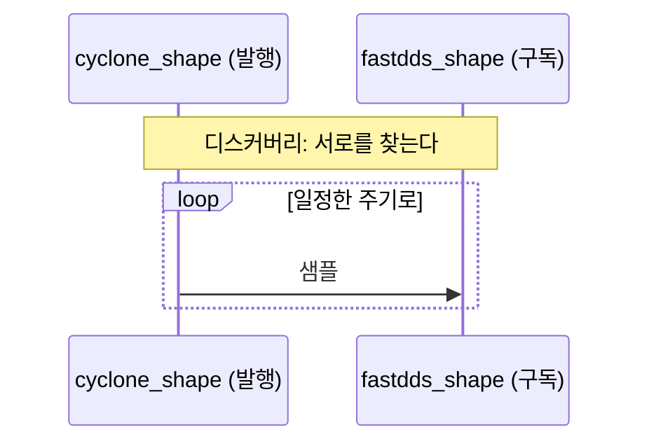
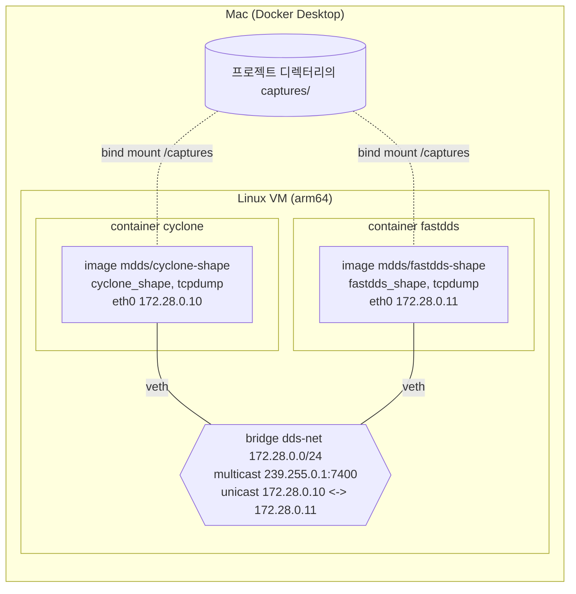

# 1. 실습 환경: 벤더 DDS 두 개를 컨테이너로

[목차](../README.md) | 이전: [0 들어가며](../00-introduction/README.md) | 다음: [2 멀티캐스트가 오가는 길](../02-multicast/README.md)

이 chapter에서는 Cyclone DDS와 Fast DDS를 Docker 컨테이너 두 개로 실행한다. 이 두 컨테이너가 이후 모든 chapter의 실험실이다. 다음 chapter에서 두 컨테이너 사이에 멀티캐스트가 전달되는지 확인하고, 그 뒤의 chapter에서 두 컨테이너 사이의 통신 패킷을 캡처한다. 이후 mdds를 구현할 때마다 mdds도 컨테이너로 실행해 같은 네트워크에 세 번째 참가자로 연결하고, 두 벤더와 통신할 수 있는지로 구현을 검증한다. 이 chapter에는 DDS 코드도 규격 읽기도 없다. 환경을 어떻게 왜 이렇게 구성했는지에 대한 설명과, 그 환경을 직접 실행해 보는 lab 두 개로 이루어진다.

## 1. 왜 이런 환경인가

이 책은 벤더가 실제로 보낸 패킷을 먼저 보고 규격에서 근거를 찾는다. 그러려면 환경이 다음 세 가지 조건을 만족해야 한다.

- **서로 다른 구현 두 개.** 같은 구현끼리만 통신하게 하면 그 구현이 규격을 해석한 방식이 정답처럼 보인다. 서로 다른 두 구현의 통신을 관찰해야 규격이 정한 부분과 구현이 선택한 부분을 구별할 수 있다. Cyclone DDS와 Fast DDS를 쓴다. 둘 다 오픈 소스이므로 (Fast DDS는 Apache-2.0, Cyclone DDS는 EPL-2.0 또는 BSD 계열의 EDL-1.0 가운데 하나를 선택하는 이중 라이선스) 소스에서 빌드하고 내부를 분석할 수 있으며, OMG 상호운용 시험에 참여한다. 또한 ROS 2가 가장 높은 등급 (Tier 1)으로 지원하는 오픈 소스 DDS다 ([REP 2000](https://www.ros.org/reps/rep-2000.html)의 Jazzy, Kilted 기준. Fast DDS가 기본). 그리고 두 구현은 서로 독립적으로 개발된다. Fast DDS는 eProsima라는 회사가 C++로, Cyclone DDS는 Eclipse 재단 (Eclipse IDE와 Jakarta EE를 관리하는 오픈 소스 재단)의 프로젝트로서 C로 개발한다.
- **두 구현에서 같게 동작하는 프로그램.** 벤더마다 예제 프로그램이 다르면 패킷의 차이가 구현 때문인지 프로그램 때문인지 알 수 없다. 그래서 OMG의 상호운용 시험 저장소에 있는 **shape_main**을 쓴다. shape_main은 DDS 구현 사이의 상호운용 시험을 위해 만든 명령행 프로그램이다. 도형 하나의 색, 위치 (x, y), 크기를 담은 ShapeType 샘플을 발행하거나 구독하고 (색이 key이다), 보내거나 받은 샘플을 토픽 이름, 색, x, y, 크기 순으로 한 줄씩 출력한다. 이름의 shape는 이 프로그램이 주고받는 데이터가 도형이라는 뜻이다. 타입 이름이 ShapeType이고, 시험에서는 Square 같은 도형 이름을 토픽 이름으로 쓴다. 도형은 시험용 데이터의 소재일 뿐 DDS의 동작이나 패킷 구조와는 관계가 없으므로, 이름에 의미를 둘 필요는 없다. 토픽 이름과 QoS 정책 (신뢰성, durability 등)은 명령행 옵션으로 지정한다. 벤더마다 구현 (Cyclone용은 C 언어 구현, Fast DDS 등은 C++ 언어 구현)이 따로 있고 각각 그 벤더의 DDS 라이브러리로 빌드되지만, 명령행 옵션, 동작, 출력 형식은 같도록 맞춰져 있다. 그래서 두 컨테이너 사이에서 달라지는 것은 DDS 라이브러리뿐이다.
- **패킷을 빠짐없이 볼 수 있는 네트워크.** 두 프로그램이 서로 다른 호스트처럼 통신하고, 두 프로그램 사이의 패킷을 통신의 시작부터 끝까지 캡처할 수 있어야 한다. 또한 다른 트래픽이 섞이지 않아야 캡처를 분석하기 쉽다.

**shape_main으로 하는 통신.** 예를 들어 Cyclone DDS 컨테이너의 shape_main이 발행하고 Fast DDS 컨테이너의 shape_main이 구독한다. 둘은 먼저 디스커버리로 서로를 찾고, 그 뒤 발행자가 일정한 주기로 샘플을 보내면 구독자가 이를 수신한다.



이후의 실험은 이 과정을 조건을 바꿔 가며 반복한다. QoS를 바꾸고, 발행자와 구독자의 벤더를 서로 바꿔 양방향을 모두 관찰한다. 양쪽에서 같은 프로그램을 실행하므로, 패킷에 나타나는 차이는 벤더 구현의 차이로 볼 수 있다.

환경은 Docker로 이렇게 구성한다. 벤더마다 그 벤더의 DDS와 shape_main을 소스에서 빌드한 이미지를 하나씩 만들고, 각 이미지로 컨테이너를 하나씩 실행한다. 그리고 두 컨테이너만 연결된 전용 가상 네트워크를 만들어, 그 네트워크에서 패킷을 캡처한다.

**Docker가 하는 일.** Docker는 두 가지 기능을 제공한다. 첫째, **이미지**를 만든다. 이미지는 프로그램과, 그 프로그램을 실행하는 데 필요한 파일 시스템 (Ubuntu 패키지, 라이브러리)을 하나로 묶은 것이다. 이미지를 만드는 절차는 `Dockerfile`에 적는다. 벤더 DDS를 빌드하는 컴파일러와 라이브러리도 이미지에 포함되므로, 독자의 컴퓨터에 설치된 소프트웨어와 관계없이 같은 환경에서 빌드된다. 둘째, 이미지로 **컨테이너**를 실행한다. 컨테이너는 호스트의 커널을 공유하지만 파일 시스템, 프로세스, 네트워크 (자체 `eth0` 인터페이스와 IP 주소)는 독립적으로 가진다. 따라서 컴퓨터 한 대에서 두 벤더를 서로 다른 호스트 두 대처럼 실행할 수 있다. 가상 머신 두 대로도 같은 구성을 만들 수 있지만, 컨테이너는 별도의 커널을 부팅하지 않으므로 자원을 적게 쓰고 더 빨리 시작된다. 벤더 DDS를 컴퓨터에 직접 설치해 실행하지 않는 이유도 여기에 있다. 두 프로그램이 한 컴퓨터의 네트워크 스택을 공유하면 한 호스트 안의 두 프로세스 사이의 통신이 되어, 서로 다른 장비 사이의 통신과 조건이 달라진다. 또한 빌드에 필요한 도구와 라이브러리 (CMake, OpenSSL 등)의 버전이 독자의 OS마다 달라진다.

**compose를 쓰는 이유.** 이 환경은 컨테이너 두 개, 고정 주소를 쓰는 네트워크 하나, 캡처 파일을 저장하는 공유 디렉터리로 구성된다. `docker` 명령으로 직접 구성하려면 먼저 네트워크를 만들고, 컨테이너마다 IP 주소, 호스트 이름, 공유 디렉터리, 권한을 명령행 옵션으로 지정해 실행해야 한다. 실행할 때마다 같은 옵션을 정확히 다시 입력해야 하고, 구성은 셸의 명령 기록에만 남는다. Docker Compose는 이 구성 전체를 파일 하나 (`docker/compose.yaml`)에 선언하고, `docker compose build`, `up`, `down` 같은 짧은 명령으로 한꺼번에 관리한다. 각 컨테이너는 `cyclone`, `fastdds`라는 서비스 이름으로 지정한다 (`docker compose exec cyclone ...`). 구성이 파일로 프로젝트 디렉터리에 있으므로 누가 실행해도 같은 구성이 만들어지고, 변경 내용은 git 기록으로 남는다.

## 2. 준비물과 설치

다음 두 환경을 기준으로 설명한다. macOS (Apple Silicon)에서는 Docker Desktop을, Ubuntu (24.04, x86_64 또는 arm64)에서는 Docker Engine을 쓴다. 이미지를 소스에서 빌드하므로 (3.2절) 두 환경 모두 같은 Dockerfile과 compose 파일로 동작한다. 설치가 끝나면 이후의 명령은 두 환경에서 같다. 이 판의 명령과 출력은 macOS (Apple Silicon)와 Ubuntu 24.04 (x86_64)에서 실행해 확인했다. 두 환경에서 캡처의 패킷 수가 달라지는 곳은 chapter 2에서 설명한다.

### 2.1 Docker

macOS
- Docker Desktop을 설치한다.
- 설정의 Resources에서 메모리를 8 GB 이상, 가능하면 16 GB로 설정한다. Docker Desktop은 Linux VM 안에서 컨테이너를 실행하므로, 빌드에 사용할 수 있는 메모리는 이 설정값으로 제한된다. Fast DDS는 C++ 코드라 첫 이미지 빌드에서 메모리를 많이 사용한다.
- 설정의 File sharing 목록에 프로젝트 디렉터리 (2.4절)가 들어 있어야 한다. 컨테이너가 캡처 파일을 프로젝트 디렉터리의 `captures/`에 직접 쓰기 때문이다 (4절). 기본 목록에 홈 디렉터리가 들어 있으므로, 홈 디렉터리 아래에 clone하면 추가 설정은 필요 없다.

Ubuntu
- Docker Engine과 compose 플러그인을 설치한다. Ubuntu 패키지로 설치한다면 `docker.io`에는 이 책이 쓰는 `docker compose` 명령이 포함되지 않으므로 `docker-compose-v2`를 함께 설치한다 (`sudo apt install docker.io docker-compose-v2`). Docker 공식 저장소에서 받으려면 Docker 공식 안내 ([Install Docker Engine on Ubuntu](https://docs.docker.com/engine/install/ubuntu/))를 따른다. 어느 방법이든 `docker compose version`이 동작하면 된다.
- `sudo` 없이 `docker`를 쓰려면 사용자를 `docker` 그룹에 추가하고 (`sudo usermod -aG docker $USER`) 다시 로그인한다. Docker 문서가 밝히듯 이 그룹은 root 수준의 권한을 주므로, 여러 사람이 쓰는 머신에서는 `sudo docker ...`로 실행하는 편이 안전하다.
- 컨테이너가 호스트 커널에서 직접 실행되므로 메모리와 파일 공유를 따로 설정할 필요가 없다. 메모리가 8 GB 정도인 머신에서는 빌드 병렬 수를 줄인다 (Lab 1-1).

두 환경 모두 디스크는 빌드 중간 산출물을 포함해 10 GB 정도의 여유 공간이 필요하다. `docker compose version`이 버전을 출력하면 준비가 끝난 것이다.

### 2.2 Deno

캡처 시나리오 스크립트를 실행하는 데 쓴다 (chapter 3부터). Deno는 TypeScript를 별도의 컴파일 단계 없이 직접 실행하는 런타임이다. 시스템 소프트웨어를 다루는 엔지니어에게는 낯설 수 있으므로 쓰는 이유를 밝혀 둔다. 캡처 하나를 만들려면 tcpdump를 먼저 시작하고, 구독자와 발행자를 차례로 실행한 뒤, 정해진 시간이 지나면 역순으로 종료해야 한다. 이 절차를 셸 스크립트로 작성하면 인용 부호 처리와 프로세스 관리 때문에 가독성이 떨어진다. TypeScript로 작성하면 시나리오 표와 실행 흐름이 코드에 그대로 드러난다. 외부 모듈은 쓰지 않고, 스크립트에 허용하는 권한도 `docker` 실행과 파일 읽기, 쓰기로 제한한다.

- macOS: `brew install deno`
- Ubuntu: Deno 공식 설치 스크립트 (`curl -fsSL https://deno.land/install.sh | sh`)를 쓴다. 압축 해제에 `unzip` (또는 `7z`)이 필요하다 (`sudo apt install unzip`). Ubuntu 기본 저장소에는 Deno 패키지가 없다.

`deno --version`이 2.x를 출력하면 된다.

### 2.3 Wireshark

캡처 파일을 분석하는 데만 쓴다. 캡처는 컨테이너 안에서 수행하므로 Wireshark가 네트워크 인터페이스에 접근할 필요는 없다.

- macOS: `brew install --cask wireshark`
- Ubuntu: 24.04의 기본 패키지는 4.2.2로 버전이 낮다. Wireshark 개발팀이 운영하는 PPA ([ppa:wireshark-dev/stable](https://launchpad.net/~wireshark-dev/+archive/ubuntu/stable))를 추가해 설치한다 (`sudo add-apt-repository ppa:wireshark-dev/stable && sudo apt update && sudo apt install wireshark`). 설치 중에 일반 사용자의 패킷 캡처를 허용할지 묻는데, 이 책에서는 파일만 열므로 어느 쪽을 선택해도 된다.

### 2.4 프로젝트 받기

이 책의 저장소를 clone한다. 실습 환경 (`docker/`), 캡처 (`captures/`), mdds의 crate들 (`crates/`. 저자의 코드가 들어 있다. 독자는 chapter 5부터 자기 작업 디렉터리에서 코드를 쓰고 각 chapter의 완성본과 비교한다)이 모두 들어 있다. 이 책에서는 clone한 디렉터리를 **프로젝트 디렉터리**라고 부른다. 이후의 명령은 프로젝트 디렉터리나 그 안의 `docker/`에서 실행한다.

## 3. 벤더 이미지

### 3.1 dds-rtps 저장소

shape_main은 OMG의 [dds-rtps 저장소](https://github.com/omg-dds/dds-rtps)에 있다. DDS 구현 사이의 상호운용 시험을 위한 저장소로, 시험에 쓰는 shape_main과 시험 실행 스크립트가 들어 있다. shape_main 소스는 언어별로 있고 (C, C++, Rust), 각 벤더가 이 소스를 자기 DDS 라이브러리로 빌드한다. 이 책이 쓰는 Cyclone DDS와 Fast DDS도 이 저장소에 shape_main 빌드 파일이 있고, 릴리스에 두 벤더의 실행 파일이 올라와 있다.

shape_main 실행 파일은 벤더의 DDS 라이브러리, IDL 컴파일러가 `shape.idl`에서 생성한 타입 코드, shape_main 소스를 함께 빌드해 만든다. 예를 들어 Fast DDS용 빌드 파일 ([`srcCxx/fast-dds-cmake/CMakeLists.txt`](https://github.com/omg-dds/dds-rtps/blob/526dc56eed8b1965a81ba5b7a644c4489337fe0a/srcCxx/fast-dds-cmake/CMakeLists.txt))은 Fast DDS 라이브러리를 찾고, Fast DDS의 IDL 컴파일러 `fastddsgen`으로 타입 코드를 생성한 뒤, `shape_main.cxx`와 함께 컴파일한다.

이 책은 shape_main 소스를 분석하지 않는다. 명령행 옵션과 출력만 사용하고, 패킷에서 이해되지 않는 동작이 보일 때 해당 부분만 찾아 읽는다.

### 3.2 소스에서 빌드하는 이유

OMG는 상호운용 시험용으로 벤더별 shape_main 실행 파일을 [dds-rtps 저장소의 릴리스](https://github.com/omg-dds/dds-rtps/releases)에 올린다. 그러나 이 실행 파일은 모두 Linux용이고 (확인한 Cyclone, Fast DDS 실행 파일은 x86-64용이었다), 릴리스 노트에는 어떤 소스 커밋과 빌드 환경으로 만들었는지가 나와 있지 않다. 따라서 이 책은 shape_main과 두 벤더의 DDS 라이브러리를 모두 Docker 이미지 안에서 소스로 빌드한다.

- 실행할 컴퓨터의 아키텍처로 빌드된다. 이미지 안에서 소스를 빌드하므로 Apple Silicon에서도 arm64 실행 파일이 만들어져 에뮬레이션 없이 실행된다.
- 실행 파일을 만든 소스 커밋이 Dockerfile에 기록된다. 따라서 몇 달 뒤에도 같은 이미지를 다시 만들 수 있다.
- 필요하면 벤더 라이브러리나 shape_main에 로그를 추가해 내부 동작을 관찰할 수 있다. 학습 목적에서는 이 점이 유용하다.

단점은 첫 빌드에 걸리는 시간이다. 캐시 없이 처음부터 빌드하면 Apple Silicon Mac (10코어, Docker Desktop 메모리 16 GB)에서 약 5분이 걸리고 (Ubuntu에서는 CPU와 메모리에 따라 다르다), 그 대부분은 Fast DDS의 C++ 컴파일 시간이다. Docker가 단계별 결과를 캐시하므로 두 번째 빌드부터는 바뀐 단계만 다시 빌드한다.

### 3.3 이미지 구성

벤더마다 Dockerfile과 이미지를 따로 둔다.

| 이미지 | Dockerfile | 실행 파일 |
|---|---|---|
| `mdds/cyclone-shape:11.0.1-f2aaccb4` | `docker/cyclone/Dockerfile` | `/usr/local/bin/cyclone_shape` |
| `mdds/fastdds-shape:3.6.1` | `docker/fastdds/Dockerfile` | `/usr/local/bin/fastdds_shape` |

이미지를 나누면 컨테이너와 벤더가 일대일로 대응해 구분이 명확하고, 한쪽 이미지만 다시 빌드할 수 있다. 대신 두 Dockerfile이 같은 베이스 이미지와 같은 shape_main 소스 커밋을 쓰도록 함께 관리해야 한다.

각 Dockerfile은 세 단계로 나뉜다 (Docker의 multi-stage build).
1. **src**: shape_main 소스 (OMG `dds-rtps` 저장소)를 내려받는다.
2. **build**: 벤더 DDS 라이브러리를 빌드하고, IDL 컴파일러로 ShapeType 코드를 만들어 shape_main과 함께 컴파일한다.
3. **runtime**: 실행에 필요한 것만 복사한다. shape_main 실행 파일, Cyclone이면 공유 라이브러리 `libddsc`, 그리고 두 이미지에 똑같이 넣은 진단 도구 (`tcpdump`, `ping`, `ip`, `socat`, `pgrep` / `pkill`)다.

runtime 단계에 빌드 도구를 포함하지 않으므로 이미지 크기는 각각 120 MB 안팎이다. 대신 runtime 단계에 필요한 공유 라이브러리를 누락하면 이미지 빌드는 성공하지만 실행 시점에 오류가 발생한다. Lab 1-2에서 이를 점검한다.

컨테이너는 시작된 뒤 아무 작업 없이 대기한다 (`sleep infinity`). shape_main과 tcpdump는 필요할 때마다 `docker compose exec`로 컨테이너 안에서 실행한다. 컨테이너가 시작되자마자 DDS가 실행되면, 캡처를 시작하기 전에 첫 패킷이 전송되어 버린다. 대기 중인 컨테이너에서 캡처를 먼저 시작하고 DDS를 나중에 실행해야 첫 패킷부터 캡처된다.

Dockerfile 각 단계의 명령은 Dockerfile과 그 주석에, 이렇게 설계한 이유는 [vendor-build.md "설계 메모"](../../docs/environment/vendor-build.md#설계-메모)에 있다.

### 3.4 버전 고정

빌드에 쓰는 소스는 모두 커밋 해시로 고정한다. shape_main 소스와 Cyclone DDS는 커밋 해시를 지정해 내려받는다. Fast DDS 쪽 저장소는 태그로 내려받는데, 태그는 나중에 다른 커밋으로 옮겨질 수 있으므로 내려받은 뒤 커밋 해시를 검사해 다르면 빌드를 중단한다. 베이스 이미지 (Ubuntu 24.04)도 날짜 태그와 다이제스트로 고정한다.

| 구성 요소 | 고정 버전 |
|---|---|
| shape_main 소스 (omg-dds/dds-rtps) | 커밋 `526dc56e`. Cyclone 이미지 (C 언어 구현 `srcC/`)와 Fast DDS 이미지 (C++ 언어 구현 `srcCxx/`) 모두 이 커밋의 소스로 빌드한다 |
| Cyclone DDS | master 커밋 `f2aaccb4` (버전 번호는 11.0.1) |
| Fast DDS | 태그 v3.6.1 (Fast-CDR, foonathan_memory_vendor, Fast-DDS-Gen은 Fast DDS v3.6.1이 지정한 버전) |

Cyclone만 릴리스 태그가 아니라 master 커밋인 데는 이유가 있다. 두 저장소가 서로 의존하기 때문이다. shape_main은 OMG의 dds-rtps 저장소에 있고, shape_main이 호출하는 DDS API는 벤더 라이브러리, 즉 Cyclone DDS 저장소에 있다. Cyclone용 shape_main (C 언어 구현)은 `dds_take_next_instance`, `dds_read_next_instance` 두 API를 쓰는데, 이 API는 Cyclone 11.0.1 릴리스 뒤에 Cyclone 저장소에 추가되었고 아직 이를 포함한 릴리스 태그가 없다. 그래서 태그 11.0.1로는 링크에 실패하므로, 그 API를 포함한 master 커밋으로 빌드한다. 커밋 해시는 태그와 달리 다른 내용으로 옮겨질 수 없으므로, 태그가 아니어도 같은 소스를 다시 내려받을 수 있다. 이미지 태그 `11.0.1-f2aaccb4`의 뒷부분이 그 커밋이다. 근거와 전체 해시 목록은 [vendor-build.md "소스와 버전"](../../docs/environment/vendor-build.md#소스와-버전)과 [docker/README.md "빌드 소스와 버전"](../../docker/README.md#빌드-소스와-버전)에 있다.

## 4. 네트워크

두 컨테이너는 `docker/compose.yaml`이 만드는 bridge 네트워크 `dds-net`에 연결된다. bridge 네트워크는 Docker가 만드는 가상 스위치다. 각 컨테이너는 자기 네트워크 네임스페이스 (자기 `eth0`과 IP)를 가지므로, DDS에서 보면 두 컨테이너는 서로 다른 호스트 두 대다.



실선은 네트워크 연결, 점선은 파일 공유 (바인드 마운트)다. 그림은 macOS 기준이다. Ubuntu에서는 Linux VM 층이 없고, bridge와 컨테이너가 호스트 커널에서 직접 실행된다.

- **주소를 고정한다.** `cyclone`은 172.28.0.10, `fastdds`는 172.28.0.11이다. 캡처를 분석할 때 주소만으로 어느 구현인지 바로 알 수 있다. 컨테이너를 다시 만들어도 주소가 같아서 다른 날 만든 캡처끼리 비교하기 쉽다. compose의 서비스 이름으로 서로를 찾을 수도 있다 (`ping fastdds`). 실제 컨테이너 이름은 프로젝트 이름이 붙은 `mdds-fastdds-1`이어서, ping 출력에는 그 이름이 표시된다.
- **호스트는 DDS 통신에 참여하지 않는다.** 포트를 바깥으로 열지 않는다 (`ports:` 없음). DDS 패킷은 bridge 안에서만 전달되고 호스트의 실제 네트워크 인터페이스로는 나가지 않는다. 따라서 회사나 집 네트워크의 다른 DDS 장비와 섞이지 않고, 반대로 이 실험이 그 네트워크에 영향을 주지도 않는다. macOS의 Docker Desktop에서는 bridge가 Docker가 쓰는 Linux VM 안에 있어서 Mac에서 이 트래픽을 직접 캡처할 수도 없다. Ubuntu에서는 bridge가 호스트 커널에 있어 호스트에서도 볼 수 있지만, 두 환경에서 절차가 같도록 캡처는 항상 컨테이너 안의 tcpdump로 수행한다.
- **캡처 파일은 프로젝트 디렉터리에 직접 저장된다.** 프로젝트 디렉터리의 `captures/`를 두 컨테이너의 `/captures`에 마운트한다 (바인드 마운트). 컨테이너 안의 tcpdump가 `/captures/...`에 쓴 파일은 호스트의 `captures/...`에 그대로 나타나고, 이 파일을 Wireshark로 연다. 캡처 스크립트는 컨테이너 안에서 tcpdump를 root 권한을 유지한 채 (`-Z root`) 실행하고, Linux의 바인드 마운트는 파일 소유자를 바꾸지 않는다. 따라서 Ubuntu에서는 이 파일이 root 소유로 생성되어 삭제할 때 `sudo`가 필요하다. macOS에서는 Docker Desktop의 파일 공유를 거치며 Mac 사용자 소유로 보인다.

두 컨테이너가 호스트의 네트워크를 공유하게 하는 방법 (`network_mode: host`)도 있지만 쓰지 않는다. 이 방식에서는 두 DDS 참가자가 한 호스트 안의 두 프로세스가 되어, 서로 다른 장비 사이의 통신을 관찰한다는 목적에 맞지 않는다. 검토한 다른 네트워크 방식과 판단은 [docker-network.md "검토한 다른 방식"](../../docs/environment/docker-network.md#검토한-다른-방식)에 있다.

이 bridge가 멀티캐스트를 실제로 전달하는지는 아직 확인하지 않았다. DDS의 참가자 디스커버리가 멀티캐스트를 쓰므로 반드시 확인해야 할 사항이다. chapter 2에서 직접 확인한다.

## 5. 직접 실행해 보기

### 5.1 Lab 1-1: 벤더 이미지 빌드와 컨테이너 실행

**목표**: 두 벤더 이미지를 소스에서 빌드하고 컨테이너 두 개를 실행한다.

**준비**: 2.1절의 Docker 설치와 설정. 첫 빌드는 Docker Hub (베이스 이미지), GitHub, Ubuntu 패키지 저장소, Gradle과 Maven 저장소에서 소스와 패키지를 내려받으므로 인터넷 연결이 필요하다.

**단계**
1. `docker/`로 이동해 이미지를 빌드한다. 첫 빌드는 Apple Silicon Mac에서 약 5분이 걸린다 (3.2절).
   ```bash
   cd docker
   docker compose build
   ```
   Docker가 쓸 수 있는 메모리가 8 GB 정도면 (macOS는 Docker Desktop 설정, Ubuntu는 머신의 메모리) 빌드 중에 컴파일러 프로세스가 강제 종료되거나 Docker 데몬과의 연결이 끊길 수 있다. 그러면 병렬 수를 줄여 다시 빌드한다: `docker compose build --build-arg JOBS=4` (그래도 실패하면 2).
2. 컨테이너를 실행한다.
   ```bash
   docker compose up -d
   ```
3. 상태와 아키텍처, 주소를 확인한다.
   ```bash
   docker compose ps
   docker compose exec cyclone uname -m
   docker compose exec cyclone hostname -I
   docker compose exec fastdds hostname -I
   docker compose exec cyclone ping -c 2 fastdds
   ```

**기대 결과**
- `docker compose ps`에 `mdds-cyclone-1`, `mdds-fastdds-1` 두 컨테이너가 `Up` 상태로 보이고, COMMAND는 `"sleep infinity"`다.
- `uname -m`은 컨테이너 안의 프로그램이 실행되고 있는 아키텍처를 출력한다. Apple Silicon Mac과 arm64 Ubuntu에서는 `aarch64`, x86_64 Ubuntu에서는 `x86_64`다. 컴퓨터의 CPU와 같은 아키텍처이므로 에뮬레이션 없이 실행되고 있다는 뜻이다.
- 주소는 `172.28.0.10` (cyclone)과 `172.28.0.11` (fastdds)이다.
- `ping`은 `fastdds`라는 이름을 172.28.0.11로 찾고 응답을 받는다.
  ```
  PING fastdds (172.28.0.11) 56(84) bytes of data.
  64 bytes from mdds-fastdds-1.dds-net (172.28.0.11): icmp_seq=1 ttl=64 time=0.480 ms
  ```

**확인 질문**
- 컨테이너는 실행 중이지만 DDS 프로세스는 하나도 실행되고 있지 않다. 왜 이렇게 했는가?
- `uname -m`이 Apple Silicon Mac에서 `aarch64`라는 것은 무엇을 보여 주는가? OMG가 배포하는 x86-64 실행 파일을 썼다면 어떻게 되었을까?

빌드가 실패하면 [vendor-build.md "빌드 문제와 대응"](../../docs/environment/vendor-build.md#빌드-문제와-대응)을 참고한다. 실습을 마치고 컨테이너를 종료하고 삭제할 때는 `docker compose down`을 실행한다. 이미지와 캡처 파일은 그대로 남는다.

### 5.2 Lab 1-2: shape_main 확인

**목표**: 두 컨테이너의 shape_main이 실행되는지, 어떤 버전으로 빌드되었는지 확인한다.

**준비**: Lab 1-1의 두 컨테이너가 실행 중이어야 한다. 명령은 `docker/`에서 실행한다.

**단계**
1. 공유 라이브러리가 모두 있는지 확인한다.
   ```bash
   docker compose exec cyclone ldd /usr/local/bin/cyclone_shape
   docker compose exec fastdds ldd /usr/local/bin/fastdds_shape
   ```
2. 옵션 목록을 확인한다.
   ```bash
   docker compose exec cyclone cyclone_shape -h
   docker compose exec fastdds fastdds_shape -h
   ```
3. 버전을 확인한다. Fast DDS는 원래 실행 파일 이름에 버전이 들어 있고, Cyclone은 이미지 라벨에 소스 커밋을 기록해 두었다.
   ```bash
   docker compose exec fastdds cat /usr/local/share/fastdds_shape.origname
   docker image inspect mdds/cyclone-shape:11.0.1-f2aaccb4 --format '{{json .Config.Labels}}'
   ```

**기대 결과**
- `ldd` 출력에 `not found`가 없다. 두 실행 파일의 연결 방식이 다르다는 것도 보인다. `cyclone_shape`는 Cyclone 라이브러리를 공유 라이브러리로 쓰고 (`libddsc.so.11 => /opt/cyclone/lib/libddsc.so.11`), `fastdds_shape`의 목록에는 Fast DDS 라이브러리가 없다. Fast DDS를 정적으로 링크해 실행 파일 안에 포함했기 때문이다.
- 두 실행 파일의 옵션 목록이 같다 (설명 문장은 `--num-instances` 한 곳이 다르다). 두 shape_main은 서로 다른 코드지만, OMG 시험 스크립트가 모든 벤더의 shape_main에 같은 옵션을 넘겨 시험하기 때문에 같은 옵션을 받도록 만들어져 있다. 출력의 앞부분은 다음과 같다.
  ```
  cyclone_shape: 
     --help, -h      : print this menu
     -v [e|d]        : set log message verbosity [e: ERROR, d: DEBUG]
     -P              : publish samples
     -S              : subscribe samples
     -d <int>        : domain id (default: 0)
     -b              : BEST_EFFORT reliability
     -r              : RELIABLE reliability
  ```
  shape_main 저장소 (omg-dds/dds-rtps) README의 "Shape Application parameters"에 적힌 옵션이 모두 있다. 같은 커밋의 README에 아직 적히지 않은 옵션 (`--cft`, `--datafrag-size`, `--size-modulo`)도 있다.
- Fast DDS의 원래 이름은 `eprosima_fastdds-3.6.1.0_shape_main_linux`다. Cyclone 이미지 라벨에는 `"mdds.cyclonedds.commit":"f2aaccb4873c4bc33d59ee45c8568a4653900f78"`와 shape_main 소스 커밋 `"mdds.dds-rtps.commit":"526dc56eed8b1965a81ba5b7a644c4489337fe0a"`가 있다.

**확인 질문**
- runtime 단계는 빌드 결과의 일부만 복사한다. `ldd`에 `not found`가 있다면 이미지 빌드와 컨테이너 실행 가운데 어디서 문제가 드러나는가?
- 두 shape_main은 서로 다른 코드다. 그런데도 옵션이 같아야 이후 chapter의 실험에서 무엇을 할 수 있는가?

## 6. 스스로 확인하기

명령이나 수치를 외웠는지가 아니라 환경을 왜 이렇게 만들었는지 이해했는지 확인하는 질문이다. 먼저 스스로 답해 본 뒤 "해설"을 펼쳐 비교해 보라.

1. 동료가 "Cyclone DDS의 예제 프로그램과 Fast DDS의 예제 프로그램을 각각 띄워서 패킷을 비교하면 되지 않나?"라고 묻는다. 왜 그렇게 하지 않고 shape_main을 쓰는가? 두 shape_main은 서로 다른 DDS 라이브러리로 빌드되는데, 이것이 비교에 어떤 의미가 있는가?

   <details>
   <summary>해설</summary>

   벤더마다 예제 프로그램이 다르면 토픽, 타입, QoS, 쓰는 주기가 다 다르다. 그러면 패킷에서 차이가 보여도 그것이 DDS 구현의 차이인지 프로그램의 차이인지 구별할 수 없다. 같은 프로그램을 양쪽에서 실행해야 차이를 구현의 차이로 읽을 수 있다.

   두 shape_main은 각각 Cyclone DDS와 Fast DDS 라이브러리로 빌드되지만, 프로그램으로서의 동작은 같다. 같은 옵션을 주면 같은 토픽, 타입, QoS로 샘플을 발행하거나 구독하고, 같은 형식으로 출력한다. OMG 상호운용 시험이 모든 벤더의 shape_main에 같은 옵션을 넘기고 정해진 출력을 기대하므로 그렇게 맞춰져 있다. 따라서 두 컨테이너 사이에서 달라지는 것은 DDS 라이브러리뿐이고, 패킷에서 보이는 차이는 DDS 구현의 차이로 읽을 수 있다. 소스가 C 언어 구현과 C++ 언어 구현으로 다르다는 점은 이 비교에 영향을 주지 않는다.

   </details>

2. 컴퓨터에 Cyclone DDS와 Fast DDS를 패키지로 직접 설치하고 두 프로그램을 실행하면 Docker 없이도 실습할 수 있을 것 같다. 이 방법을 쓰면 이 책의 목적에 비추어 무엇을 잃는가? 두 가지를 들어 보라.

   <details>
   <summary>해설</summary>

   첫째, 두 프로그램이 한 컴퓨터의 네트워크 스택을 공유하므로 한 호스트 안의 두 프로세스가 된다. 이 책이 보려는 것은 서로 다른 장비 사이의 통신인데, 같은 IP를 쓰는 두 프로세스의 통신은 그것과 다르다.

   둘째, 빌드와 실행 환경이 독자마다 달라진다. 컴파일러, CMake, OpenSSL 같은 도구와 라이브러리의 버전이 OS와 패키지 관리자마다 달라서, 같은 결과를 보장할 수 없다. Docker에서는 고정한 Ubuntu 이미지 안에서 빌드하므로 누구나 같은 실행 파일을 얻는다.

   </details>

3. 컨테이너가 시작되자마자 shape_main이 자동으로 실행되도록 compose 파일을 바꾸면 더 편할 것 같다. 이 환경에서는 왜 컨테이너를 대기 상태로 두고, DDS는 필요할 때마다 컨테이너 안에서 실행하는가?

   <details>
   <summary>해설</summary>

   캡처를 먼저 시작하고 DDS를 나중에 실행하기 위해서다. 컨테이너가 시작되자마자 DDS가 실행되면 캡처를 시작하기 전에 첫 패킷 (참가자가 처음 보내는 디스커버리 공지)이 전송되어 버린다. 대기 중인 컨테이너에서 캡처를 먼저 시작해 두면 통신의 처음부터 캡처된다. 발행자만 종료했다가 다시 실행하는 식으로 실험 순서를 직접 정할 수 있다는 것도 장점이다.

   </details>

4. 어느 날 캡처를 열었더니 172.28.0.10과 172.28.0.11 사이의 패킷이 보인다. 주소만 보고 어느 쪽이 Cyclone DDS인지 알 수 있는 것은 환경의 어떤 설계 덕분인가? 이 설계가 없다면 다른 날 만든 캡처끼리 비교할 때 무엇이 불편한가?

   <details>
   <summary>해설</summary>

   compose 파일이 전용 bridge 네트워크를 만들고, 컨테이너마다 주소를 고정해 두었기 때문이다 (.10은 Cyclone DDS, .11은 Fast DDS).

   주소를 고정하지 않으면 컨테이너를 다시 만들 때마다 주소가 바뀔 수 있다. 그러면 캡처를 열 때마다 "이번에는 어느 주소가 어느 벤더인가"를 따로 확인해야 하고, 다른 날 만든 캡처를 나란히 놓고 비교하기 어렵다.

   </details>


## 참고 자료

- [Docker: Bridge network driver](https://docs.docker.com/engine/network/drivers/bridge/): 사용자 정의 bridge와 기본 bridge의 차이 (이름으로 찾기, 격리), 컨테이너 사이 통신 (4절)
- [Docker: Multi-stage builds](https://docs.docker.com/build/building/multi-stage/): 빌드 단계와 실행 단계를 나눠 이미지를 작게 만드는 방법 (3.3절)
- [Docker: Compose file reference](https://docs.docker.com/reference/compose-file/): `compose.yaml`의 항목 (`networks`, `ipv4_address`, `volumes`, `init`, `cap_add`)
- [Docker: Linux post-installation steps](https://docs.docker.com/engine/install/linux-postinstall/): `docker` 그룹이 주는 권한과 그 위험 (2.1절)
- [omg-dds/dds-rtps README (커밋 526dc56e)](https://github.com/omg-dds/dds-rtps/blob/526dc56eed8b1965a81ba5b7a644c4489337fe0a/README.md): shape_main의 옵션, 단계별 출력 문자열, 상호운용 시험 스크립트가 시험 항목을 돌리는 방식
- [REP 2000](https://www.ros.org/reps/rep-2000.html): ROS 2 배포판별 지원 플랫폼과 DDS 구현의 지원 등급 (1절)
