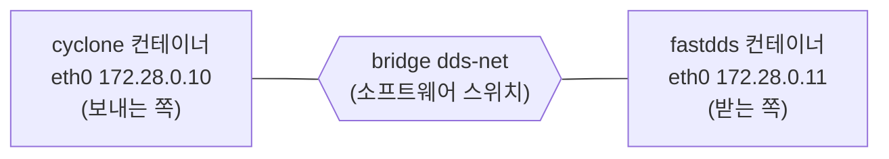
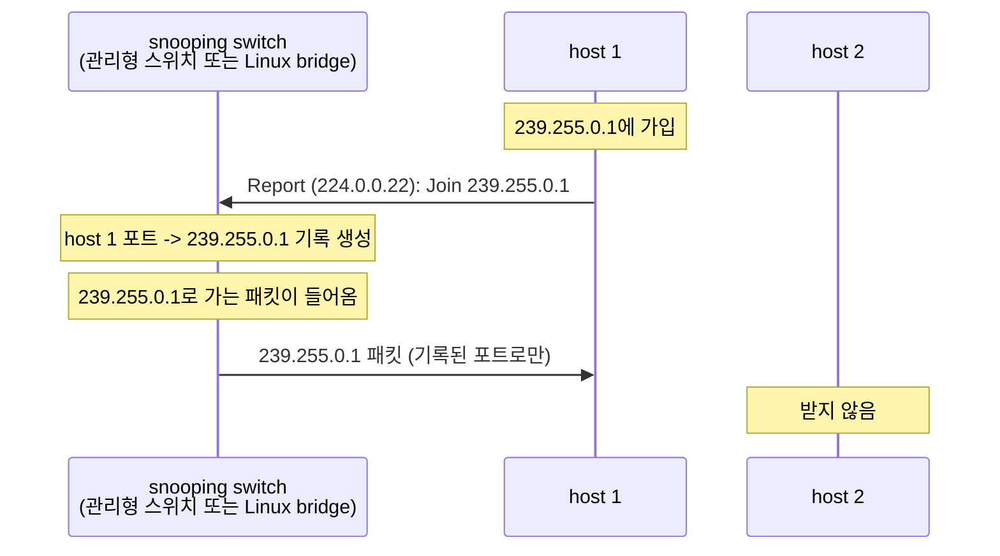

# 2. 멀티캐스트가 오가는 길

[목차](../README.md) | 이전: [1 실습 환경](../01-environment/README.md) | 다음: [3 첫 DDS 통신 들여다보기](../03-first-communication/README.md)

DDS 참가자는 처음에 상대의 주소를 모른다. 그래서 기본 설정에서는 정해진 멀티캐스트 주소로 자기를 알리고, 같은 주소에서 다른 참가자의 알림을 받는다. 이 chapter에서는 DDS를 실행하지 않고, chapter1에서 만든 두 컨테이너 사이에 멀티캐스트가 전달되는지만 확인한다. 그리고 그 과정에서 오가는 패킷을 캡처해 멀티캐스트가 어떻게 전달되는지 본다. 이 확인을 건너뛰면, chapter3에서 두 DDS가 서로를 찾지 못할 때 원인이 네트워크에 있는지 DDS에 있는지 가를 수 없다.

## 1. 왜 필요한가

DDS 참가자가 같은 네트워크의 다른 참가자를 찾는 과정을 참가자 디스커버리 (SPDP - Simple Participant Discovery Protocol)라고 한다. 상대의 주소를 모르는 상태에서 상대에게 패킷을 보내는 방법은 세 가지다.

- **유니캐스트**: 주소 하나로 보낸다. 상대의 주소를 미리 알아야 한다.
- **브로드캐스트**: 같은 네트워크의 모든 호스트로 보낸다. DDS와 관계없는 호스트도 모두 받는다.
- **멀티캐스트**: 그룹 주소로 보낸다. 그 그룹에 가입한 호스트만 받는다.

RTPS 규격은 이 가운데 멀티캐스트를 기본으로 정한다. 모든 참가자는 DDS 기본 멀티캐스트 주소 239.255.0.1로 자기를 알리고, 이 주소에서 다른 참가자의 알림을 받는다 (RTPS 2.5 Sec. 9.6.2.4). UDP 포트는 도메인 번호 (같은 네트워크에서 DDS 시스템을 나누는 번호)로 정해지며, 도메인 0이면 7400이다 (RTPS 2.5 Sec. 9.6.2.3). 이 번호를 정하는 규칙은 chapter8에서 다룬다.

네트워크가 이 멀티캐스트를 전달하지 못해도 DDS는 오류를 내지 않는다. 참가자는 정상적으로 시작되고, 다만 상대를 찾지 못해 아무 데이터도 받지 못한다. 이 증상만으로는 원인이 네트워크인지 DDS 설정인지 알 수 없다. 그래서 DDS를 실행하기 전에, DDS 없이 멀티캐스트 패킷만 주고받아 네트워크가 멀티캐스트를 전달하는지 먼저 확인한다. 이 chapter의 lab이 그 확인이다.

응용 프로그램이 멀티캐스트로 데이터를 보낼 때는 UDP를 쓴다. TCP는 상대 하나와 맺는 연결이라 멀티캐스트에 쓸 수 없다. UDP는 전달을 보장하지 않으므로, RTPS는 신뢰성 있는 전송에 필요한 확인과 재전송을 직접 정의한다 (chapter10).

### 1.1 lab 전에 알아 둘 것

lab의 네트워크는 다음과 같다. chapter1에서 만든 두 컨테이너가 Docker의 bridge `dds-net`에 연결되어 있다.



**네트워크의 기본 개념**
- **호스트와 인터페이스**: 네트워크에 연결된 컴퓨터를 호스트라고 한다. 이 lab에서는 컨테이너 하나가 호스트 하나다. 호스트는 네트워크 인터페이스 (여기서는 `eth0`)로 네트워크에 연결된다.
- **스위치와 포트**: 스위치는 여러 호스트를 잇고, 받은 패킷을 목적지 호스트 쪽으로 전달하는 장치다. 호스트가 연결되는 자리를 스위치 포트라고 한다. UDP 포트 7400 같은 번호와는 다른 것이다. UDP 포트는 한 호스트 안에서 어느 소켓이 받을지 가르는 번호이고, 스위치 포트는 스위치의 연결 자리다. Docker의 bridge는 Linux 커널 안에서 동작하는 소프트웨어 스위치이고, 컨테이너마다 스위치 포트가 하나씩 있다.
- **IP 주소와 MAC 주소**: 패킷에는 주소가 두 종류 적힌다. IP 주소 (예: 172.28.0.11)는 프로그램이 상대를 가리킬 때 쓴다. MAC 주소 (예: `fa:5c:1f:f9:bb:0a`)는 스위치와 인터페이스가 쓰며, 스위치는 MAC 주소만 보고 패킷을 전달한다. 그래서 커널은 패킷을 보낼 때 목적지 IP 주소에 맞는 MAC 주소를 찾아 함께 적는다. 목적지가 호스트 하나이면 ARP라는 절차로 그 호스트에게 MAC 주소를 물어 알아낸다. 컨테이너의 IP 주소는 `docker/compose.yaml`에 고정되어 있고, MAC 주소는 컨테이너를 만들 때마다 Docker가 무작위로 정한다 (확인: `docker compose exec fastdds ip -br link show eth0`).
- **커널과 소켓**: 프로그램은 패킷을 직접 만들지 않는다. 소켓을 열어 운영체제 커널에 "이 주소로 보내라", "이 UDP 포트로 온 것을 달라"고 요청하고, 패킷을 만들고 받는 일은 커널이 한다.
- **서브넷과 라우터**: 서브넷은 IP 주소의 앞부분이 같은 호스트의 묶음이다 (이 lab에서는 172.28.0.0/24). 보통 같은 스위치에 연결되어 라우터 없이 바로 주고받는다. 다른 서브넷으로 가는 패킷은 라우터가 넘겨 준다.

**멀티캐스트에 관한 개념**
- **그룹 주소**: 224.0.0.0부터 239.255.255.255까지 (224.0.0.0/4)가 멀티캐스트 그룹 주소다. 호스트 하나가 아니라 그룹을 가리킨다.
- **그룹 가입**: 받는 쪽 프로그램이 소켓으로 "이 그룹을 받겠다"고 요청하면 커널이 두 가지 일을 한다. 첫째, 그 그룹으로 온 패킷을 그 소켓으로 올려 보내도록 등록한다. 둘째, 가입했다는 사실을 IGMP 메시지로 네트워크에 알린다. 가입은 상대 없이 혼자 하는 등록이다. 보내는 쪽은 가입하지 않아도 된다.
- **IGMP** (Internet Group Management Protocol): 호스트가 자기가 가입한 그룹을 네트워크 장비에 알리는 프로토콜이다. 가입할 때와 탈퇴할 때 Membership Report를 보낸다.
- **flooding**: 스위치가 받은 패킷을, 그 패킷이 들어온 스위치 포트를 뺀 모든 스위치 포트로 복사해 보내는 것이다. 받을 호스트가 어느 스위치 포트에 있는지 모를 때 하는 동작이다.
- **TTL**: IP 패킷이 지날 수 있는 라우터 수의 상한이다. chapter1의 ping 출력에서 `ttl=64`를 보았다. 멀티캐스트 소켓의 기본 TTL은 1이어서, 프로그램이 바꾸지 않으면 라우터를 넘지 않는다. DDS 구현이 쓰는 값은 벤더마다 다르다 (chapter4).

### 1.2 mcast-check가 하는 일

확인에는 이 프로젝트의 진단 도구 `mcast-check`를 쓴다. 이 도구에는 두 모드가 있다. 받는 쪽 (`recv`)은 멀티캐스트를 받는 프로그램의 일반적인 순서 (bind, 그룹 가입, 수신)로 소켓을 다루고, 보내는 쪽 (`send`)은 그룹 주소로 짧은 문자열을 세 번 보낸다. C 함수 이름으로 쓰면 다음과 같다.

| 순서 | recv (받는 쪽) | send (보내는 쪽) |
|---|---|---|
| 1 | `socket()`, `bind(0.0.0.0:7400)` | `socket()`, `bind(0.0.0.0:0)` (임의 포트) |
| 2 | `setsockopt(IP_ADD_MEMBERSHIP, 239.255.0.1)`: 그룹 가입 | `setsockopt(IP_MULTICAST_TTL, 1)` |
| 3 | `recvfrom()`: 받은 패킷의 출발 주소와 내용 출력 | `sendto(239.255.0.1:7400)`을 1초 간격으로 3번 |
| 4 | Ctrl+C로 끝나면 소켓을 닫는다. 커널이 그룹에서 탈퇴한다 | 끝나면 소켓을 닫는다 |

소스는 [`tools/mcast-check/src/main.rs`](../../tools/mcast-check/src/main.rs)에 있다. mdds 코드는 chapter5부터 쓰므로, 이 chapter에서는 위 순서만 알면 된다.

**어디서 실행하는가.** mcast-check는 벤더 이미지에 들어 있지 않고 별도 이미지 `mdds/tools`에 있다. 그래서 벤더 컨테이너 안에서 실행하지 않고, 이 이미지로 컨테이너를 하나 더 시작해 실행한다. 이때 새 컨테이너가 벤더 컨테이너의 네트워크를 함께 쓰게 한다 (`docker run --network container:<벤더 컨테이너>`). 새 컨테이너는 자기 네트워크 인터페이스를 따로 갖지 않고 벤더 컨테이너의 `eth0`과 IP 주소를 그대로 쓴다. 그래서 네트워크에서 보면 벤더 컨테이너가 보내고 받는 것과 같고, 벤더 이미지를 고치지 않고도 벤더 DDS와 같은 네트워크 조건에서 시험할 수 있다. 도구 컨테이너는 mcast-check가 끝나면 지워진다.

lab에서는 이 `docker run` 명령을 대신 실행하는 [`docker/mcast-check.sh`](../../docker/mcast-check.sh)를 쓴다.

## 2. 캡처에서 보기

### 2.1 Lab 2-1: 멀티캐스트 보내고 받기

#### 2.1.1 목표

fastdds 컨테이너가 239.255.0.1:7400 그룹에 가입해 받고, cyclone 컨테이너가 그 그룹으로 보낸다. 받는 쪽에서 캡처해 그룹 가입, 데이터, 탈퇴가 어떤 패킷으로 오가는지 본다.

#### 2.1.2 준비

Lab 1-1의 두 컨테이너가 실행 중이어야 한다. 명령은 모두 `docker/`에서 실행한다. 처음 한 번 도구 이미지를 빌드한다.
```bash
cd docker
docker compose up -d        # 벤더 컨테이너 두 개 (cyclone, fastdds) 시작
docker compose build tools  # mcast-check를 컴파일해 mdds/tools 이미지를 만든다 (컨테이너는 시작하지 않음)
```
터미널 세 개를 쓴다. 모두 `docker/`에서 연다.

| 터미널 | 하는 일 |
|---|---|
| A | fastdds 컨테이너의 `eth0` 캡처 (tcpdump) |
| B | fastdds 컨테이너에서 받기 (`mcast-check recv`) |
| C | 가입 상태 확인, cyclone 컨테이너에서 보내기 (`mcast-check send`) |

#### 2.1.3 절차

1. 터미널 A에서 캡처를 시작한다. `listening on eth0`이 출력될 때까지 기다린다. 터미널 B에서 받기를 시작하기 전에 캡처를 시작해야 가입 패킷이 잡힌다.
   ```bash
   docker compose exec fastdds tcpdump -i eth0 -U -Z root -w /captures/mcast-check/my-join.pcap 'igmp or udp port 7400'
   ```
   `-w`는 패킷을 화면에 찍지 않고 파일에 저장한다. 따옴표 안은 캡처 필터로, IGMP와 UDP 7400 패킷만 저장한다. `-U`는 패킷을 받는 대로 파일에 쓰게 해서 Ctrl+C로 끝낼 때 마지막 패킷을 잃지 않게 한다. `-Z root`는 저장 파일의 소유자를 root로 유지한다 (chapter1).
2. 터미널 B에서 받기를 시작한다.
   ```bash
   ./mcast-check.sh fastdds recv   # fastdds 컨테이너의 eth0에서 받기
   ```
3. 터미널 B에 `joined 239.255.0.1 ...`이 출력되면, 터미널 C에서 fastdds 컨테이너의 `eth0`이 가입한 그룹을 확인하고 cyclone 컨테이너에서 보낸다.
   ```bash
   docker compose exec fastdds ip maddr show eth0   # eth0이 받도록 등록된 멀티캐스트 주소 목록
   ./mcast-check.sh cyclone send                    # cyclone 컨테이너의 eth0에서 보내기
   ```
   `ip maddr`의 출력에서 `inet` 줄이 IP 그룹 주소, `link` 줄이 MAC 주소다. 224.0.0.1 (같은 서브넷의 모든 호스트)은 가입하지 않아도 늘 있다.
4. 터미널 B에서 Ctrl+C로 받기를 끝낸다. 터미널 C에서 가입한 그룹을 다시 확인한다.
   ```bash
   docker compose exec fastdds ip maddr show eth0   # 239.255.0.1 항목이 없어야 한다
   ```
5. 약 2초 기다린 뒤 터미널 A에서 Ctrl+C로 캡처를 끝낸다. 탈퇴 패킷이 1초 안에 한 번 더 나가므로 (3.2절), 기다리지 않으면 마지막 패킷을 놓칠 수 있다.
6. 프로젝트 디렉터리의 `captures/mcast-check/my-join.pcap`을 Wireshark로 열고, 창 위쪽의 표시 필터에 `igmp or udp.port == 7400`을 입력한다 (tcpdump의 캡처 필터와 문법이 다르다). Wireshark는 캡처한 패킷 하나를 프레임이라고 부르고 `No.` 열에 번호를 붙인다. 목록에서 프레임을 고르면 창 아래쪽에 상세 내용이 나온다. Ethernet 항목을 펼치면 목적지 MAC 주소가, Internet Protocol 항목을 펼치면 TTL이 보인다.

#### 2.1.4 기대 결과

- 터미널 B (받는 쪽)에 다음 네 줄이 출력된다. 첫 줄은 가입했다는 뜻이고, 나머지 세 줄이 cyclone (172.28.0.10)에서 받은 것이다. 출발 포트는 실행마다 다르다.
  ```
  joined 239.255.0.1 on 172.28.0.11, listening on port 7400 (Ctrl+C to stop)
  26 bytes from 172.28.0.10:39424: hello 1/3 from 172.28.0.10
  26 bytes from 172.28.0.10:39424: hello 2/3 from 172.28.0.10
  26 bytes from 172.28.0.10:39424: hello 3/3 from 172.28.0.10
  ```
- 받는 동안의 `ip maddr show eth0`에 `inet  239.255.0.1`과 `link  01:00:5e:7f:00:01`이 있다 (IPv6 줄은 생략).
  ```
  11:	eth0
  	link  01:00:5e:00:00:01
  	link  01:00:5e:7f:00:01
  	inet  239.255.0.1
  	inet  224.0.0.1
  ```
  받기를 끝낸 뒤에는 둘 다 사라진다. 커널이 그룹 목록을 관리한다는 것을 보여 준다.
- 터미널 A의 tcpdump가 끝나면서 `11 packets captured`를 출력한다. Wireshark로 연 `my-join.pcap`에는 다음 11개의 패킷이 있다. 같은 패킷이 두 번씩 보이는 것은 정상이다 (아래 설명). 복사본이 잡히지 않는 호스트 (저자의 Ubuntu 24.04, 커널 7.0)에서는 IGMP가 한 번씩만 잡혀 `7 packets captured`다 (아래 설명).

  | 프레임 | 시각 (초) | 출발 -> 목적지 | 내용 |
  |---|---|---|---|
  | 1, 2 | 0.000 | 172.28.0.11 -> 224.0.0.22 | IGMPv3 Membership Report, Join group 239.255.0.1 |
  | 3, 4 | 0.074 | 172.28.0.11 -> 224.0.0.22 | 같은 Join을 한 번 더 |
  | 5, 6, 7 | 2.1, 3.1, 4.1 | 172.28.0.10 -> 239.255.0.1 | UDP 7400, 26바이트 (hello 1/3, 2/3, 3/3) |
  | 8, 9 | 5.173 | 172.28.0.11 -> 224.0.0.22 | IGMPv3 Membership Report, Leave group 239.255.0.1 |
  | 10, 11 | 5.465 | 172.28.0.11 -> 224.0.0.22 | 같은 Leave를 한 번 더 |

  Wireshark는 첫 패킷 (첫 Join)을 0초로 보여 준다. 표의 시각은 참고 캡처 `captures/mcast-check/join.fastdds.pcap`의 값이다 ([설명](../../captures/mcast-check/README.md)). `my-join.pcap`의 시각은 절차 2, 3, 4 사이에 기다린 시간에 따라 달라진다. Join과 Leave를 다시 보내는 간격도 실행마다 다르다 (3.2절). 패킷의 종류와 순서는 같아야 한다.
- 모든 패킷의 TTL은 1이다. hello의 목적지 MAC 주소는 `01:00:5e:7f:00:01`이고, IGMP의 목적지 MAC 주소는 `01:00:5e:00:00:16`이다 (3.1절).

**같은 패킷이 두 번씩 보이는 이유.** 프레임 1과 2처럼 fastdds가 보낸 IGMP 패킷은 두 개씩 잡힌다. 이것은 3.2절에서 볼 "같은 Report를 한 번 더 보내는" 것 (프레임 1, 2와 프레임 3, 4)과는 다른 중복이다.
- 하나는 `eth0`으로 나가는 패킷이다.
- 다른 하나는 커널이 같은 패킷을 자기 수신 경로로도 한 부 돌려준 것이다. 이것을 multicast loopback이라고 한다. 같은 호스트에서 같은 그룹에 가입한 다른 프로그램도 받을 수 있게 하는 기능이다.
- tcpdump는 나가는 패킷과 들어오는 패킷을 모두 잡으므로 둘 다 보인다. tcpdump에 `-Q out`이나 `-Q in`을 주어 방향을 나눠 캡처하면 양쪽에 하나씩 있다.
- 돌려준 복사본이 tcpdump에 잡히는지는 Docker 호스트의 커널에 따라 다르다. macOS의 Docker Desktop (Linux VM)에서는 잡히고 (참고 캡처), Ubuntu 24.04 (커널 7.0)에서는 잡히지 않았다. 그 커널에서도 복사본은 같은 컨테이너의 소켓에는 전달된다 (fastdds에서 받기와 보내기를 함께 실행하면 자기가 보낸 hello를 받는다). 그래서 그 호스트에서 직접 만든 `my-join.pcap`에는 IGMP가 한 번씩, 모두 7개가 있다. chapter3부터의 캡처에서도 자기가 보낸 멀티캐스트는 한 번씩만 보인다.

hello는 cyclone이 보냈으므로 fastdds 쪽에서는 한 번씩만 보인다. 복사본이 잡히는 호스트에서 보내는 쪽 (cyclone)의 `eth0`에서 캡처하면 반대로 hello가 두 개씩, fastdds가 보낸 IGMP가 하나씩 보인다 (참고 캡처 `captures/mcast-check/join.cyclone.pcap`, 10 프레임). 이 차이는 chapter3에서 DDS 패킷의 수를 셀 때 필요하다. 멀티캐스트는 받는 쪽 캡처에서 센다.

#### 2.1.5 확인 질문

- `ip maddr`에서 239.255.0.1이 받기를 끝낸 뒤 사라졌다. 받기를 시작하고 끝낼 때 커널은 각각 무엇을 하는가?
- cyclone 컨테이너는 239.255.0.1 그룹에 가입하지 않았다. 그런데도 보낼 수 있었던 이유는 무엇인가?

#### 2.1.6 실패하면

- `mcast-check.sh`가 "컨테이너가 떠 있지 않다"고 하면 `docker compose up -d`를 실행한다. `Unable to find image 'mdds/tools'`이면 `docker compose build tools`를 실행한다.
- 캡처에 Join이 없으면 tcpdump를 받기 (터미널 B)보다 늦게 시작한 것이다. 1부터 다시 한다.
- 받는 쪽이 `bind` 오류 (`Address already in use`)로 끝나면 fastdds 컨테이너의 네트워크를 쓰는 다른 프로세스가 UDP 7400을 쓰고 있다. fastdds 컨테이너 안의 프로세스 (예: shape_main)일 수도 있고, 끝내지 않은 이전 `mcast-check recv`일 수도 있다. 후자는 도구 컨테이너 안에 있어 fastdds 컨테이너의 `ps`에는 보이지 않는다. `docker ps --filter ancestor=mdds/tools`로 찾아 `docker stop <컨테이너 id>`로 끝낸다. 이 상태에서는 `ip maddr show eth0`에 239.255.0.1이 계속 보인다.
- 그 밖의 문제는 [docker-network.md "문제와 대응"](../../docs/environment/docker-network.md#문제와-대응)을 참고한다.

직접 만든 `my-join.pcap`은 git에 들어가지 않는다 (`.gitignore`). Ubuntu에서는 이 파일이 root 소유로 생성된다. 디렉터리는 자기 소유이므로 `sudo` 없이 지울 수 있다 (`rm`이 쓰기 금지 파일이라고 확인을 묻는다. `rm -f`는 묻지 않는다).

### 2.2 Lab 2-2: 가입하지 않으면

#### 2.2.1 목표

아무도 그룹에 가입하지 않은 채 보내면 패킷이 어디까지 가는지 본다.

#### 2.2.2 준비

Lab 2-1의 준비와 같다 (두 컨테이너 실행, 도구 이미지 빌드). Lab 2-1을 마쳤다면 이미 되어 있다.

터미널은 Lab 2-1의 A와 C 두 개만 쓴다. 받기 (`mcast-check recv`)는 실행하지 않으므로 터미널 B는 쓰지 않는다.

| 터미널 | 하는 일 |
|---|---|
| A | fastdds 컨테이너의 `eth0` 캡처 (tcpdump) |
| C | 가입 상태 확인, cyclone 컨테이너에서 보내기 (`mcast-check send`) |

#### 2.2.3 절차

1. 터미널 A에서 캡처를 시작하고 `listening on eth0`을 기다린다.
   ```bash
   docker compose exec fastdds tcpdump -i eth0 -U -Z root -w /captures/mcast-check/my-nojoin.pcap 'igmp or udp port 7400'
   ```
2. 터미널 C에서 fastdds가 239.255.0.1에 가입하지 않았음을 확인하고, cyclone에서 보낸다.
   ```bash
   docker compose exec fastdds ip maddr show eth0 # 239.255.0.1 가 보이지 않음
   ./mcast-check.sh cyclone send   # cyclone 컨테이너의 eth0에서 보내기
   ```
3. 보내기가 끝나고 약 2초 기다린 뒤 터미널 A에서 Ctrl+C로 캡처를 끝낸다. 곧바로 끝내면 마지막 패킷을 놓칠 수 있다. tcpdump가 잡은 패킷 수 (`packets captured`)를 출력한다.

#### 2.2.4 기대 결과

- `ip maddr show eth0`에 239.255.0.1이 없다. fastdds는 이 그룹에 가입하지 않았다. 보인다면 Lab 2-1의 받기가 아직 끝나지 않은 것이다 (2.1.6절).
- 그런데도 캡처에는 cyclone이 보낸 UDP 7400 패킷 3개가 있다 (`3 packets captured`). 패킷은 fastdds의 `eth0`까지 도착했다. 참고 캡처는 `captures/mcast-check/nojoin.fastdds.pcap`이다 ([설명](../../captures/mcast-check/README.md)).
- fastdds 컨테이너는 이 그룹에 가입하지 않았으므로, 커널은 도착한 패킷을 IP 단계에서 버린다 (3.1절). 이 그룹의 패킷을 받으려는 프로그램이 반드시 가입해야 하는 이유다.

정리하면, 이 환경에서 패킷은 fastdds의 가입 여부와 관계없이 (Lab 2-1과 Lab 2-2 모두) fastdds의 `eth0`까지 왔고, 받을지 말지는 받는 쪽 커널이 가입 여부로 정한다. 가입자가 없는 그룹의 패킷을 bridge가 전달하는 것을 flooding이라고 한다. 이 bridge가 왜 flooding하는지는 3.3절에서 본다.

#### 2.2.5 확인 질문

- 이 환경에서 그룹 가입이 하는 일은 무엇이고, 하지 않는 일은 무엇인가?
- tcpdump에는 패킷이 보였지만 프로그램은 받지 못한다. tcpdump가 보는 지점과 프로그램이 받는 지점은 어떻게 다른가?

## 3. 규격 읽기

lab에서 본 동작은 IETF의 RFC 문서가 정한다. 필요한 부분만 읽는다.

### 3.1 멀티캐스트 주소와 MAC 주소

#### 3.1.1 그룹 주소가 닿는 범위

IPv4 멀티캐스트 주소는 224.0.0.0/4다 (RFC 1112). DDS 기본 멀티캐스트 주소 239.255.0.1은 그 가운데 239.0.0.0/8에 있다. 이 범위는 조직이 자기 네트워크 안에서 인터넷 주소 관리 기관 (IANA)에 등록하지 않고 쓰는 주소다 (RFC 5771 Sec. 10).

DDS에 중요한 것은 이 패킷이 어디까지 가는가다. 라우터는 멀티캐스트 라우팅을 따로 설정하지 않으면 멀티캐스트를 다른 서브넷으로 넘기지 않는다 (서브넷 사이의 멀티캐스트 전달은 별도의 멀티캐스트 라우터가 맡는다, RFC 1112 Sec. 1). 그래서 멀티캐스트를 쓰는 디스커버리는 보통 같은 스위치나 bridge에 연결된 참가자끼리만 서로를 찾는다. 이 chapter의 Docker 환경에서는 `dds-net`의 bridge에 연결된 컨테이너끼리다. 서브넷이 다른 참가자를 찾는 방법은 chapter19에서 다룬다.

Lab 2-1에서 본 TTL 1도 같은 뜻이다. hello의 TTL 1은 mcast-check가 정한 값이고 (1.2절), IGMP 메시지는 규격이 TTL 1로 보내도록 정한다 (RFC 3376 Sec. 4). 어느 쪽도 라우터를 넘을 필요가 없는 패킷이다.

#### 3.1.2 그룹 주소의 MAC 주소: 묻지 않고 계산한다

1.1절에서 본 것처럼, 커널은 패킷을 보낼 때 목적지 MAC 주소를 적어야 한다. 목적지가 호스트 하나이면 ARP로 그 호스트에게 물어 알아낸다. 그룹 주소에는 이 방법을 쓸 수 없다.
- **물어볼 상대가 정해져 있지 않다.** 그룹에 가입한 호스트는 여럿일 수도, 하나도 없을 수도 있다. 아무도 없으면 답이 오지 않아 보낼 수조차 없다.
- **받는 쪽도 MAC 주소를 미리 알아야 한다.** 물리 네트워크 인터페이스는 보통 자기 MAC 주소, 브로드캐스트 주소 (`ff:ff:ff:ff:ff:ff`), 미리 등록해 둔 그룹 MAC 주소로 온 패킷만 받도록 하드웨어 필터를 둔다. 그래서 가입하는 호스트는 그 그룹의 패킷이 어떤 MAC 주소로 올지 가입할 때 알아야 한다. 이때 보내는 쪽은 아직 없을 수도 있으니 물어볼 수도 없다. (이 lab의 컨테이너 인터페이스 `eth0`은 가상 인터페이스 (veth)라 이 필터가 없고, 그룹 MAC 주소로 온 패킷을 모두 IP 단계로 올린다. Lab 2-2에서 가입하지 않은 fastdds의 `eth0`에서도 패킷이 보인 이유다.)

그래서 규격은 그룹 IP 주소에서 MAC 주소를 계산하는 규칙을 정했다. `01:00:5e:00:00:00`의 아래 23비트에 그룹 주소의 아래 23비트를 넣는다 (RFC 1112 Sec. 6.4). 보내는 쪽과 받는 쪽의 커널이 같은 규칙으로 계산하므로, 서로 연락하지 않아도 같은 MAC 주소에 이른다.

| 그룹 주소 | MAC 주소 | lab에서 쓰인 곳 |
|---|---|---|
| 239.255.0.1 | `01:00:5e:7f:00:01` | hello의 목적지 |
| 224.0.0.22 | `01:00:5e:00:00:16` | IGMP Report의 목적지 (3.2절) |

- **보내는 쪽 (cyclone)**: 239.255.0.1로 보내면 커널이 목적지 MAC 주소를 `01:00:5e:7f:00:01`로 계산해 적는다. 출발지 MAC 주소는 cyclone 자신의 주소 그대로다.
- **받는 쪽 (fastdds)**: 239.255.0.1에 가입하면 커널이 같은 계산을 해서 `01:00:5e:7f:00:01`을 받을 주소로 등록한다. Lab 2-1의 `ip maddr`에 `link 01:00:5e:7f:00:01`이 함께 나온 것이 이 등록이다.

그룹 MAC 주소는 어떤 호스트의 주소도 아니다. 목적지로만 쓰이고, 가입한 호스트의 인터페이스가 받을 주소에 더해질 뿐이다. 그룹 주소의 MAC 주소는 IP 주소로 계산되므로 어느 환경에서나 같다.

#### 3.1.3 23비트와 32개의 그룹

IPv4 주소는 32비트이고, 멀티캐스트 주소는 앞 4비트가 항상 `1110`이다 (첫 바이트 224-239). 그래서 그룹을 가르는 부분은 나머지 28비트다. MAC 주소에는 그 가운데 아래 23비트만 들어가고, 위 5비트는 버려진다. 239.255.0.1 (`11101111.11111111.00000000.00000001`)로 나눠 보면 다음과 같다.

| 부분 | 비트 수 | 239.255.0.1에서 |
|---|---|---|
| 멀티캐스트 표시 | 4 | `1110` (첫 바이트 239의 위 4비트) |
| 버려지는 부분 | 5 | `1111` (239의 아래 4비트)과 `1` (둘째 바이트 255의 맨 위 비트) |
| MAC에 들어가는 부분 | 23 | `1111111` (255의 아래 7비트), `00000000`, `00000001` -> `7f:00:01` |

버려지는 5비트에 올 수 있는 값은 32가지 (2의 5제곱)다. 이 5비트가 무엇이든 MAC 주소는 같으므로, 그룹 32개가 MAC 주소 하나를 함께 쓴다. 예를 들어 224.127.0.1, 230.255.0.1, 239.127.0.1로 보내는 패킷도 목적지 MAC 주소가 239.255.0.1과 같은 `01:00:5e:7f:00:01`이다.

그래서 MAC 주소만으로는 어느 그룹의 패킷인지 정확히 가릴 수 없다. 받는 쪽 커널은 IP 단계에서 목적지 그룹이 가입한 그룹인지 확인하고, 가입하지 않은 그룹의 패킷은 버린다 (물리 인터페이스에서는 MAC 필터 다음의 두 번째 확인이고, MAC 필터가 없는 이 lab의 veth에서는 이 확인만 거친다). Lab 2-2에서 패킷이 `eth0`에 도착했는데도 프로그램이 받을 수 없는 것은 이 확인 때문이다. tcpdump는 이 확인보다 앞에서 패킷을 보므로 버려질 패킷도 보인다.

### 3.2 그룹 가입: IGMPv3

Lab 2-1에서 본 IGMP 패킷은 IGMP 버전 3 (RFC 3376)이다. 호스트는 Membership Report를 224.0.0.22로 보낸다. 이 주소는 IGMPv3를 이해하는 멀티캐스트 라우터가 듣는 주소다 (RFC 3376 Sec. 4.2.14).

- **가입과 탈퇴는 모두 Membership Report다.** Report 안의 기록 (group record)이 그 그룹을 받기 시작하는지, 그만 받는지를 나타낸다 (RFC 3376 Sec. 4.2.12, 5.1). IGMPv3에는 탈퇴 전용 메시지가 따로 없다. Wireshark가 표시하는 "Join group", "Leave group"은 이 기록을 읽기 쉽게 붙인 이름이다.
- **같은 Report를 한 번 더 보낸다.** Report가 중간에 사라질 경우에 대비해 같은 Report를 다시 보낸다. 기본값으로는 모두 두 번 보내고, 다시 보내는 시점은 1초 안에서 무작위로 고른다 (RFC 3376 Sec. 5.1, 8.1, 8.11). Lab 2-1에서 Join이 0초와 0.074초에, Leave가 5.173초와 5.465초에 나간 것은 이 규칙 때문이다. 다시 보내는 시점은 실행마다 다르다.

### 3.3 스위치가 멀티캐스트를 전달하는 방식

결론부터 적으면, 이 환경의 bridge는 가입 기록을 만들기는 하지만 (snooping) 그 기록을 새로 고쳐 줄 querier가 없어서, 가입 여부와 관계없이 모든 멀티캐스트를 flooding한다. 이 절은 그 세 용어가 무엇이고 왜 그렇게 되는지를 설명한다.

#### 3.3.1 snooping: 가입자가 있는 스위치 포트로만 보내기

스위치는 그룹 MAC 주소로 온 패킷을 누가 받아야 하는지 모른다. 그래서 기본적으로는 브로드캐스트처럼 모든 스위치 포트로 flooding한다. 가입한 호스트가 몇 개뿐인 네트워크에서는 낭비다.

그래서 많은 스위치가 **IGMP snooping**을 지원한다. 호스트는 가입할 때 IGMP Report를 보낸다 (3.2절). snooping 스위치는 이 Report를 엿보아 "어느 스위치 포트에 어느 그룹의 가입자가 있는가"를 기록하고, 그 그룹의 패킷을 기록된 스위치 포트로만 보낸다.
- snooping은 따로 있는 장치가 아니라, 패킷을 전달하는 스위치 자신이 하는 일이다.
- 물리 스위치에서는 관리형 스위치가 이 기능을 제공하는 경우가 많고, 설정에서 활성화하거나 비활성화할 수 있다. 설정 기능이 없는 비관리형 스위치에는 이 기능이 없을 수 있다.
- 이 환경에서는 Docker의 bridge가 snooping 스위치다 (3.3.3절).
- snooping 스위치를 만들 때 고려할 점은 RFC 4541이 정리했다. 표준처럼 강제하는 규칙이 아니라 정보성 문서 (Informational)다.

#### 3.3.2 querier: 기록을 새로 고치는 역할

snooping 스위치의 가입 기록은 호스트가 가입하는 순간 보내는 Report로 바로 만들어진다. 그래서 가입한 호스트는 곧바로 패킷을 받는다. 하지만 이 기록은 그대로 두면 실제 가입 상태와 달라진다.
- 탈퇴 Report는 중간에 사라질 수 있다 (3.2절).
- 호스트가 갑자기 종료되면 탈퇴를 보내지 못한다.
- 스위치가 시작되기 전에 가입한 호스트는 처음부터 기록에 없다.

그래서 누군가 주기적으로 "이 네트워크에서 어떤 그룹을 받고 있는가"를 물어 기록을 새로 고쳐야 한다. 이 질문이 **IGMP Query**이고, Query를 보내는 장치를 **querier**라고 한다. querier는 장치의 종류가 아니라 역할이다. 보통 멀티캐스트 라우터가 맡지만, 라우터가 없는 네트워크에서는 스위치가 맡게 할 수도 있다.

querier가 있는 네트워크에서 snooping 스위치가 동작하는 순서는 다음과 같다. 가입할 때는 Report 하나로 기록이 만들어지고, 그 뒤 그룹의 패킷은 기록된 스위치 포트로만 간다.



그 뒤 querier가 주기적으로 (기본 125초마다) 모든 호스트에게 Query를 보내고, 가입한 호스트는 Report로 답한다. 스위치는 이 답으로 기록을 갱신하고, 일정 시간 (기본 260초) 동안 Report가 없는 기록은 지운다 (RFC 3376 Sec. 8.2, 8.4. Linux bridge의 기본값도 260초다). 이 환경에서는 Query가 없으므로 이 과정은 관찰할 수 없다.

#### 3.3.3 이 환경의 bridge가 flooding하는 이유

Docker의 bridge 네트워크는 Linux 커널의 bridge, 곧 소프트웨어 스위치다. Linux bridge는 snooping이 활성화되어 있으면 Lab 2-1의 Report를 받아 가입 기록을 만든다. 하지만 그 기록에 따라 전달하는 것은 querier가 있을 때뿐이다. querier가 있다고 보는 경우는 둘이다.
- 다른 장치가 보낸 Query를 최근에 받았다.
- bridge 자신이 querier를 맡도록 설정되어 있다.

둘 다 아니면 가입 기록을 쓰지 않고 모든 멀티캐스트를 flooding한다. Query가 없으면 기록을 새로 고칠 수 없다. 그런 기록만 믿고 전달하면, 기록에서 빠진 가입자가 패킷을 받지 못할 수 있기 때문이다 ([이 동작을 넣은 Linux 커밋](https://github.com/torvalds/linux/commit/b00589af3b04736376f24625ab0b394642e89e29)의 설명).

이 환경은 두 경우 모두 아니다.
- **bridge 자신은 querier가 아니다.** 이것은 bridge의 설정 `multicast_querier`로 정하며, 기본값은 0 (맡지 않음)이다. bridge가 있는 Linux 커널 (Ubuntu에서는 호스트, Mac에서는 Docker Desktop의 Linux VM)의 `/sys/class/net/<bridge 이름>/bridge/multicast_querier` 파일로 읽을 수 있다. 같은 디렉터리의 `multicast_snooping`은 snooping이 활성화되어 있는지 나타낸다. 이 환경의 `dds-net` bridge는 snooping 1, querier 0이다 (읽는 명령은 [docker-network.md](../../docs/environment/docker-network.md#멀티캐스트가-컨테이너-사이를-넘어가는-원리)).
- **Query를 보내는 다른 장치도 없다.** 아무도 가입하지 않은 상태에서 fastdds의 `eth0`을 기본 Query 간격 (125초)보다 긴 140초 동안 캡처해도 IGMP 패킷은 하나도 없었다 (Docker Desktop Mac arm64). 직접 확인하려면 Lab 2-2의 캡처를 125초 넘게 유지한다.

그래서 bridge는 querier가 없다고 보고 flooding한다. 다만 Lab 2-2의 결과만으로는 이것을 가를 수 없다. 가입자가 없는 그룹은 querier가 있어도 flooding되기 때문이다 (아래). querier가 없다는 것은 위의 설정값과 캡처로 확인한 것이다.

querier가 있는 네트워크에서는 결과가 달라질 수 있다. Linux bridge는 가입자가 있는 그룹을 가입자가 있는 스위치 포트 (와 라우터가 연결된 스위치 포트)로만 보내고, 가입자가 없는 그룹은 여전히 flooding한다. 물리 스위치는 제품과 설정에 따라 다르다. 이 책의 실습은 querier가 없는 Docker bridge에서 하므로 이 차이를 시험하지 않는다. 실제 장비에서 DDS가 서로를 찾지 못할 때는 스위치의 snooping과 querier 설정도 확인할 대상이다.

### 3.4 네트워크를 먼저 의심할 때

DDS 참가자가 서로를 찾지 못하면, 다음 순서로 네트워크를 먼저 확인한다.

1. **전달되는가**: DDS를 종료하고 `mcast-check`로 보내고 받아 본다 (Lab 2-1). 실패하면 원인은 네트워크에 있고, DDS 설정을 볼 필요가 없다.
2. **가입했는가**: DDS를 실행하고 받는 쪽에서 `ip maddr show eth0`에 239.255.0.1이 있는지 본다. 없다면 DDS가 가입하지 않았거나 다른 인터페이스에서 가입한 것이다.
3. **가입을 알렸는가**: 받는 쪽 캡처에 IGMP Membership Report (Join)와 상대가 보낸 패킷이 있는지 본다. 패킷이 있는데 받지 못하면 목적지 그룹과 UDP 포트를 양쪽 설정과 비교한다. 도메인 번호가 다르면 포트가 달라진다.

세 가지가 모두 정상이면 네트워크는 멀티캐스트를 전달하고 있다. 원인은 DDS 쪽 (도메인 번호, 설정)에 있다.

## 4. 스스로 확인하기

명령이나 수치를 외웠는지가 아니라 동작의 원리를 이해했는지 확인하는 질문이다. 먼저 스스로 답해 본 뒤 "해설"을 펼쳐 비교해 보라.

1. 동료가 "멀티캐스트로 보내려면 보내는 쪽도 그 그룹에 가입해야 하지 않나?"라고 묻는다. 맞는가? 가입은 누가, 무엇을 위해 하는가?

   <details>
   <summary>해설</summary>

   맞지 않다. 보내는 쪽은 그룹 주소를 목적지로 지정해 보내기만 하면 된다. Lab 2-1에서 cyclone은 가입하지 않고 보냈다.

   가입은 받는 쪽이 한다. 가입하면 받는 쪽 커널이 그 그룹의 패킷을 소켓으로 올려 보내도록 등록하고, IGMP Report로 네트워크에 가입 사실을 알린다. 앞의 것이 없으면 패킷이 도착해도 프로그램이 받지 못하고, 뒤의 것은 snooping 스위치가 전달할 스위치 포트를 정하는 데 쓴다. DDS 참가자는 모두 다른 참가자의 알림을 받아야 하므로, 모든 참가자가 239.255.0.1에 가입한다.

   </details>

2. Lab 2-2에서 아무도 가입하지 않았는데 fastdds의 `eth0`에 패킷이 도착했다. 그렇다면 DDS 참가자는 그룹에 가입하지 않아도 다른 참가자의 알림을 받을 수 있는가?

   <details>
   <summary>해설</summary>

   받을 수 없다. 패킷이 `eth0`까지 온 것은 이 환경의 bridge가 querier가 없어 모든 멀티캐스트를 flooding하기 때문이다. 하지만 받는 쪽 커널은 가입하지 않은 그룹의 패킷을 IP 단계에서 버리므로 프로그램의 소켓까지 올라가지 않는다. tcpdump는 그보다 앞에서 패킷을 보기 때문에 패킷이 보였을 뿐이다.

   그리고 snooping과 querier가 함께 동작하는 스위치에서는, 가입자가 있는 그룹의 패킷이 가입자가 있는 스위치 포트로만 전달된다. 가입하지 않은 호스트는 패킷이 `eth0`에 도착하지 않을 수도 있다 (이 chapter의 환경에서는 시험하지 않았다).

   </details>

3. 두 컴퓨터가 서로 다른 서브넷에 있고, 그 사이를 라우터가 잇는다. ping은 서로 된다. 두 DDS 참가자가 기본 설정으로 서로를 찾을 수 있는가?

   <details>
   <summary>해설</summary>

   찾지 못할 가능성이 높다. ping은 유니캐스트라서 라우터가 다른 서브넷으로 넘겨 준다. 하지만 참가자의 알림은 멀티캐스트이고, 라우터는 멀티캐스트 라우팅을 따로 설정하지 않으면 멀티캐스트를 다른 서브넷으로 넘기지 않는다 (3.1절). 그래서 ping이 된다고 해서 참가자가 서로를 찾는다고 볼 수는 없다. 서브넷이 다른 참가자를 찾는 방법은 chapter19에서 다룬다.

   </details>

4. chapter3에서 두 DDS를 실행했는데 서로를 찾지 못한다. 어떤 순서로 원인을 좁혀 가겠는가?

   <details>
   <summary>해설</summary>

   네트워크부터 확인한다 (3.4절). 먼저 DDS를 종료하고 `mcast-check`로 두 컨테이너 사이에 멀티캐스트가 전달되는지 확인한다. 실패하면 원인은 네트워크에 있고 DDS를 볼 필요가 없다. 전달되면 DDS를 실행하고, 받는 쪽 `ip maddr`에 239.255.0.1이 있는지 보아 DDS가 가입했는지 확인하고, 캡처에서 IGMP Join이 나갔는지와 상대의 패킷이 오는지 본다.

   여기까지 정상이면 네트워크는 문제가 없다. 원인을 DDS 쪽 (도메인 번호가 달라 포트가 다르다, 다른 인터페이스를 쓴다 등)에서 찾는다. 이렇게 네트워크와 DDS를 나눠 확인하는 것이 이 chapter의 목적이다.

   </details>

## 참고 자료

- [RFC 1112: Host Extensions for IP Multicasting, Sec. 6.4](https://www.rfc-editor.org/rfc/rfc1112#section-6.4): 멀티캐스트 IP 주소를 Ethernet MAC 주소로 바꾸는 규칙 (3.1절)
- [RFC 2365: Administratively Scoped IP Multicast](https://www.rfc-editor.org/rfc/rfc2365): 239.0.0.0/8 안의 범위 구분 (Local Scope 등)과 관리자가 라우터에 두는 경계 (3.1절보다 깊이 알고 싶을 때)
- [RFC 3376: IGMP Version 3, Sec. 5.1](https://www.rfc-editor.org/rfc/rfc3376#section-5.1): 가입 상태가 바뀔 때 보내는 Report와 재전송 규칙 (3.2절)
- [RFC 4541: Considerations for IGMP and MLD Snooping Switches, Sec. 2.1](https://www.rfc-editor.org/rfc/rfc4541#section-2.1): snooping 스위치의 IGMP 처리와 전달 규칙 (3.3절)
- [IP_ADD_MEMBERSHIP(2const)](https://man7.org/linux/man-pages/man2/IP_ADD_MEMBERSHIP.2const.html), [IP_MULTICAST_TTL(2const)](https://man7.org/linux/man-pages/man2/IP_MULTICAST_TTL.2const.html): Linux의 그룹 가입 소켓 옵션과 멀티캐스트 TTL 기본값 1 (1절)
