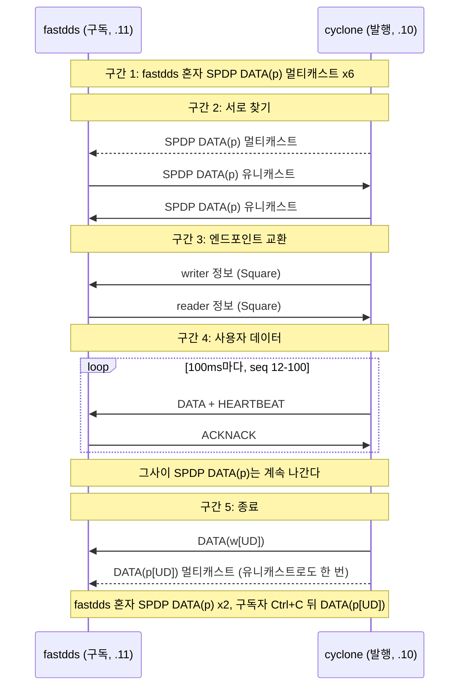

# 3. 첫 DDS 통신 들여다보기

[목차](../README.md) | 이전: [2 멀티캐스트가 오가는 길](../02-multicast/README.md) | 다음: [4 같은 규격, 다른 구현](../04-vendor-differences/README.md)

chapter 2에서 두 컨테이너 사이에 멀티캐스트가 통하는 것을 확인했다. 이제 두 벤더의 shape_main을 실제로 통신시키고 그 패킷을 캡처한다. 이 chapter에서는 메시지의 종류와 순서만 알아본다. 참가자가 서로를 찾고 (SPDP), writer와 reader를 알리고 (SEDP), 데이터를 보내고, 사라지는 흐름이 어떤 패킷으로 보이는지 Wireshark에서 가려내는 것이 목표다. 바이트의 뜻은 chapter 7부터, 각 단계의 동작 원리는 chapter 9, 10, 11에서 다룬다. 두 벤더가 같은 규격을 어떻게 다르게 행동하는지는 chapter 4에서 비교한다.

## 1. 왜 필요한가

chapter 0의 3.2절은 DDS의 디스커버리를 그림 하나로 요약했다. 참가자들이 주기적으로 자기를 알리고 (SPDP), 서로를 알게 되면 각자의 writer와 reader를 알리고 (SEDP), 맞는 짝이 생기면 데이터가 writer에서 reader로 바로 간다. 이 chapter는 그 그림을 실제 패킷으로 본다. 두 벤더의 shape_main이 처음 통신하는 약 20초 안에 그 모든 단계가 지나간다.

이 chapter를 마치면 DDS 통신 캡처를 열어, 어느 프레임이 참가자 디스커버리이고, 어느 것이 엔드포인트 디스커버리이고, 어느 것이 사용자 데이터이고, 어디서 참가자가 사라졌는지를 Wireshark의 Info 열과 필터만으로 가를 수 있다. 그리고 chapter 0의 3.3절이 말한 디스커버리의 대가 (데이터가 없어도 계속 나가는 패킷)를 프레임 수와 바이트로 직접 센다.

여기서 보는 두 캡처 (`rel-cyclone-pub`, `be-cyclone-pub`)는 이 책 전체의 정답 데이터이기도 하다. chapter 7에서 mdds의 파서가 이 바이트를 맞게 읽는지, chapter 9와 11에서 디스커버리 상태 머신이 같은 순서로 동작하는지를 이 캡처로 검사한다.

### 1.1 shape_main 실행과 출력 읽기

shape_main이 무엇이고 어떤 옵션이 있는지는 chapter 1에서 보았다 (Lab 1-2). 이 chapter에서 쓰는 옵션은 다음과 같다. 두 shape_main은 같은 옵션을 받는다.

| 옵션 | 뜻과 이 chapter의 값 |
|---|---|
| `-P` / `-S` | 발행 / 구독. `-P`는 DataWriter 하나를, `-S`는 DataReader 하나를 만든다. 발행은 cyclone, 구독은 fastdds |
| `-d 0` | 도메인 번호 |
| `-t Square` | 토픽 이름 |
| `-x 1` | 데이터 표현 (1 = XCDR1, 2 = XCDR2. chapter 6, 16). 실행 파일의 기본값에 기대지 않으려고 양쪽에 명시한다 |
| `-r` / `-b` | RELIABILITY QoS (chapter 0 2.3절). `-r` reliable은 빠진 샘플을 다시 받고, `-b` best-effort는 받은 것만 받는다. 양쪽을 같게 준다. Lab 3-1은 `-r` |
| `-c BLUE` | 발행 전용. 샘플의 색. 구독자에게 주면 색으로 거르는 다른 토픽이 되므로 주지 않는다 |
| `--write-period 100 --num-iterations 100` | 발행 전용. 100ms마다 100개를 쓰고 약 10초 뒤 스스로 끝난다 |

이 chapter에서 발행자와 구독자는 shape_main 프로세스, 곧 참가자 하나를 가리킨다. writer와 reader는 그 안의 엔드포인트다. 발행자 안에 writer 하나, 구독자 안에 reader 하나가 있다. 디스커버리를 위해 참가자가 스스로 갖는 내장 writer와 reader는 따로 있다 (3.1절).

shape_main의 출력 가운데 이 chapter에서 뜻을 알아야 하는 줄은 다음과 같다 (shape_main 소스 `526dc56`의 출력문). 샘플 줄의 형식 (토픽, 색, x, y, [크기])은 chapter 1에서 보았다.

| 출력 | 누가 | 뜻 |
|---|---|---|
| `on_publication_matched() ... matched readers 1 (change = 1)` | 발행자 | 맞는 reader를 하나 찾았다 (매칭, [용어 정리](../glossary.md#프로토콜)). 이 줄이 찍혀야 샘플이 상대에게 간다 |
| `on_subscription_matched() ... matched writers 1 (change = 1)` | 구독자 | 맞는 writer를 하나 찾았다 |
| `on_subscription_matched() ... matched writers 0 (change = -1)` | 구독자 | 상대 writer가 사라졌다 |
| `Square     BLUE       NOT_ALIVE_NO_WRITERS_INSTANCE_STATE` | 구독자 | 이 인스턴스 (BLUE Square)에 writer가 없어졌다 (chapter 13) |
| `Done.` | 구독자 | Ctrl+C로 끝났다 |

발행자는 샘플마다 출력하지 않는다. 발행자 터미널은 `Create topic`, `Create writer`, `on_publication_matched` 세 줄로 끝난다.

## 2. 캡처에서 보기

### 2.1 Lab 3-1: 첫 DDS 통신

#### 2.1.1 목표

fastdds 컨테이너에서 구독자를, cyclone 컨테이너에서 발행자를 실행해 처음으로 두 벤더를 통신시킨다. 받는 쪽 (fastdds)에서 캡처해 `my-rel-cyclone-pub.pcap`을 만든다. 이 lab에서는 터미널의 출력을 보고, 캡처의 내용은 Lab 3-2에서 본다.

#### 2.1.2 준비

Lab 1-1의 두 컨테이너가 실행 중이어야 한다. 명령은 모두 `docker/`에서 실행한다. 시작하기 전에 이전 실행이 남아 있지 않은지 확인한다. 첫 명령에 두 컨테이너가 `Up`으로 나오고, 나머지 네 명령은 아무것도 출력하지 않아야 정상이다 (`pgrep`은 찾는 것이 없으면 종료 코드 1을 돌려주는데, 그것이 정상이다).
```bash
docker compose ps
docker ps -q --filter ancestor=mdds/tools             # chapter 2의 mcast-check 컨테이너
docker compose exec cyclone pgrep -x cyclone_shape
docker compose exec fastdds pgrep -x fastdds_shape
docker compose exec fastdds pgrep -x tcpdump
```
터미널 세 개를 쓴다. 모두 `docker/`에서 연다. Lab 2-1과 같은 배치다.

| 터미널 | 하는 일 |
|---|---|
| A | fastdds 컨테이너의 `eth0` 캡처 (tcpdump) |
| B | fastdds 컨테이너에서 구독 (`fastdds_shape -S`) |
| C | cyclone 컨테이너에서 발행 (`cyclone_shape -P`) |

#### 2.1.3 절차

시간 간격이 결과에 영향을 준다. 적힌 대로 기다린다.

1. 터미널 A에서 캡처를 시작한다. `listening on eth0`이 출력되면 1초 더 기다린다. 필터는 chapter 2와 달리 UDP 전체다. DDS 패킷은 포트가 여럿이기 때문이다. 같은 이름의 파일이 있으면 말없이 덮어쓴다.
   ```bash
   docker compose exec fastdds tcpdump -i eth0 -U -Z root -w /captures/cyclone-fastdds/my-rel-cyclone-pub.pcap 'udp or igmp'
   ```
2. 터미널 B에서 구독자를 시작한다. `Create reader for topic: Square`까지 출력되고 더 나오지 않는다. 아직 발행자가 없으므로 정상이다.
   ```bash
   docker compose exec fastdds fastdds_shape -S -d 0 -t Square -x 1 -r
   ```
3. 구독자를 시작하고 3초 뒤 터미널 C에서 발행자를 시작한다 (더 기다려도 된다. 구독자 혼자인 구간이 길어질 뿐이다). 터미널 B에 `matched writers 1`과 샘플 줄이 찍히기 시작한다.
   ```bash
   docker compose exec cyclone cyclone_shape -P -d 0 -t Square -x 1 -r -c BLUE --write-period 100 --num-iterations 100
   ```
4. 발행자는 약 10초 뒤 스스로 끝나고 터미널 C에 프롬프트가 돌아온다. 그 직후 터미널 B에 `matched writers 0`과 `NOT_ALIVE_NO_WRITERS_INSTANCE_STATE`가 찍힌다. 5초 더 기다린다.
5. 터미널 B에서 Ctrl+C로 구독자를 끝낸다. `Done.`이 출력된다. 반드시 Ctrl+C로 끝낸다. 창을 닫는 것처럼 다른 방법으로 끝나면 구독자가 사라진다는 패킷 (Lab 3-2의 구간 5)이 나가지 않는다.
6. 2초 기다린 뒤 터미널 A에서 Ctrl+C로 캡처를 끝낸다. 구독자가 사라지면서 보내는 마지막 패킷이 1초 안에 더 나오기 때문이다. tcpdump가 `N packets captured`와 두 줄을 더 출력하고 끝난다.

#### 2.1.4 기대 결과

- 터미널 C (발행자)는 세 줄을 출력하고 약 10초 뒤 끝난다.
  ```
  Create topic: Square
  Create writer for topic: Square color: BLUE
  on_publication_matched() topic: 'Square'  type: 'ShapeType' : matched readers 1 (change = 1)
  ```
- 터미널 B (구독자)는 다음 순서로 출력한다. 샘플 줄의 x, y 값은 실행마다 다르다. 샘플 줄은 약 80-100줄로, 발행자가 쓴 100개보다 적을 수 있다 (2.2.6절).
  ```
  Create topic: Square
  Create reader for topic: Square
  on_subscription_matched() topic: 'Square'  type: 'ShapeType' : matched writers 1 (change = 1)
  Square     BLUE       106 104 [20]
  Square     BLUE       109 107 [20]
  ...
  on_subscription_matched() topic: 'Square'  type: 'ShapeType' : matched writers 0 (change = -1)
  Square     BLUE       NOT_ALIVE_NO_WRITERS_INSTANCE_STATE
  Done.
  ```
- 터미널 A의 tcpdump는 `N packets captured`를 출력한다. 참고 캡처는 268개이고, 손으로 하면 기다린 시간에 따라 더 많거나 적다.
- 프로젝트 디렉터리의 `captures/cyclone-fastdds/`에 `my-rel-cyclone-pub.pcap`이 생긴다. 이 파일은 git에 들어가지 않는다. Ubuntu에서는 root 소유로 생성된다.

참고 캡처 `rel-cyclone-pub.pcap`은 이 절차와 같은 순서를 스크립트 [`docker/capture-shape-scenario.ts`](../../docker/capture-shape-scenario.ts)가 같은 간격으로 실행해 만든 것이다. 직접 만든 캡처는 프레임 번호와 시각이 참고 캡처와 다르고, 디스커버리 구간의 모양도 조금 다를 수 있다 (2.2.4절).

#### 2.1.5 확인 질문

- 구독자가 발행자보다 먼저 시작했는데 발행자를 찾았다. 구독자 혼자 있던 3초 동안 네트워크에는 무엇이 나갔을까? (Lab 3-2에서 확인한다.)
- 발행자 터미널에는 샘플 줄이 없다. 발행자가 샘플을 보냈다는 증거는 캡처의 어느 서브메시지인가? (Lab 3-2에서 확인한다.)

#### 2.1.6 실패하면

- 터미널 B가 `Create reader`에서 넘어가지 않으면 발행자가 실행 중인지 터미널 C를 본다. 둘 다 실행 중인데 `matched`가 찍히지 않으면 네트워크부터 의심한다 (chapter 2 3.4절).
- 이전 실행의 shape_main이 남아 있으면 (2.1.2절의 `pgrep`에 번호가 나오면) `docker compose exec <컨테이너> pkill -INT -x <벤더>_shape`로 끝낸다. SIGTERM (`pkill`의 기본값)이 아니라 SIGINT를 보내야 정리하고 끝난다. 남은 tcpdump는 `pkill -INT -x tcpdump`로 끝낸다.
- chapter 2의 `mcast-check recv` 컨테이너가 남아 UDP 7400을 잡고 있으면 fastdds_shape는 오류 없이 시작하지만 7400 소켓을 열지 못한다. 구독자를 시작한 뒤 `docker compose exec fastdds ss -ulpn`을 보면 7400 줄에 `fastdds_shape`가 없다. chapter 2의 2.1.6절대로 그 컨테이너를 끝내고 다시 한다.
- 캡처가 비어 있거나 패킷 수가 매우 적으면 tcpdump를 구독자보다 늦게 시작했거나 너무 일찍 끝낸 것이다. 1부터 다시 한다.
- 그 밖의 문제는 [docker-network.md "문제와 대응"](../../docs/environment/docker-network.md#문제와-대응)을 참고한다.

### 2.2 Lab 3-2: 캡처에서 RTPS 메시지 찾기

#### 2.2.1 목표

참고 캡처 `rel-cyclone-pub.pcap`에서 통신의 다섯 구간 (구독자 혼자, 서로 찾기, 엔드포인트 교환, 사용자 데이터, 종료)을 Wireshark로 찾는다. 그리고 내장 엔드포인트의 트래픽과 사용자 트래픽을 프레임 수와 바이트로 센다.

#### 2.2.2 준비

이 lab은 직접 만든 `my-rel-cyclone-pub.pcap`이 아니라 참고 캡처 [`captures/cyclone-fastdds/rel-cyclone-pub.pcap`](../../captures/cyclone-fastdds/README.md#rel-cyclone-pub)을 연다. 본문의 프레임 번호가 이 파일 기준이기 때문이다. 같은 순서가 직접 만든 캡처에도 있으니, 끝낸 뒤 자기 캡처에서 같은 구간을 찾아본다. 화면 표기는 Wireshark 4.6.9 기준이고, 버전이 다르면 Info 열의 문구가 조금 다를 수 있다.

Wireshark가 RTPS 패킷을 보여 주는 방식 세 가지를 알아 둔다.
- **Info 열은 서브메시지 목록이다.** RTPS 메시지 하나는 헤더 뒤에 서브메시지 여러 개가 이어진 것이고 ([용어 정리](../glossary.md#프로토콜)), Wireshark는 Info 열에 그 이름을 쉼표로 나열한다 (예: `INFO_TS, DATA, HEARTBEAT`). 이 chapter에서 보는 서브메시지는 셋이다. `DATA`는 writer가 보내는 데이터, `HEARTBEAT`는 writer가 가진 샘플의 번호 범위를 알리는 것, `ACKNACK`는 reader가 받은 것과 빠진 것을 알리는 것이다. `INFO_TS`와 `INFO_DST`는 뒤따르는 서브메시지에 시각과 목적지 정보를 붙이는 보조 서브메시지로, 이 chapter에서는 읽지 않는다.
- **디스커버리도 DATA다.** 참가자 정보와 writer / reader 정보도 사용자 데이터와 같은 DATA 서브메시지로 나간다 (3.1절). Wireshark는 어느 종류의 writer가 보냈는지에 따라 DATA 뒤에 표시를 붙인다. 규격에는 DATA 하나뿐이고 이 표시는 Wireshark의 것이다.

  | Info 열 | 보낸 writer | 뜻 |
  |---|---|---|
  | `DATA(p)` | SPDP writer | 참가자 정보 (나는 누구이고 어디로 보내면 된다) |
  | `DATA(w)` | SEDP writer | 내 writer 하나의 정보 (토픽, 타입, QoS) |
  | `DATA(r)` | SEDP writer | 내 reader 하나의 정보 |
  | `DATA(m)` | 참가자 메시지 writer | 내 writer들이 살아 있다는 알림 (liveliness, chapter 14) |
  | `DATA` | 사용자 writer | 사용자 데이터 (여기서는 Square 샘플) |
  | `[UD]` 붙음 | 위의 writer | 그 항목이 사라진다는 알림. 참가자 정보에 붙으면 참가자가, writer 정보에 붙으면 그 writer가 사라진다는 뜻이다 (정확한 뜻은 chapter 13) |

- **두 가지 이상한 표시는 정상이다.** Fast DDS가 보낸 모든 메시지 끝에는 `Unknown[80]`이 붙는다. Fast DDS가 붙이는 벤더 전용 서브메시지로, Wireshark가 모르는 번호라 이렇게 표시한다 ([용어 정리](../glossary.md#프로토콜)). Cyclone이 보낸 writer 정보는 `DATA(w)`가 아니라 `DATA[Malformed Packet]`로 빨갛게 표시된다. Wireshark 4.6.9가 그 안의 한 항목을 끝까지 해석하지 못해서다. Fast DDS는 이 메시지를 받아 매칭했고 사용자 데이터가 이어졌으므로 통신에는 문제가 없었다.

캡처는 fastdds 쪽에서 했으므로 fastdds가 보낸 멀티캐스트는 나가는 것과 돌아온 것 두 개씩 보인다 (chapter 2 2.1.4절. 복사본이 잡히지 않는 호스트에서 직접 만든 캡처에는 한 번씩만 보인다). cyclone이 보낸 것은 한 번씩이다.

#### 2.2.3 절차

1. Wireshark로 `captures/cyclone-fastdds/rel-cyclone-pub.pcap`을 열고 표시 필터에 `rtps`를 입력한다. 창 아래 상태 표시줄의 Displayed가 전체 268개 가운데 256개가 된다. 나머지 12개는 chapter 2에서 본 IGMP다 (표에 적힌 IGMP 프레임으로 가려면 필터를 `rtps || igmp`로 바꾼다).
2. 아래 표의 구간을 차례로 찾는다. 표의 "표지"가 그 구간의 시작과 끝을 알려 주는 프레임이다. 구간마다 적힌 필터를 쓰거나, 필터 `rtps` 상태에서 프레임 번호로 간다 (Go > Go to Packet). 필터의 `||`는 "또는"이다.

   | 구간 | 프레임 | 시각 (초) | 표지와 보이는 것 | 필터 |
   |---|---|---|---|---|
   | 1 구독자 혼자 | 1-16 | 0.0-0.5 | fastdds의 `DATA(p)`가 멀티캐스트로 0.1초 간격으로 6번 (두 개씩 보인다). 사이에 IGMP Join | `rtps.sm.wrEntityId == 0x000100c2` |
   | 2 서로 찾기 | 17, 18, 23 | 3.11 | 17 cyclone의 `DATA(p)` 멀티캐스트. 18 fastdds가 cyclone에게 유니캐스트로 `DATA(p)`. 23 cyclone이 fastdds에게 유니캐스트로 `DATA(p)` | 위와 같음 |
   | 3 엔드포인트 교환 | 19-47 | 3.11-4.21 | `HEARTBEAT`와 `ACKNACK`가 오간다. 22 cyclone의 writer 정보 (`DATA[Malformed Packet]`, 상세 창에 토픽 Square). 47 fastdds의 reader 정보 (`DATA(r) -> Square`) | `rtps.sm.wrEntityId == 0x000003c2 \|\| rtps.sm.wrEntityId == 0x000004c2` |
   | 4 사용자 데이터 | 48-253 | 4.21-13.45 | 48 cyclone의 첫 `HEARTBEAT`. 50부터 `INFO_TS, DATA, HEARTBEAT`가 100ms마다, 그때마다 fastdds의 `ACKNACK`. 상세 창의 writerSeqNumber는 12에서 100까지 | `rtps.sm.wrEntityId == 0x00000202` |
   | 5 종료 | 254-268 | 13.55-19.57 | 254 cyclone의 `DATA(w[UD])`. 255 (멀티캐스트)와 256 (유니캐스트) `DATA(p[UD])`. 257-258 IGMP Leave. 259-262 fastdds 혼자 `DATA(p)` 두 번. 구독자를 끝내자 263-264 `DATA(p[UD])`, 265-268 IGMP Leave | `rtps.sm.wrEntityId == 0x000100c2` |

   구간 2와 3은 같은 밀리초에 섞여 있다. 프레임 번호가 아니라 표지 (`DATA(p)` 세 개, writer 정보, reader 정보)로 가른다. 구간 3의 `HEARTBEAT`와 `ACKNACK`의 숫자와 왕복 횟수는 읽지 않는다 (chapter 10, 11). 유니캐스트의 목적지 포트가 양쪽이 다른데 (fastdds 7410과 7411, cyclone 44686), 참가자마다 자기가 받을 포트를 `DATA(p)`에 실어 알리기 때문이다 (3.1절). 구간 2의 `DATA(p)`를 펼치면 상세 창의 `PID_METATRAFFIC_UNICAST_LOCATOR`와 `PID_DEFAULT_UNICAST_LOCATOR`에 그 주소와 포트가 보인다 (Fast DDS의 것에는 종류를 모르는 로케이터도 하나 보이는데, Fast DDS 전용이다. chapter 4).
3. 구간과 상관없이 흐르는 것이 하나 있다. 필터 `rtps.sm.wrEntityId == 0x000100c2`로 보면 `DATA(p)`가 캡처 내내 나간다. fastdds는 약 3초마다 멀티캐스트로 보내면서 아는 참가자 (cyclone)에게 유니캐스트로도 보낸다. cyclone은 약 8초마다 멀티캐스트로 보내고, 상대를 찾은 직후 몇 초 동안은 약 1초마다 유니캐스트로도 보낸다. 이 주기와 방식은 두 벤더의 설정과 동작이다 (3.1절).
4. 묶음별로 센다. 필터를 입력한 뒤 Statistics > Capture File Properties를 열면 Displayed 열에 프레임 수와 바이트가 나온다 (필터를 바꾸면 창을 다시 연다). 아래 필터를 차례로 센다. 사용자 writer의 entityId 필터 (`0x00000202`)에는 그 writer에게 보낸 `ACKNACK`도 걸린다. ACKNACK 서브메시지 안에도 상대 writer의 entityId가 들어 있기 때문이다. 그래서 보낸 쪽 주소 (`ip.src`)로 나눈다.
   - 내장 엔드포인트 트래픽 전체: `rtps && !(rtps.sm.wrEntityId == 0x00000202)`
   - 사용자 writer가 보낸 것 (DATA와 HEARTBEAT): `rtps.sm.wrEntityId == 0x00000202 && ip.src == 172.28.0.10`
   - 사용자 reader가 보낸 것 (ACKNACK): `rtps.sm.wrEntityId == 0x00000202 && ip.src == 172.28.0.11`

#### 2.2.4 기대 결과

다섯 구간을 그림으로 줄이면 다음과 같다. 프레임 번호는 위의 표에 있다. 실선은 유니캐스트, 점선은 멀티캐스트다. 구간 3과 4의 `HEARTBEAT`, `ACKNACK` 반복과 IGMP는 뺐다. 전체 흐름도는 [캡처 README](../../captures/cyclone-fastdds/README.md#rel-cyclone-pub)에 있다 (그곳의 `HB a-b`, `ACKNACK b/n` 표기는 chapter 10 전에는 읽지 않아도 된다).



묶음별 수는 다음과 같다. 이 캡처의 조건 (참가자 둘, 샘플 20바이트, 데이터가 흐른 약 9초와 그 뒤 약 6초의 대기, Fast DDS가 모든 메시지에 붙이는 60바이트 벤더 전용 서브메시지)에서 나온 수이고, IGMP는 들어 있지 않으며, 바이트는 Ethernet, IP, UDP 헤더 (42바이트)를 포함한 프레임 길이다.

| 묶음 | 필터 | 프레임 | 바이트 |
|---|---|---|---|
| RTPS 전체 | `rtps` | 256 | 55,760 |
| 내장 엔드포인트 트래픽 전체 | `rtps && !(rtps.sm.wrEntityId == 0x00000202)` | 72 | 25,628 |
| 그 가운데 SPDP (`DATA(p)`) | `rtps.sm.wrEntityId == 0x000100c2` | 42 | 20,796 |
| 그 가운데 SEDP (writer / reader 정보와 그 HEARTBEAT, ACKNACK) | `rtps.sm.wrEntityId == 0x000003c2 \|\| rtps.sm.wrEntityId == 0x000004c2` | 24 | 3,828 |
| 그 가운데 참가자 메시지 (`DATA(m)`과 그 HEARTBEAT, ACKNACK)만 든 것 | 위 둘에 걸리지 않는 나머지 | 6 | 1,004 |
| 사용자 writer가 보낸 것 (DATA 89개와 HEARTBEAT) | `rtps.sm.wrEntityId == 0x00000202 && ip.src == 172.28.0.10` | 90 | 14,528 |
| 사용자 reader가 보낸 것 (ACKNACK) | `rtps.sm.wrEntityId == 0x00000202 && ip.src == 172.28.0.11` | 94 | 15,604 |

SEDP 행의 24 프레임 가운데 11개에는 참가자 메시지의 `HEARTBEAT`나 `ACKNACK`가 같은 메시지에 묶여 있다. 세 행을 더하면 72가 된다. 사용자 두 행을 더한 184는 캡처 전체에서 사용자 writer의 entityId가 든 프레임 수다.

이 표에서 읽을 것은 비율이 아니라 성격이다.
- **SEDP는 교환이 끝나면 멈춘다.** writer 정보와 reader 정보를 주고받는 구간 3에 12 프레임이 들었다. 이 캡처에서는 그 뒤에도 SEDP의 `HEARTBEAT`와 `ACKNACK`가 약 1초마다 오가서, 종료의 `DATA(w[UD])`까지 합쳐 12 프레임이 더 있다. best-effort 캡처 (Lab 3-3)에서는 교환 뒤에 한 쌍만 더 오간다. 그 차이는 chapter 11에서 본다.
- **SPDP는 데이터가 없어도 계속 나간다.** 42 프레임 가운데 fastdds 자신의 멀티캐스트는 26개 (`ip.src == 172.28.0.11 && ip.dst == 239.255.0.1`)인데 이것은 같은 패킷이 두 번 보인 13쌍이다. 복사본을 빼면 실제로 나간 SPDP는 29 프레임 (14,006바이트)이다. 발행자가 사라진 뒤에도 fastdds는 3초마다 보냈다.
- **reliable은 ACKNACK를 더한다.** 사용자 reader가 보낸 94 프레임은 모두 `ACKNACK`다. 샘플 89개를 받는 데 비슷한 수의 패킷을 돌려보냈다.

chapter 0의 3.3절이 말한 "적지 않은 몫"은 이 한 실행에서는 이렇게 나타났다. 다른 조건에서는 비율이 달라지므로 DDS 일반의 값으로 읽지 않는다. 변하지 않는 것은 성격이다. 데이터가 흐르지 않아도 참가자마다 SPDP가 계속 나가고, writer와 reader가 늘면 SEDP도 그만큼 는다.

직접 만든 캡처에서는 구간 3의 길이, `HEARTBEAT`와 `ACKNACK`의 왕복 횟수, 첫 사용자 seq가 다를 수 있다. 참고 캡처는 구간 3이 1.1초 걸린 경우다. 왜 다른지는 chapter 11에서 본다.

#### 2.2.5 확인 질문

- 프레임 100, 200, 260은 각각 어느 구간인가? Info 열과 보낸 쪽 주소만으로 답해 보라 (답: 100과 200은 구간 4, 260은 구간 5에서 fastdds 혼자 보낸 `DATA(p)`다).
- 발행자가 없던 처음 3초에도 fastdds는 패킷을 보냈다. 무엇이고, 받는 이가 없는데 왜 보내는가?
- Lab 3-1의 두 번째 확인 질문: 발행자가 샘플을 보냈다는 증거는 어느 서브메시지인가?

#### 2.2.6 이 chapter에서 답하지 않는 것

캡처에 보이지만 뒤 chapter에서 다루는 것이다. 지금은 몰라도 된다.
- 사용자 데이터의 seq가 12부터다. 1-11은 어디로 갔나? -> chapter 11, 13
- 구간 3에서 fastdds의 사용자 reader가 `HEARTBEAT`를 받기 전에 `ACKNACK`를 네 번 보낸다 (33, 36, 40, 46). 규격이 허용하는 동작이지만 (3.2절), 왜 네 번이고 무엇을 위한 것인지 -> chapter 10
- 참고 캡처의 구간 3은 1.1초 걸렸고 직접 만든 캡처는 더 짧을 수 있다. 양쪽 로그의 matched가 각각 언제 찍히는지 -> chapter 11
- 구독 로그의 샘플은 84줄인데 캡처의 사용자 DATA는 89개다 -> chapter 13
- 종료 때 `DATA(w[UD])` 다음에 `DATA(p[UD])`가 오는 순서와, 구독 로그의 `NOT_ALIVE_NO_WRITERS`가 어느 메시지로 정해지는지 -> chapter 11, 13

### 2.3 Lab 3-3: best-effort와 비교

#### 2.3.1 목표

같은 통신을 `-b` (best-effort)로 한 참고 캡처 `be-cyclone-pub.pcap`에서 무엇이 사라지고 무엇이 남는지 본다.

#### 2.3.2 준비

[`captures/cyclone-fastdds/be-cyclone-pub.pcap`](../../captures/cyclone-fastdds/README.md#be-cyclone-pub)을 연다. 양쪽 shape_main에 `-r` 대신 `-b`를 준 것 말고는 Lab 3-1과 같은 절차로 만든 캡처다. 직접 만들어 보려면 Lab 3-1의 절차에서 `-r`을 `-b`로 바꾸고 파일 이름을 `my-be-cyclone-pub.pcap`으로 한다.

#### 2.3.3 절차

1. 필터 `rtps.sm.wrEntityId == 0x00000202`로 사용자 트래픽만 본다. Info 열을 훑어 `HEARTBEAT`나 `ACKNACK`가 있는지 찾는다.
2. 필터 `rtps && !(rtps.sm.wrEntityId == 0x00000202)`로 내장 엔드포인트 트래픽만 본다. `HEARTBEAT`와 `ACKNACK`가 있는지, 있다면 어느 writer의 것인지 (상세 창의 writerEntityId) 본다.
3. 필터 `rtps.sm.wrEntityId == 0x00000202 && ip.src == 172.28.0.10`으로 사용자 writer가 보낸 것의 프레임 수와 바이트를 센다 (Statistics > Capture File Properties).

#### 2.3.4 기대 결과

- 사용자 트래픽은 98 프레임 (12,740바이트) 모두 `INFO_TS, DATA`다. `HEARTBEAT`도 `ACKNACK`도 없다. 사용자 reader가 보낸 프레임은 0개다. writerSeqNumber는 3에서 100까지다.
- 내장 엔드포인트 트래픽에는 `HEARTBEAT`와 `ACKNACK`가 그대로 있다. writerEntityId는 모두 `0x000003c2`, `0x000004c2` (SEDP) 또는 `0x000200c2` (참가자 메시지)다. 사용자 QoS를 best-effort로 해도 SEDP와 참가자 메시지는 reliable로 오간다 (3.1절). SPDP는 원래 best-effort다.
- 구간의 순서 (구독자 혼자, 서로 찾기, 엔드포인트 교환, 사용자 데이터, 종료)는 Lab 3-2와 같다.

#### 2.3.5 확인 질문

- 이 캡처에 남아 있는 `HEARTBEAT`와 `ACKNACK`는 어느 writer의 것인가? 어떻게 확인했는가?
- reliable 캡처 (Lab 3-2)에는 있고 이 캡처에는 없는 서브메시지는 무엇이고, 누가 보낸 것인가?

#### 2.3.6 이 chapter에서 답하지 않는 것

- 사용자 seq가 3부터다 (reliable 캡처는 12부터). 캡처된 DATA는 98개로 reliable 때의 89개보다 많다 -> chapter 11, 13
- reader 정보 (`DATA(r)`)가 나가기까지 걸린 시간이 캡처마다 다르다 -> chapter 11

## 3. 규격 읽기

lab에서 본 것 가운데 두 가지만 규격으로 확인한다. 디스커버리가 왜 사용자 데이터와 같은 DATA로 보이는가, 그리고 HEARTBEAT와 ACKNACK는 언제 오가는가.

### 3.1 디스커버리도 같은 프로토콜로 한다: 내장 엔드포인트

RTPS의 SPDP와 SEDP는 따로 만든 메시지를 쓰지 않는다. 참가자마다 미리 정해진 **내장 엔드포인트** (built-in endpoint)를 두고, 그 writer와 reader가 사용자 엔드포인트와 같은 프로토콜로 정보를 주고받는다 (RTPS 2.5 Sec. 8.5.2, 8.5.4.1). 참가자 정보를 쓰는 writer, writer 정보를 쓰는 writer, reader 정보를 쓰는 writer가 각각 있고, 상대 참가자에는 그것을 읽는 reader가 있다. 그래서 캡처에서 SPDP와 SEDP가 `DATA`, `HEARTBEAT`, `ACKNACK`로 보인다.

내장 엔드포인트의 entityId는 규격이 정한다 (RTPS 2.5 Sec. 9.3.1.3, 표 9.2). Lab 3-2의 필터에 쓴 값이 여기서 온다.

| 내장 엔드포인트 | entityId | Wireshark 표시 |
|---|---|---|
| SPDP 참가자 정보 writer | `0x000100c2` | `DATA(p)` |
| SEDP writer 정보 writer | `0x000003c2` | `DATA(w)` |
| SEDP reader 정보 writer | `0x000004c2` | `DATA(r)` |
| 참가자 메시지 writer | `0x000200c2` | `DATA(m)` |

entityId의 마지막 바이트는 종류다 (Sec. 9.3.1.2, 표 9.1). `c2`는 key가 있는 내장 writer, `c7`은 key가 있는 내장 reader, `02`는 key가 있는 사용자 writer, `07`은 key가 있는 사용자 reader이고, key가 없는 종류는 번호가 다르다. Cyclone의 Square writer `0x00000202`에서 `02`가 그것이다. 앞의 세 바이트는 구현이 고르므로 다른 실행이나 다른 벤더에서는 다를 수 있다. 내장 엔드포인트의 entityId는 모든 참가자에서 같으므로, 도메인 안에서 엔드포인트 하나를 가리킬 때는 메시지 헤더에 있는 참가자의 guidPrefix (12바이트)와 entityId를 합친 GUID를 쓴다 (Sec. 8.2.4.1).

세 종류의 내장 writer는 성격이 다르다.
- **SPDP writer는 best-effort이고 주기적이다.** 참가자 정보 하나를 미리 정한 주소 목록으로 주기적으로 다시 보낸다 (Sec. 8.5.3.1). 받는 이가 있는지는 상관없다. 그래서 구간 1에서 fastdds 혼자 `DATA(p)`를 보냈고, 참가자는 어느 순서로 시작해도 서로를 찾는다. 규격의 기본 주기는 30초이고 (Sec. 9.6.2.4), 두 벤더는 더 짧게 설정되어 있다 (이 캡처에서 Fast DDS 3초, Cyclone 약 8초. chapter 9). 모르는 참가자의 정보를 받으면 바로 한 번 더 보내 시작을 앞당길 수 있는데, 이것은 선택이다 (Sec. 8.5.3.1). 구간 2에서 두 벤더가 서로에게 유니캐스트로 보낸 `DATA(p)`가 이 동작으로 보인다.
- **SEDP writer는 reliable이다.** DDS 규격이 이 내장 엔터티를 reliable로 정하므로 RTPS도 reliable writer와 reader로 대응시킨다 (Sec. 8.5.4.2). 그래서 사용자 QoS가 best-effort여도 SEDP에는 `HEARTBEAT`와 `ACKNACK`가 남는다 (Lab 3-3).
- **참가자 메시지 writer도 reliable이다.** 참가자가 자기 writer들이 살아 있음을 알리는 데 쓰는 writer이고 (Sec. 8.4.13), 규격이 reliable로 정한다 (Sec. 8.4.13.3). `DATA(m)`과 그 `HEARTBEAT`, `ACKNACK`가 캡처에 섞여 있는 이유다. liveliness는 chapter 14에서 다룬다.

주소와 포트도 이 프로토콜로 알린다. 규격이 고정한 주소는 멀티캐스트 239.255.0.1뿐이고, 모든 참가자가 여기로 보내고 듣는다 (Sec. 9.6.2.4). 포트는 도메인 번호와 참가자 번호로 계산하는 기본 공식이 있지만 기본값일 뿐이다 (Sec. 9.6.2.1-9.6.2.3, chapter 8). 참가자가 실제로 받는 유니캐스트 주소와 포트는 SPDP의 참가자 정보에 로케이터 ([용어 정리](../glossary.md#프로토콜))로 실어 알리고, 엔드포인트가 다른 주소를 쓰면 SEDP의 정보에 실어 알린다 (Sec. 9.6.2.1, 9.6.2.2). 구간 2에서 본 것처럼 Fast DDS는 기본 공식의 7410과 7411을, Cyclone은 다른 포트를 알렸다. 두 벤더의 차이는 chapter 4에서 비교한다.

### 3.2 reliable과 best-effort: HEARTBEAT와 ACKNACK

RTPS는 구현마다 다를 수 있는 동작 가운데 상호운용에 꼭 필요한 것만 "해야 한다"로 정한다 (RTPS 2.5 Sec. 8.4.2). Lab 3-2와 3-3의 차이는 그 가운데 세 가지로 설명된다.
- **reliable writer는 매칭된 reliable reader에게 HEARTBEAT를 주기적으로 보내야 한다.** 가진 샘플의 번호 범위를 알리는 메시지다. 보낼 샘플이 없으면 보내지 않아도 된다 (Sec. 8.4.2.2). 구간 4에서 cyclone이 `DATA`마다 `HEARTBEAT`를 붙인 것이 이것이다. 얼마나 자주 보낼지는 구현이 정한다 (chapter 10).
- **reliable reader는 final 플래그가 꺼진 HEARTBEAT를 받거나 빠진 샘플이 있으면 ACKNACK로 답해야 한다.** 받은 것과 빠진 것을 알리는 메시지다. 답은 늦춰도 된다. 빠진 것이 있으면 writer는 결국 응답해야 한다 (다시 보내거나, 더는 줄 수 없음을 GAP이나 HEARTBEAT로 알린다) (Sec. 8.4.2.2, 8.4.2.3). 구간 4에서 fastdds가 매번 `ACKNACK`를 보낸 것이 이것이다. reader는 writer를 처음 찾았을 때 HEARTBEAT를 받기 전에 먼저 ACKNACK를 보낼 수도 있고 (pre-emptive ACKNACK, [용어 정리](../glossary.md#프로토콜)), writer가 거기에 답할 의무는 없다 (Sec. 8.4.2.3). 구간 3에서 fastdds의 사용자 reader가 먼저 보낸 `ACKNACK`가 그 경우다. 이때 cyclone은 아직 그 reader의 정보를 받기 전이었다.
- **best-effort reader는 아무것도 보내지 않는다.** 받기만 한다 (Sec. 8.4.2.3). HEARTBEAT는 reliable writer가 reliable reader에게 지는 의무이므로, 둘 다 best-effort이면 HEARTBEAT도 없다. 그래서 Lab 3-3의 사용자 트래픽에는 `DATA`만 남는다.

빠진 샘플을 어떻게 찾아 다시 보내는지, HEARTBEAT와 ACKNACK에 적힌 번호가 무엇인지는 chapter 10에서 구현하면서 본다.

## 4. 스스로 확인하기

명령이나 수치를 외웠는지가 아니라 동작의 원리를 이해했는지 확인하는 질문이다. 먼저 스스로 답해 본 뒤 "해설"을 펼쳐 비교해 보라.

1. 동료가 "shape_main에 `-b`를 주었는데 캡처에 HEARTBEAT와 ACKNACK가 있다. best-effort가 적용되지 않은 것 아닌가?"라고 묻는다. 어떻게 답하고, 무엇을 보여 주겠는가?

   <details>
   <summary>해설</summary>

   적용되었다. 사용자 writer의 entityId로 거르면 (`rtps.sm.wrEntityId == 0x00000202`) 사용자 트래픽에는 `DATA`만 있다. 남아 있는 HEARTBEAT와 ACKNACK는 SEDP와 참가자 메시지 엔드포인트의 것이다 (writerEntityId `0x000003c2`, `0x000004c2`, `0x000200c2`). SEDP 엔드포인트와 참가자 메시지 writer는 사용자 QoS와 무관하게 규격이 reliable로 정한다 (RTPS 2.5 Sec. 8.5.4.2, 8.4.13.3). 보여 줄 것은 두 필터의 결과다.

   </details>

2. 캡처에 `DATA`가 수백 개다. 그 가운데 내 Square 샘플만 보려면 무엇으로 거르고, 왜 Info 열의 이름만으로는 부족한가?

   <details>
   <summary>해설</summary>

   보낸 writer의 entityId로 거른다. 참가자 정보, writer 정보, reader 정보, 사용자 데이터는 모두 같은 DATA 서브메시지이고 (내장 엔드포인트, Sec. 8.5.2), Wireshark의 `(p)`, `(w)`, `(r)` 표시는 그 entityId를 보고 붙인 것이다. 사용자 데이터에는 표시가 없고, 참가자가 여럿이면 사용자 writer도 여럿이라 Info 열만으로는 어느 writer의 것인지 알 수 없다. 이 캡처에서는 `rtps.sm.wrEntityId == 0x00000202`다. 다만 이 필터에는 그 writer에게 보낸 ACKNACK도 걸리므로, DATA만 보려면 보낸 쪽 주소를 함께 건다.

   </details>

3. 참고 캡처의 처음 3초 (구독자 혼자)에는 무엇이 보였는가? 발행자를 끝내 실행하지 않았다면 그 뒤로 무엇이 흘렀겠는가? 그것이 chapter 0의 3.3절과 어떻게 이어지는가?

   <details>
   <summary>해설</summary>

   SPDP 참가자 정보 (`DATA(p)`)가 멀티캐스트로 반복해서 나갔다. 발행자가 없어도 이것은 계속된다. SPDP writer는 받는 이가 있든 없든 주기적으로 보내기 때문이다 (Sec. 8.5.3.1). 이 캡처에서 관찰한 것은 처음 3초와 발행자가 사라진 뒤 약 6초뿐이지만, 규격의 동작과 참고 캡처의 3초 주기로 보아 그 뒤로도 같다. 주기는 구현의 설정값이다 (규격 기본 30초). SEDP는 상대가 없으면 나가지 않는다. 이것이 chapter 0의 3.3절이 말한, 데이터가 없어도 참가자마다 계속 드는 디스커버리의 비용이다.

   </details>

4. 참가자가 셋이 되면 (예: 구독자 둘, 발행자 하나) Lab 3-2의 다섯 구간 가운데 어느 구간이 늘어나는가?

   <details>
   <summary>해설</summary>

   구간 2 (서로 찾기)와 구간 3 (엔드포인트 교환)이 는다. SPDP 공지는 참가자마다 하나씩 주기적으로 나가므로 참가자 수에 비례해 늘고, SEDP는 참가자 쌍마다 서로의 writer와 reader 정보를 주고받으므로 쌍의 수에 비례해 는다 (chapter 0 3.3절의 N x (N - 1) x E). 구간 4의 사용자 데이터가 두 reader에게 어떻게 가는지 (따로 보내는지, 멀티캐스트로 한 번 보내는지)는 이 chapter의 캡처로는 확인하지 못한다. 구간 1과 5는 참가자마다 한 번씩이다.

   </details>

## 참고 자료

- [DDSI-RTPS 2.5 규격 (PDF)](https://www.omg.org/spec/DDSI-RTPS/2.5/PDF): Sec. 8.5.1-8.5.4 (디스커버리와 내장 엔드포인트), 표 9.2 (내장 엔드포인트의 entityId), Sec. 8.4.2 (상호운용에 필요한 writer와 reader의 동작), Sec. 8.4.13 (Writer Liveliness Protocol) (3절)
- [Wireshark Display Filter Reference: RTPS](https://www.wireshark.org/docs/dfref/r/rtps.html): `rtps.sm.wrEntityId` 같은 필터 필드 이름의 목록 (Lab 3-2, 3-3)
