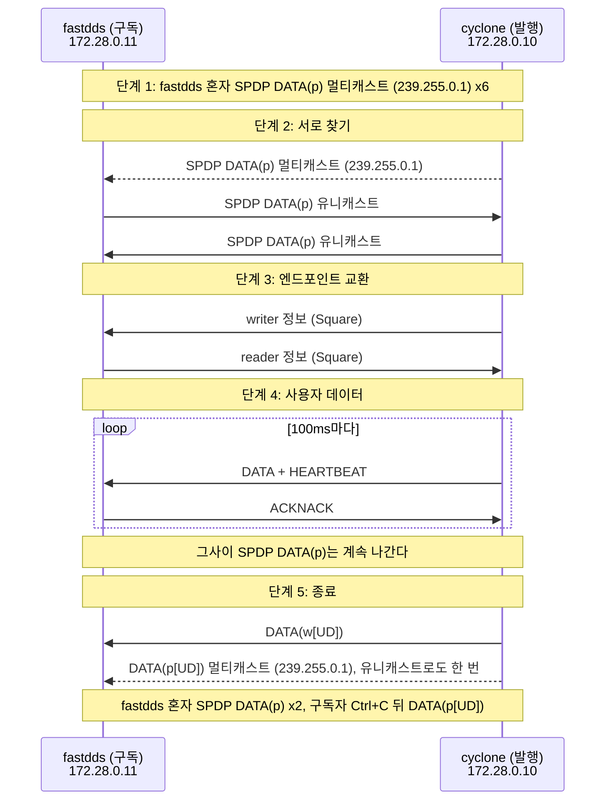

# 3. 첫 DDS 통신 들여다보기

[목차](../README.md) | 이전: [2 멀티캐스트가 오가는 길](../02-multicast/README.md) | 다음: [4 같은 규격, 다른 구현](../04-vendor-differences/README.md)

chapter2에서 두 컨테이너 사이에 멀티캐스트가 통하는 것을 확인했다. 이제 두 벤더의 shape_main을 실제로 통신시키고 그 패킷을 캡처해, 참가자가 서로를 찾고 (SPDP), writer와 reader를 알리고 (SEDP), 데이터를 보내고, 사라지는 흐름을 Wireshark가 패킷마다 바이트를 해석해 붙여 주는 이름만으로 가려낸다. 그 바이트를 직접 읽는 것은 chapter7부터, 각 단계의 동작 원리는 chapter9, 10, 11에서, 두 벤더의 차이는 chapter4에서 다룬다.

## 1. 왜 필요한가

chapter0 3.2는 DDS의 디스커버리를 그림 하나로 요약했다. 참가자들이 주기적으로 자기를 알리고 (SPDP), 서로를 알게 되면 각자의 writer와 reader를 알리고 (SEDP), 맞는 짝이 생기면 데이터가 writer에서 reader로 바로 간다. 이 chapter는 그 그림을 실제 패킷으로 본다. 두 벤더의 shape_main이 처음 통신하는 약 20초 안에 그 모든 단계가 지나간다.

이 chapter를 마치면 DDS 통신 캡처를 열어, 어느 프레임이 참가자 디스커버리 (SPDP)이고, 어느 것이 엔드포인트 디스커버리 (SEDP)이고, 어느 것이 사용자 데이터이고, 어디서 참가자가 사라졌는지를 Wireshark의 Info 열과 필터만으로 가를 수 있다. 그리고 chapter0 3.3이 말한 디스커버리의 부가 비용, 곧 사용자 데이터와 별도로 나가는 패킷 (데이터가 없어도 계속 나간다)을 프레임 수와 바이트로 직접 센다.

여기서 보는 두 캡처는 이 책 전체에서 mdds를 검사하는 기준 데이터 (정답)이기도 하다. chapter7에서 mdds의 파서가 이 바이트를 맞게 읽는지, chapter9와 11에서 mdds의 디스커버리가 같은 순서로 동작하는지를 이 캡처로 검사한다. 검사하는 것은 메시지의 바이트와 단계의 순서이고, 시간 간격, 확인 메시지의 왕복 횟수, 첫 샘플의 번호처럼 실행마다 달라지는 것은 아니다.

이 chapter에서 발행자와 구독자는 shape_main 프로세스, 곧 참가자 하나를 가리킨다. writer와 reader는 그 안의 엔드포인트다. 발행자 안에 writer 하나, 구독자 안에 reader 하나가 있다. 디스커버리를 위해 참가자가 스스로 갖는 내장 writer와 reader는 따로 있다 (3.1절).

## 2. 캡처에서 보기

### 2.1 Lab 3-1: 첫 DDS 통신

#### 2.1.1 목표

fastdds 컨테이너에서 구독자를, cyclone 컨테이너에서 발행자를 실행해 처음으로 두 벤더를 통신시킨다. 받는 쪽 (fastdds)에서 캡처해 `my-reliable-cyclone-pub.pcap`을 만든다. 이 lab에서는 터미널의 출력을 보고, 캡처의 내용은 Lab 3-2에서 본다.

#### 2.1.2 준비

Lab 1-1의 두 컨테이너가 실행 중이어야 한다. 명령은 모두 `docker/`에서 실행한다. 시작하기 전에 이전 실행이 남아 있지 않은지 확인한다. 첫 명령에 두 컨테이너가 `Up`으로 나오고, 나머지 네 명령은 아무것도 출력하지 않아야 정상이다. `Still running:` 줄이 나오면 2.1.5절의 방법으로 끝낸 뒤 진행한다.
```bash
docker compose ps
[ -z "$(docker ps -q --filter ancestor=mdds/tools)" ] || echo "Still running: mcast-check container"
docker compose exec cyclone pgrep -x cyclone_shape >/dev/null && echo "Still running: cyclone_shape"
docker compose exec fastdds pgrep -x fastdds_shape >/dev/null && echo "Still running: fastdds_shape"
docker compose exec fastdds pgrep -x tcpdump >/dev/null && echo "Still running: tcpdump"
```
터미널 세 개를 쓴다. 모두 `docker/`에서 연다. Lab 2-1과 같은 배치다.

| 터미널 | 하는 일 |
|---|---|
| A | fastdds 컨테이너의 `eth0` 캡처 (tcpdump) |
| B | fastdds 컨테이너에서 구독 (`fastdds_shape -S`) |
| C | cyclone 컨테이너에서 발행 (`cyclone_shape -P`) |

shape_main이 무엇이고 어떤 옵션이 있는지는 chapter1에서 보았다 (Lab 1-2). 이 lab에서 쓰는 옵션은 다음과 같다. 두 shape_main은 같은 옵션을 받는다.

| 옵션 | 뜻과 이 lab의 값 |
|---|---|
| `-P` / `-S` | 발행 / 구독. `-P`는 DataWriter 하나를, `-S`는 DataReader 하나를 만든다. 발행은 cyclone, 구독은 fastdds |
| `-d 0` | 도메인 번호 |
| `-t Square` | 토픽 이름 |
| `-x 1` | 샘플을 바이트로 직렬화하는 방식 (데이터 표현. 1 = XCDR1, 2 = XCDR2. chapter6, 16). 실행 파일의 기본값에 기대지 않으려고 양쪽에 명시한다 |
| `-r` / `-b` | RELIABILITY QoS (chapter0 2.3). `-r` reliable은 빠진 샘플을 다시 받고, `-b` best-effort는 받은 것만 받는다. 양쪽을 같게 준다. 이 lab은 `-r` |
| `-c BLUE` | 발행 전용. 샘플의 색. 구독자에게 주면 색으로 거르는 다른 토픽이 되므로 주지 않는다 |
| `--write-period 100 --num-iterations 100` | 발행 전용. 100ms마다 100개를 쓰고 약 10초 뒤 스스로 끝난다 |

#### 2.1.3 절차

시간 간격이 결과에 영향을 준다. 적힌 대로 기다린다.

1. 터미널 A에서 캡처를 시작한다. `listening on eth0`이 출력되면 1초 더 기다린다. 필터는 chapter2와 달리 UDP 전체다. DDS 패킷은 포트가 여럿이기 때문이다. 같은 이름의 파일이 있으면 경고 없이 덮어쓴다.
   ```bash
   docker compose exec fastdds tcpdump -i eth0 -U -Z root -w /captures/cyclone-fastdds/my-reliable-cyclone-pub.pcap 'udp or igmp'
   ```
2. 터미널 B에서 구독자를 시작한다. `Create reader for topic: Square`까지 출력되고 더 나오지 않는다. 아직 발행자가 없으므로 정상이다.
   ```bash
   docker compose exec fastdds fastdds_shape -S -d 0 -t Square -x 1 -r
   ```
3. 구독자를 시작하고 3초 뒤 터미널 C에서 발행자를 시작한다 (더 기다려도 된다. 구독자 혼자인 시간이 길어질 뿐이다). 터미널 B에 `matched writers 1`과 샘플 줄이 찍히기 시작한다.
   ```bash
   docker compose exec cyclone cyclone_shape -P -d 0 -t Square -x 1 -r -c BLUE --write-period 100 --num-iterations 100
   ```
4. 발행자는 약 10초 뒤 스스로 끝나고 터미널 C에 프롬프트가 돌아온다. 그 직후 터미널 B에 `matched writers 0`과 `NOT_ALIVE_NO_WRITERS_INSTANCE_STATE`가 찍힌다. 5초 더 기다린다.
5. 터미널 B에서 Ctrl+C로 구독자를 끝낸다. `Done.`이 출력된다. 창을 닫으면 구독자가 끝나지 않고 컨테이너 안에서 계속 실행되어, 구독자가 사라진다는 패킷 (Lab 3-2의 종료 단계)이 나가지 않는다.
6. 2초 기다린 뒤 터미널 A에서 Ctrl+C로 캡처를 끝낸다. 구독자가 사라지면서 보내는 마지막 패킷이 1초 안에 더 나오기 때문이다. tcpdump가 `N packets captured`와 두 줄을 더 출력하고 끝난다.

#### 2.1.4 기대 결과

- 터미널 C (발행자)는 세 줄을 출력하고 약 10초 뒤 끝난다. 발행자는 샘플마다 출력하지 않는다.
  ```
  Create topic: Square
  Create writer for topic: Square color: BLUE
  on_publication_matched() topic: 'Square'  type: 'ShapeType' : matched readers 1 (change = 1)
  ```
- 터미널 B (구독자)는 다음 순서로 출력한다. 샘플 줄의 x, y 값은 실행마다 다르다. 샘플 줄은 약 80-100줄로, 발행자가 쓴 100개보다 적을 수 있다 (2.2.6절).
  ```
  Create topic: Square
  Create reader for topic: Square
  on_subscription_matched() topic: 'Square'  type: 'ShapeType' : matched writers 1 (change = 1)
  Square     BLUE       106 104 [20]
  Square     BLUE       109 107 [20]
  ...
  on_subscription_matched() topic: 'Square'  type: 'ShapeType' : matched writers 0 (change = -1)
  Square     BLUE       NOT_ALIVE_NO_WRITERS_INSTANCE_STATE
  Done.
  ```
- 터미널 A의 tcpdump는 `N packets captured`를 출력한다.
- 프로젝트 디렉터리의 `captures/cyclone-fastdds/`에 `my-reliable-cyclone-pub.pcap`이 생긴다. 이 파일은 git에 들어가지 않는다. Ubuntu에서는 root 소유로 생성된다.

출력 가운데 뜻을 알아야 하는 줄은 다음과 같다 (chapter1에서 빌드한 shape_main 소스 `526dc56e`의 출력문). 샘플 줄의 형식 (토픽, 색, x, y, [크기])은 chapter1에서 보았다.

| 출력 | 누가 | 뜻 |
|---|---|---|
| `on_publication_matched() ... matched readers 1 (change = 1)` | 발행자 | 맞는 reader를 하나 찾았다 (매칭, [용어 정리](../glossary.md#프로토콜)). 이 줄이 찍혀야 샘플이 상대에게 간다 |
| `on_subscription_matched() ... matched writers 1 (change = 1)` | 구독자 | 맞는 writer를 하나 찾았다 |
| `on_subscription_matched() ... matched writers 0 (change = -1)` | 구독자 | 상대 writer가 사라졌다 |
| `Square     BLUE       NOT_ALIVE_NO_WRITERS_INSTANCE_STATE` | 구독자 | 이 인스턴스 (BLUE Square)에 writer가 없어졌다 |
| `Done.` | 구독자 | Ctrl+C로 끝났다 |

#### 2.1.5 실패하면

- 터미널 B가 `Create reader`에서 넘어가지 않으면 발행자가 실행 중인지 터미널 C를 본다. 둘 다 실행 중인데 `matched`가 찍히지 않으면 네트워크부터 의심한다 (chapter2 3.4).
- 이전 실행의 shape_main이 남아 있으면 (2.1.2절의 확인 명령에 `Still running:` 줄이 나오면) `docker compose exec <컨테이너> pkill -INT -x <벤더>_shape`로 끝낸다. SIGTERM (`pkill`의 기본값)이 아니라 SIGINT를 보내야 정리하고 끝난다. 남은 tcpdump는 `pkill -INT -x tcpdump`로 끝낸다. 남은 mcast-check 컨테이너는 `docker ps --filter ancestor=mdds/tools`로 찾아 `docker stop <컨테이너 id>`로 끝낸다.
- chapter2의 `mcast-check recv` 컨테이너가 남아 UDP 7400을 점유하고 있으면 fastdds_shape는 오류 없이 시작하지만 7400 소켓을 열지 못한다. 구독자를 시작한 뒤 `docker compose exec fastdds ss -ulpn`을 보면 7400 줄에 `fastdds_shape`가 없다. chapter2 2.1.6의 방법으로 그 컨테이너를 끝내고 다시 한다.
- 캡처가 비어 있거나 패킷 수가 매우 적으면 tcpdump를 구독자보다 늦게 시작했거나 너무 일찍 끝낸 것이다. 절차 1부터 다시 한다.
- 그 밖의 문제는 [docker-network.md "문제와 대응"](../../docs/environment/docker-network.md#문제와-대응)을 참고한다.

### 2.2 Lab 3-2: 캡처에서 RTPS 메시지 찾기

#### 2.2.1 목표

참고 캡처 `reliable-cyclone-pub.pcap`에서 통신의 다섯 단계를 표지 프레임으로 찾고, 내장 엔드포인트의 트래픽 (디스커버리)과 사용자 트래픽을 프레임 수와 바이트로 센다.

다섯 단계는 이 책이 흐름을 설명하려고 나눈 것이다.

1. 구독자 혼자: 구독자가 자기를 알리지만 상대가 없다.
2. 서로 찾기: 발행자가 시작되고 두 참가자가 서로를 안다.
3. 엔드포인트 교환: 각자 자기 writer와 reader의 정보를 보낸다.
4. 사용자 데이터: Square 샘플이 흐른다.
5. 종료: 발행자가, 그다음 구독자가 사라진다고 알린다.

단계 2와 3은 같은 시간대에 섞여 있어 프레임 범위로 나눌 수 없다. 그래서 단계마다 Info 열만으로 알아볼 수 있는 프레임 (표지 프레임)을 정해 찾는다. 표지 사이의 다른 프레임은 이 lab에서 단계로 나누지 않는다.

#### 2.2.2 준비

이 lab은 스크립트로 만든 참고 캡처를 연다. 스크립트 [`docker/capture-shape-scenario.ts`](../../docker/capture-shape-scenario.ts)는 Lab 3-1의 절차와 같은 순서의 명령을 같은 간격으로 실행한다. 그 결과물이 [`captures/cyclone-fastdds/reliable-cyclone-pub.pcap`](../../captures/cyclone-fastdds/README.md#reliable-cyclone-pub)이고, 이 파일의 패킷은 268개다. 본문의 프레임 번호가 이 파일 기준이므로, 직접 만든 `my-reliable-cyclone-pub.pcap`이 아니라 이 파일을 연다. 직접 만든 캡처는 기다린 시간에 따라 패킷 수가 다르고, 프레임 번호와 시각도 다르다.

Wireshark가 RTPS 패킷을 보여 주는 방식은 [wireshark.md](../../docs/environment/wireshark.md)에 있다. 이 lab에서 알아야 하는 것은 다음 세 가지다.
- **Info 열은 서브메시지 목록이다.** RTPS 메시지 하나는 헤더 뒤에 서브메시지 여러 개가 이어진 것이고 ([용어 정리](../glossary.md#프로토콜)), Info 열에 그 이름이 쉼표로 나열된다. `DATA`는 writer가 보내는 샘플 하나를 실은 서브메시지다. `HEARTBEAT`와 `ACKNACK`는 샘플을 빠짐없이 전하기 위한 (reliable) 확인 메시지로, writer는 `HEARTBEAT`로 자기가 보낸 샘플의 번호 (몇 번부터 몇 번까지)를 알리고 reader는 `ACKNACK`로 받은 것과 빠진 것을 답한다. 지금은 이 역할만 알면 되고, 자세한 동작은 3.2절과 chapter10에서 다룬다.
- **디스커버리도 DATA다.** 참가자 정보 (SPDP)는 `DATA(p)`, writer 정보와 reader 정보 (SEDP)는 `DATA(w)`와 `DATA(r)`로 표시되고, 사라진다는 알림에는 `[UD]` (사라진다는 뜻의 두 플래그 Unregistered, Disposed)가 붙는다. 사용자 데이터는 표시 없이 `DATA`다. 규격에는 DATA 하나뿐이고 이 표시는 Wireshark가 보낸 writer의 entityId (참가자 안에서 writer나 reader 하나를 가리키는 식별자, [용어 정리](../glossary.md#프로토콜))를 보고 붙인 것이다 (3.1절).
- **두 가지 이상한 표시는 정상이다.** Fast DDS가 보낸 메시지 끝의 `Unknown[80]`은 벤더 전용 서브메시지이고, Cyclone이 보낸 writer 정보는 `DATA(w)` 대신 `DATA[Malformed Packet]`로 표시되지만 토픽 이름은 상세 창에서 정상으로 읽힌다 ([wireshark.md](../../docs/environment/wireshark.md#정상인-두-가지-이상한-표시)).

캡처는 fastdds 쪽에서 했으므로 fastdds가 보낸 멀티캐스트는 나가는 것과 돌아온 것 두 개씩 보이고 (chapter2 2.1.4), cyclone이 보낸 것은 한 번씩이다. 주소는 cyclone 172.28.0.10, fastdds 172.28.0.11이다.

찾을 다섯 단계를 그림으로 줄이면 다음과 같다. 실선은 유니캐스트, 점선은 멀티캐스트다. 단계 3과 4에서 반복되는 `HEARTBEAT`, `ACKNACK`와 IGMP는 뺐다. 프레임 번호가 모두 붙은 흐름도는 [캡처 README](../../captures/cyclone-fastdds/README.md#reliable-cyclone-pub)에 있다.



#### 2.2.3 절차

1. Wireshark로 `captures/cyclone-fastdds/reliable-cyclone-pub.pcap`을 열고 표시 필터에 `rtps`를 입력한다. 창 아래 상태 표시줄의 Displayed가 전체 268개 가운데 256개가 된다. 나머지 12개는 chapter2에서 본 IGMP다.
2. 아래 표의 표지 프레임을 차례로 찾는다 (Go > Go to Packet). Source 열 (보낸 쪽 주소)과 Info 열을 본다.

   | 단계 | 표지 프레임 | 보낸 쪽 | Info 열 |
   |---|---|---|---|
   | 1 구독자 혼자 | 1부터 | fastdds | `DATA(p)` 멀티캐스트. 두 개씩 보인다 |
   | 2 서로 찾기 | 17 | cyclone | 첫 `DATA(p)` 멀티캐스트 |
   | 2 서로 찾기 | 18 | fastdds | cyclone에게 보내는 유니캐스트 `DATA(p)` |
   | 2 서로 찾기 | 23 | cyclone | fastdds에게 보내는 유니캐스트 `DATA(p)` |
   | 3 엔드포인트 교환 | 22 | cyclone | writer 정보 (`DATA[Malformed Packet]`) |
   | 3 엔드포인트 교환 | 47 | fastdds | reader 정보 (`DATA(r) -> Square`) |
   | 4 사용자 데이터 | 50부터 | cyclone | 표시 없는 `DATA` |
   | 5 종료 | 254 | cyclone | `DATA(w[UD])` |
   | 5 종료 | 255-256 | cyclone | `DATA(p[UD])` 멀티캐스트와 유니캐스트 |
   | 5 종료 | 263-264 | fastdds | 구독자를 끝낸 뒤의 `DATA(p[UD])` |

3. 프레임 22를 골라 상세 창에서 `DATA` > `serializedData` > `PID_TOPIC_NAME`을 펼친다 ([wireshark.md의 그림](../../docs/environment/wireshark.md#상세-창-서브메시지-안을-본다)).
4. 프레임 50을 골라 상세 창에서 `DATA` > `writerEntityId`를 본다. 이 값이 이 캡처에서 Square 샘플을 보내는 사용자 writer의 entityId이고, 아래 필터에 쓴다. 사용자 엔드포인트의 entityId는 벤더와 실행에 따라 다를 수 있다 (3.1절).
5. 표시 필터 `rtps.sm.wrEntityId == 0x000100c2`를 입력한다. `0x000100c2`는 `DATA(p)`를 보내는 SPDP writer의 entityId로, 규격이 정한 값이다 (3.1절). `DATA(p)`가 단계와 상관없이 캡처 내내 나가는 것이 보인다.
6. 세 묶음으로 센다 (세는 법은 [wireshark.md](../../docs/environment/wireshark.md#프레임-수와-바이트-세기)). 사용자 writer의 필터에는 그 writer에게 보낸 `ACKNACK`도 걸리므로 (ACKNACK 서브메시지 안에도 상대 writer의 entityId가 들어 있다) 보낸 쪽 주소 (`ip.src`)로 나눈다.
   - 내장 엔드포인트 트래픽 전체: `rtps && !(rtps.sm.wrEntityId == 0x00000202)`
   - 사용자 writer가 보낸 것 (DATA와 HEARTBEAT): `rtps.sm.wrEntityId == 0x00000202 && ip.src == 172.28.0.10`
   - 사용자 reader가 보낸 것 (ACKNACK): `rtps.sm.wrEntityId == 0x00000202 && ip.src == 172.28.0.11`
7. Lab 3-1에서 만든 `my-reliable-cyclone-pub.pcap`을 열어 같은 표지 프레임을 찾는다.

#### 2.2.4 기대 결과

- 표지 프레임이 표의 순서대로 있다. 단계 1의 `DATA(p)`는 발행자가 시작되기 전 약 3초 동안 fastdds 혼자 보낸 것이다.
- 프레임 22의 `PID_TOPIC_NAME`에 토픽 이름 Square가 보인다. Info 열의 `Malformed`는 그 아래 항목에서 Wireshark가 멈춘 것이고 통신과는 상관없다.
- 프레임 50의 `writerEntityId`는 `0x00000202`다.
- SPDP writer의 `DATA(p)`는 캡처 내내 나간다. 발행자가 있는 동안에는 두 벤더가 모두 보내고, 주기는 벤더마다 다르다 (chapter4).
- 직접 만든 캡처에서도 표지 프레임의 순서는 같다. 프레임 번호와 시각, 단계 3에서 writer 정보와 reader 정보 사이의 시간, 그사이 `HEARTBEAT`와 `ACKNACK`의 왕복 횟수, 첫 사용자 DATA의 `writerSeqNumber`는 다를 수 있다. 참고 캡처는 이 시간이 약 1.1초인 경우다. 왜 다른지는 chapter11에서 본다.
- 묶음별 수는 다음과 같다. 이 캡처의 조건 (참가자 둘, 샘플 하나의 직렬화된 데이터 32바이트, 데이터가 흐른 약 9초와 그 뒤 약 6초의 대기, Fast DDS가 모든 메시지에 붙이는 60바이트 벤더 전용 서브메시지)에서 나온 수이고, IGMP는 들어 있지 않다. 내장 엔드포인트 트래픽을 SPDP, SEDP, 참가자 메시지로 더 나눈 수는 [캡처 README](../../captures/cyclone-fastdds/README.md#reliable-cyclone-pub)에 있다.

  | 묶음 | 프레임 | 바이트 |
  |---|---|---|
  | RTPS 전체 | 256 | 55,760 |
  | 내장 엔드포인트 트래픽 전체 | 72 | 25,628 |
  | 사용자 writer가 보낸 것 (DATA 89개와 HEARTBEAT) | 90 | 14,528 |
  | 사용자 reader가 보낸 것 (ACKNACK) | 94 | 15,604 |

이 표에서 읽을 것은 비율이 아니라, 어떤 트래픽이 언제 나가는가다.
- **디스커버리 트래픽은 사용자 데이터가 없어도 나간다.** 내장 엔드포인트 트래픽 72 프레임 가운데 42개가 SPDP (`DATA(p)`와 `DATA(p[UD])`)이고 나머지 30개가 SEDP와 참가자 메시지다 (fastdds 자신의 멀티캐스트가 두 번씩 보인 것을 포함한 수다). SPDP는 발행자가 사라진 뒤에도 fastdds가 주기적으로 보냈고, SEDP도 writer 정보와 reader 정보를 교환한 뒤에 cyclone의 `ACKNACK`가 약 1초마다 이어졌다 (그 이유는 chapter11).
- **reliable은 ACKNACK를 더한다.** 사용자 reader가 보낸 94 프레임은 모두 `ACKNACK`다. 샘플 89개를 받는 데 비슷한 수의 패킷을 답으로 보냈다.

chapter0 3.3이 말한 디스커버리의 부가 비용 ("트래픽의 적지 않은 몫")은 이 한 실행에서는 이렇게 나타났다. 다른 조건에서는 비율이 달라지므로 DDS 일반의 값으로 읽지 않는다. 변하지 않는 것은 두 가지다. 데이터가 흐르지 않아도 참가자마다 SPDP가 계속 나가고, writer와 reader가 늘면 SEDP도 그만큼 는다.

#### 2.2.5 확인 질문

- 프레임 100, 200, 260은 각각 어느 단계인가? Info 열과 보낸 쪽 주소만으로 답해 보라 (답: 100과 200은 단계 4, 260은 단계 5에서 fastdds 혼자 보낸 `DATA(p)`다).
- Lab 3-1의 발행자 터미널에는 샘플 줄이 없었다. 발행자가 샘플을 보냈다는 증거는 캡처의 어느 서브메시지인가? (답: 단계 4의 표시 없는 `DATA`. 프레임 50부터 `writerEntityId`가 `0x00000202`인 것)

#### 2.2.6 이 chapter에서 답하지 않는 것

캡처에 보이지만 뒤 chapter에서 다루는 것이다. 지금은 몰라도 된다.
- 사용자 데이터의 `writerSeqNumber`가 12부터다. 1-11은 어디로 갔나? -> chapter11, 13
- reader 정보 (47)가 나가기 전에 fastdds의 사용자 reader가 `HEARTBEAT`를 받지 않은 채 `ACKNACK`를 네 번 보내고 (33, 36, 40, 46) cyclone은 답하지 않는다. 무엇을 위한 것인가? -> chapter10
- writer 정보에서 reader 정보까지 걸리는 시간이 왜 실행마다 다르고, 양쪽 로그의 matched가 각각 언제 찍히는지 -> chapter11
- 참고 캡처의 구독 로그 (`reliable-cyclone-pub.sub.log`)는 샘플이 84줄인데 캡처의 사용자 DATA는 89개다 -> chapter13
- 종료 때 `DATA(w[UD])` 다음에 `DATA(p[UD])`가 오는 순서와, 구독 로그의 `NOT_ALIVE_NO_WRITERS`가 어느 메시지로 정해지는지 -> chapter11, 13

### 2.3 Lab 3-3: best-effort와 비교

#### 2.3.1 목표

같은 통신을 `-b` (best-effort)로 한 참고 캡처 `best-effort-cyclone-pub.pcap`에서 무엇이 사라지고 무엇이 남는지 본다.

#### 2.3.2 준비

[`captures/cyclone-fastdds/best-effort-cyclone-pub.pcap`](../../captures/cyclone-fastdds/README.md#best-effort-cyclone-pub)을 연다. 양쪽 shape_main에 `-r` 대신 `-b`를 준 것 말고는 Lab 3-1과 같은 절차로 만든 캡처다. 직접 만들어 보려면 Lab 3-1의 절차에서 `-r`을 `-b`로 바꾸고 파일 이름을 `my-best-effort-cyclone-pub.pcap`으로 한다.

#### 2.3.3 절차

1. 필터 `rtps.sm.wrEntityId == 0x00000202`로 사용자 트래픽만 본다. Info 열을 훑어 `HEARTBEAT`나 `ACKNACK`가 있는지 찾는다.
2. 필터 `rtps && !(rtps.sm.wrEntityId == 0x00000202)`로 내장 엔드포인트 트래픽만 본다. `HEARTBEAT`와 `ACKNACK`가 있는지, 있다면 어느 writer의 것인지 (상세 창의 `writerEntityId`) 본다.
3. 필터 `rtps.sm.wrEntityId == 0x00000202 && ip.src == 172.28.0.10`으로 사용자 writer가 보낸 것의 프레임 수와 바이트를 센다.

#### 2.3.4 기대 결과

- 사용자 트래픽은 98 프레임 (12,740바이트) 모두 `INFO_TS, DATA`다. `HEARTBEAT`도 `ACKNACK`도 없다. 사용자 reader가 보낸 프레임은 0개다. `writerSeqNumber`는 3에서 100까지다.
- 내장 엔드포인트 트래픽에는 `HEARTBEAT`와 `ACKNACK`가 그대로 있다. `writerEntityId`는 모두 `0x000003c2`, `0x000004c2` (SEDP) 또는 `0x000200c2` (참가자 메시지)다. 사용자 QoS를 best-effort로 해도 SEDP와 참가자 메시지는 reliable로 오간다 (3.1절). SPDP는 원래 best-effort다.
- 단계의 순서 (구독자 혼자, 서로 찾기, 엔드포인트 교환, 사용자 데이터, 종료)는 Lab 3-2와 같다.

#### 2.3.5 이 chapter에서 답하지 않는 것

- 사용자 데이터의 `writerSeqNumber`가 3부터다 (reliable 캡처는 12부터). 캡처된 DATA는 98개로 reliable 때의 89개보다 많다 -> chapter11, 13
- reader 정보 (`DATA(r)`)가 나가기까지 걸린 시간이 캡처마다 다르다 -> chapter11

## 3. 규격 읽기

Lab 3-2의 다섯 단계는 RTPS 규격이 정한 동작이 차례로 나타난 것이다. 단계마다 규격의 어느 절이 그 메시지를 정하는지 아래 표로 잇고, 그 가운데 두 가지 (디스커버리가 왜 사용자 데이터와 같은 DATA로 보이는가, HEARTBEAT와 ACKNACK는 언제 오가는가)를 3.1절과 3.2절에서 읽는다. 각 단계의 동작 자체는 뒤 chapter에서 구현하며 읽는다.

| 단계 | 규격 절 (RTPS 2.5) | 읽는 곳 |
|---|---|---|
| 1 구독자 혼자 | SPDP writer의 주기적 공지 (Sec. 8.5.3.1) | 3.1절, chapter9 |
| 2 서로 찾기 | 상대 참가자를 알게 되면 SEDP 엔드포인트를 짝 맺음 (Sec. 8.5.5.1) | chapter9 |
| 3 엔드포인트 교환 | SEDP 내장 엔드포인트 (Sec. 8.5.4.1), reliable (Sec. 8.5.4.2) | 3.1절, chapter11 |
| 4 사용자 데이터 | reliable writer와 reader의 의무 (Sec. 8.4.2.2, 8.4.2.3) | 3.2절, chapter10 |
| 5 종료 | writer 정보 삭제 (Sec. 8.5.4.4 표 8.82), 삭제 플래그 (Sec. 9.6.4.9), 참가자 제거 (Sec. 8.5.5.2) | 3.1절, chapter4 3.2, chapter13 |

### 3.1 디스커버리도 같은 프로토콜로 한다: 내장 엔드포인트

RTPS의 SPDP와 SEDP는 따로 만든 메시지를 쓰지 않는다. 참가자마다 미리 정해진 **내장 엔드포인트** (built-in endpoint)를 두고, 그 writer와 reader가 사용자 엔드포인트와 같은 프로토콜로 정보를 주고받는다 (RTPS 2.5 Sec. 8.5.2, 8.5.4.1). 참가자 정보를 보내는 writer, writer 정보를 보내는 writer, reader 정보를 보내는 writer가 각각 있고, 상대 참가자에는 그것을 받는 reader가 있다. 그래서 캡처에서 SPDP와 SEDP가 `DATA`, `HEARTBEAT`, `ACKNACK`로 보인다.

내장 엔드포인트의 entityId는 규격이 정하므로 모든 참가자에서 같다 (RTPS 2.5 Sec. 9.3.1.3, 표 9.2). Lab 3-2의 필터에 쓴 값이 여기서 온다.

| 내장 엔드포인트 | entityId | Wireshark 표시 |
|---|---|---|
| SPDP 참가자 정보 writer | `0x000100c2` | `DATA(p)` |
| SEDP writer 정보 writer | `0x000003c2` | `DATA(w)` |
| SEDP reader 정보 writer | `0x000004c2` | `DATA(r)` |
| 참가자 메시지 writer | `0x000200c2` | `DATA(m)` |

사용자 엔드포인트의 entityId는 구현이 고른다. 마지막 바이트만 종류로 정해져 있어 (Sec. 9.3.1.2, 표 9.1), key가 있는 토픽의 writer는 내장이면 `c2`, 사용자 writer면 `02`로 끝난다 (key가 없으면 `c3`, `03`). Lab 3-2에서 본 Cyclone의 Square writer `0x00000202`가 그 예이고, 다른 실행이나 다른 벤더에서는 앞의 세 바이트가 다를 수 있다. entityId와 그것을 참가자의 guidPrefix와 합친 GUID는 [용어 정리](../glossary.md#프로토콜)에 있다.

세 종류의 내장 writer는 성격이 다르다.
- **SPDP writer는 best-effort이고 주기적이다.** 참가자 정보 하나를 미리 정한 주소 목록으로 주기적으로 다시 보낸다 (Sec. 8.5.3.1). 받는 이가 있는지는 상관없다. 그래서 단계 1에서 fastdds 혼자 `DATA(p)`를 보냈고, 참가자는 어느 순서로 시작해도 서로를 찾는다. 규격의 기본 주기는 30초이고 (Sec. 9.6.2.4), 두 벤더는 더 짧게 설정되어 있다 (chapter4). 모르는 참가자의 정보를 받으면 바로 한 번 더 보내 시작을 앞당길 수 있는데, 이것은 선택이다 (Sec. 8.5.3.1). 단계 2에서 두 벤더가 서로에게 유니캐스트로 보낸 `DATA(p)`가 이 동작으로 보인다. 참가자가 사라질 때는 규격이 알림을 요구하지 않는다. 규격이 적어 둔 참가자 제거 방법은 공지가 lease 기간 넘게 끊기면 지우는 것이고 (Sec. 8.5.5.2), 단계 5처럼 종료 때 `DATA(p[UD])`를 보내 상대가 기다리지 않게 하는 것은 구현의 선택이다 (chapter4 3.2).
- **SEDP writer는 reliable이다.** DDS 규격이 이 내장 엔드포인트를 reliable로 정하므로 RTPS도 reliable writer와 reader로 대응시킨다 (Sec. 8.5.4.2). 그래서 사용자 QoS가 best-effort여도 SEDP에는 `HEARTBEAT`와 `ACKNACK`가 남는다 (Lab 3-3). writer가 지워지면 그 writer 정보도 지우는데 (Sec. 8.5.4.4, 표 8.82), 이 캡처에서는 그 알림이 `PID_STATUS_INFO`에 Unregistered와 Disposed 플래그를 켠 DATA (`DATA(w[UD])`)였다 (플래그의 정의는 Sec. 9.6.4.9).
- **참가자 메시지 writer도 reliable이다.** 참가자가 자기 writer들이 살아 있음을 알리는 데 쓰는 writer다 (Sec. 8.4.13). 규격은 이 writer를 reliable로 정하고, 상대의 reader는 best-effort여도 된다고 한다 (Sec. 8.4.13.3). 이 캡처에서는 양쪽 reader도 reliable이어서 `DATA(m)`과 그 `HEARTBEAT`, `ACKNACK`가 섞여 있다. liveliness는 chapter14에서 다룬다.

참가자가 받는 유니캐스트 주소와 포트도 SPDP의 참가자 정보에 로케이터 ([용어 정리](../glossary.md#프로토콜))로 실어 알린다. 단계 2의 `DATA(p)`를 펼치면 상세 창의 `PID_METATRAFFIC_UNICAST_LOCATOR`와 `PID_DEFAULT_UNICAST_LOCATOR`에 보인다. 두 벤더가 알린 로케이터의 차이는 chapter4에서, 포트의 기본 공식은 chapter8에서 본다.

### 3.2 reliable과 best-effort: HEARTBEAT와 ACKNACK

RTPS는 모든 구현이 규격을 따르고 서로 통신하기 위해 지켜야 하는 동작을 Sec. 8.4.2에 모아 둔다. Lab 3-2와 3-3의 차이는 그 가운데 세 가지로 설명된다.
- **reliable writer는 매칭된 reliable reader에게 HEARTBEAT를 주기적으로 보내야 한다.** 보낼 샘플이 없으면 보내지 않아도 된다 (Sec. 8.4.2.2). 단계 4에서 cyclone이 `DATA`마다 `HEARTBEAT`를 붙인 것이 이것이다. 얼마나 자주 보낼지는 구현이 정한다 (chapter10).
- **reliable reader는 답을 요구하는 HEARTBEAT를 받으면 ACKNACK로 답해야 한다.** 답은 늦춰도 되고, 빠진 것이 있으면 writer는 결국 다시 보내거나 더는 줄 수 없음을 알려야 한다 (Sec. 8.4.2.2, 8.4.2.3). 단계 4의 `HEARTBEAT`는 모두 답을 요구하는 것이었고, fastdds가 매번 `ACKNACK`를 보낸 것이 이것이다. 답을 요구하지 않는 HEARTBEAT (final 플래그)와 HEARTBEAT 없이 나가는 ACKNACK는 chapter10에서 본다.
- **best-effort reader는 아무것도 보내지 않는다.** 받기만 한다 (Sec. 8.4.2.3). HEARTBEAT는 reliable writer가 reliable reader에게 지는 의무이므로, 둘 다 best-effort이면 HEARTBEAT도 없다. 그래서 Lab 3-3의 사용자 트래픽에는 `DATA`만 남는다.

빠진 샘플을 어떻게 찾아 다시 보내는지, HEARTBEAT와 ACKNACK에 적힌 번호가 무엇인지는 chapter10에서 구현하면서 본다.

## 4. 스스로 확인하기

명령이나 수치를 외웠는지가 아니라 동작의 원리를 이해했는지 확인하는 질문이다. 먼저 스스로 답해 본 뒤 "해설"을 펼쳐 비교해 보라.

1. 동료가 "shape_main에 `-b`를 주었는데 캡처에 HEARTBEAT와 ACKNACK가 있다. best-effort가 적용되지 않은 것 아닌가?"라고 묻는다. 어떻게 답하고, 무엇을 보여 주겠는가?

   <details>
   <summary>해설</summary>

   적용되었다. 사용자 writer의 entityId로 거르면 (`rtps.sm.wrEntityId == 0x00000202`) 사용자 트래픽에는 `DATA`만 있다. 남아 있는 HEARTBEAT와 ACKNACK는 SEDP와 참가자 메시지 엔드포인트의 것이다 (writerEntityId `0x000003c2`, `0x000004c2`, `0x000200c2`). SEDP 엔드포인트와 참가자 메시지 writer는 사용자 QoS와 무관하게 규격이 reliable로 정한다 (RTPS 2.5 Sec. 8.5.4.2, 8.4.13.3). 보여 줄 것은 두 필터의 결과다.

   </details>

2. 참고 캡처에는 `DATA` 서브메시지가 든 프레임이 백 개 넘게 있다. 그 가운데 내 Square 샘플만 보려면 무엇으로 거르고, 왜 Info 열의 이름만으로는 부족한가?

   <details>
   <summary>해설</summary>

   보낸 writer의 entityId로 거른다. 참가자 정보, writer 정보, reader 정보, 사용자 데이터는 모두 같은 DATA 서브메시지이고 (내장 엔드포인트, Sec. 8.5.2), Wireshark의 `(p)`, `(w)`, `(r)` 표시는 그 entityId를 보고 붙인 것이다. 사용자 데이터에는 표시가 없고, 참가자가 여럿이면 사용자 writer도 여럿이라 Info 열만으로는 어느 writer의 것인지 알 수 없다. 이 캡처에서는 `rtps.sm.wrEntityId == 0x00000202`다. 다만 이 필터에는 그 writer에게 보낸 ACKNACK도 걸리므로, DATA만 보려면 보낸 쪽 주소를 함께 건다.

   </details>

3. 참고 캡처의 처음 3초 (구독자 혼자)에는 무엇이 보였는가? 발행자를 끝내 실행하지 않았다면 그 뒤로 무엇이 흘렀겠는가? 그것이 chapter0 3.3과 어떻게 이어지는가?

   <details>
   <summary>해설</summary>

   SPDP 참가자 정보 (`DATA(p)`)가 멀티캐스트로 반복해서 나갔다. 발행자가 없어도 이것은 계속된다. SPDP writer는 받는 이가 있든 없든 주기적으로 보내기 때문이다 (Sec. 8.5.3.1). 이 캡처에서 관찰한 것은 처음 3초와 발행자가 사라진 뒤 약 6초뿐이지만, 규격의 동작과 참고 캡처의 3초 주기로 보아 그 뒤로도 같다. 주기는 구현의 설정값이다 (규격 기본 30초). SEDP는 상대가 없으면 나가지 않는다. 이것이 chapter0 3.3이 말한, 데이터가 없어도 참가자마다 계속 드는 디스커버리의 부가 비용이다.

   </details>

4. 참가자가 하나 늘면 (예: 구독자 둘, 발행자 하나) 디스커버리의 부가 비용 가운데 한 번 드는 것과 계속 드는 것은 각각 어떻게 느는가?

   <details>
   <summary>해설</summary>

   계속 드는 것은 SPDP다. 참가자마다 자기 공지를 주기적으로 보내므로 참가자 수에 비례해 늘고, 데이터가 흐르지 않아도 멈추지 않는다. 한 번 드는 것은 SEDP다. 새 참가자는 기존 참가자 각각과 서로의 writer와 reader 정보를 교환하므로, 교환할 때 참가자 쌍의 수에 비례해 는다 (chapter0 3.3의 N x (N - 1) x E). 다만 교환이 끝난 뒤에도 SEDP 엔드포인트가 reliable이라 확인 메시지는 이어진다 (Lab 3-2). 사용자 데이터가 두 reader에게 어떻게 가는지 (따로 보내는지, 멀티캐스트로 한 번 보내는지)는 이 chapter의 캡처로는 확인하지 못한다.

   </details>

5. 발행자는 끝나면서 `DATA(w[UD])`를 먼저, `DATA(p[UD])`를 그다음에 보냈다. 둘 가운데 규격이 요구하는 알림은 무엇이고, 다른 하나가 없으면 구독자는 발행자가 사라진 것을 어떻게 아는가?

   <details>
   <summary>해설</summary>

   규격이 요구하는 것은 `DATA(w[UD])`다. writer가 지워지면 SEDP의 writer 정보도 지워야 하고 (Sec. 8.5.4.4, 표 8.82), 그 알림이 Unregistered와 Disposed 플래그를 붙인 DATA다. 참가자 정보에 같은 플래그를 붙여 보내는 `DATA(p[UD])`는 규격이 요구하지 않는 구현의 선택이다. 그것이 없으면 구독자는 SPDP 공지가 lease 기간 넘게 끊긴 것으로 발행자가 사라졌다고 판단한다 (Sec. 8.5.5.2). 그렇게 사라지는 캡처는 chapter4의 Lab 4-2에서 본다.

   </details>

## 참고 자료

- [DDSI-RTPS 2.5 규격 (PDF)](https://www.omg.org/spec/DDSI-RTPS/2.5/PDF): Sec. 8.5.1-8.5.5 (디스커버리와 내장 엔드포인트), 표 9.2 (내장 엔드포인트의 entityId), Sec. 8.4.2 (상호운용에 필요한 writer와 reader의 동작), Sec. 8.4.13 (Writer Liveliness Protocol) (3절)
- [Wireshark Display Filter Reference: RTPS](https://www.wireshark.org/docs/dfref/r/rtps.html): `rtps.sm.wrEntityId` 같은 필터 필드 이름의 목록 (Lab 3-2, 3-3)
