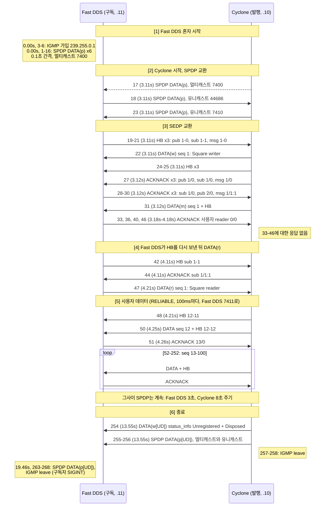
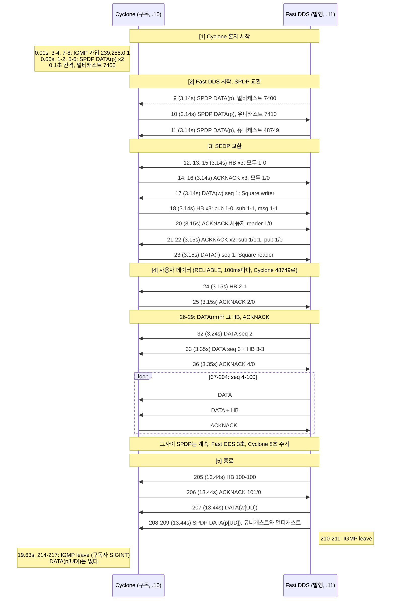
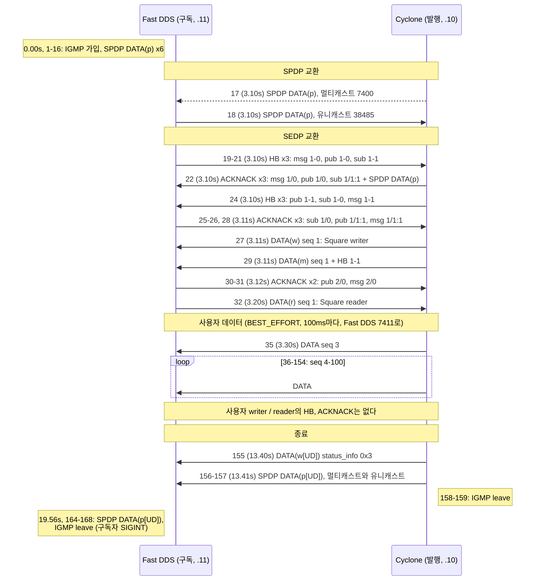
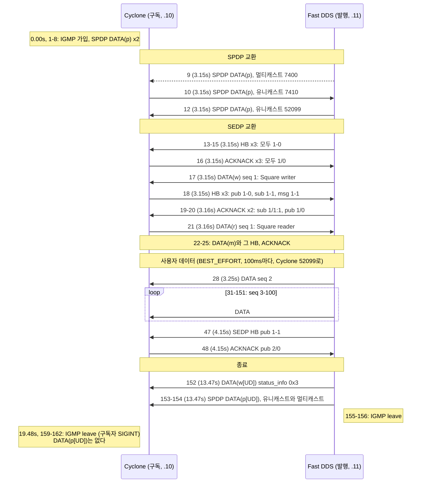
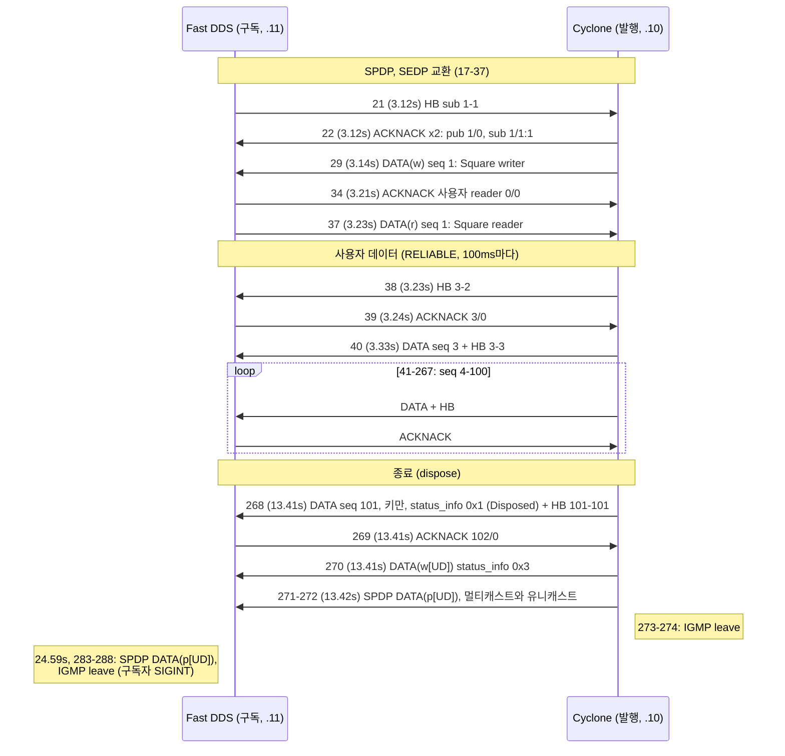
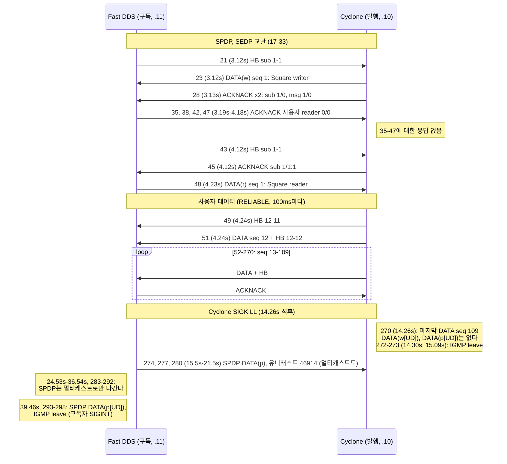
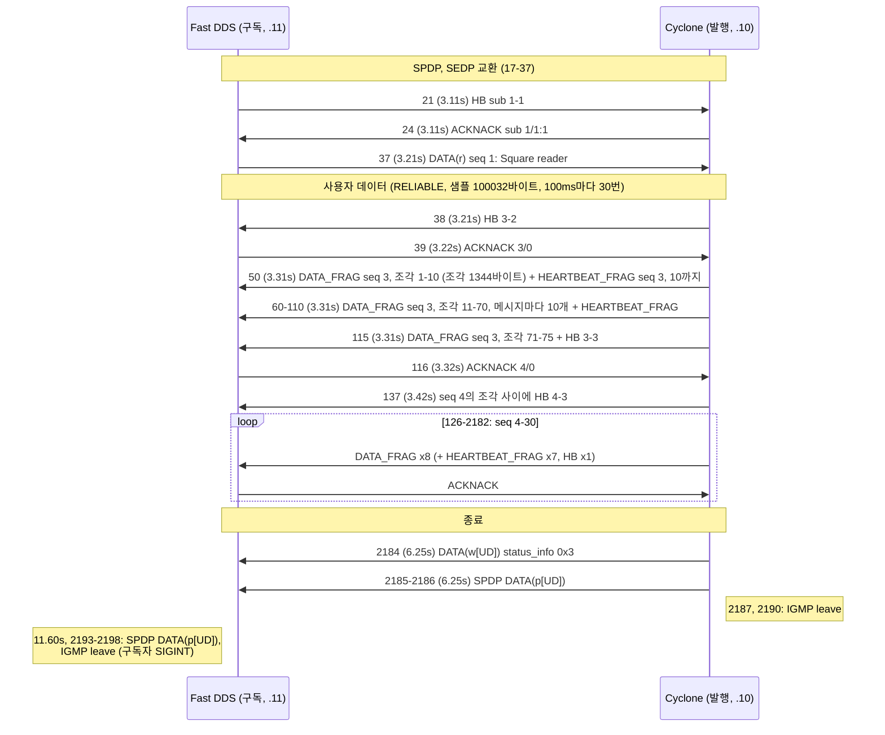

# Cyclone DDS <-> Fast DDS 캡처

[chapter 1-4 노트](../../docs-for-agent/notes/01-04-environment-and-captures.md) | [시나리오 표](../../docs-for-agent/notes/01-04-environment-and-captures.md#시나리오-표) | [docker-network.md](../../docs/environment/docker-network.md)

Cyclone DDS와 Fast DDS의 shape_main을 통신시켜 잡은 패킷과 로그다. 이후 chapter에서 파서와 상태 머신을 검증하는 정답 데이터로 쓴다.

## 공통 조건
- 벤더와 빌드 소스: Cyclone DDS master `f2aaccb4` (11.0.1), Fast DDS 3.6.1, shape_main 소스 omg-dds/dds-rtps `526dc56`. 자세한 버전 표는 [docker/README.md](../../docker/README.md#빌드-소스와-버전).
- 주소: cyclone 172.28.0.10, fastdds 172.28.0.11 (bridge `dds-net`).
- 캡처는 구독자 컨테이너의 `eth0`에서 `tcpdump "udp or igmp"`로 한다. 자기가 보낸 멀티캐스트는 loopback 복사본 때문에 두 번씩 잡힌다 ([docker-network.md](../../docs/environment/docker-network.md#멀티캐스트가-컨테이너-사이를-넘어가는-원리)).
- 다시 만들기: `docker/`에서 `./capture-shape-scenario.ts <이름>` (기존 파일이 있으면 `--force`). 다시 만들면 프레임 번호, 시각, 임의 포트가 바뀌므로 아래 그림도 고친다.
- Wireshark 4.6.9 기준. 필터 `rtps`.

## 파일
| 파일 | 내용 |
|---|---|
| [`../mcast-check/`](../mcast-check/) | 네트워크 검증 (01-04-environment-and-captures Step 4). DDS 없이 멀티캐스트만. [docker-network.md "검증 명령"](../../docs/environment/docker-network.md#검증-명령) |
| `rel-cyclone-pub.*` | Cyclone 발행 -> Fast DDS 구독, RELIABLE. 캡처는 fastdds |
| `rel-fastdds-pub.*` | Fast DDS 발행 -> Cyclone 구독, RELIABLE. 캡처는 cyclone |
| `be-cyclone-pub.*` | Cyclone 발행 -> Fast DDS 구독, BEST_EFFORT. 캡처는 fastdds |
| `be-fastdds-pub.*` | Fast DDS 발행 -> Cyclone 구독, BEST_EFFORT. 캡처는 cyclone |
| `dispose-on-exit.*` | Cyclone 발행, 끝날 때 인스턴스 dispose (`PID_STATUS_INFO` Disposed). 캡처는 fastdds |
| `lease-expiry.*` | Cyclone 발행자를 SIGKILL. 참가자 제거 메시지 없이 lease 만료로 사라진다. 캡처는 fastdds |
| `large-sample.*` | Cyclone 발행, 샘플 약 100KB x 30회. DATA_FRAG (조각 1344바이트), HEARTBEAT_FRAG. 캡처는 fastdds |
| `xcdr2.*` | Cyclone 발행, XCDR2 (`D_CDR2_LE`, PID_DATA_REPRESENTATION XCDR2). 캡처는 fastdds |

## rel-cyclone-pub
```
fastdds: fastdds_shape -S -d 0 -t Square -x 1 -r
cyclone: cyclone_shape -P -d 0 -t Square -x 1 -r -c BLUE --write-period 100 --num-iterations 100
```

### 흐름
프레임 268개는 세 묶음이다: 사용자 데이터 184개 (DATA, HEARTBEAT, ACKNACK가 100ms마다 반복), 디스커버리 72개, IGMP 12개. 반복을 걷어 내면 아래 6단계가 남는다. 메시지마다 앞에 프레임 번호와 시각 (캡처 시작 기준)을 붙였다. 실선은 유니캐스트, 점선은 멀티캐스트다.



- 표기: `HB a-b`는 HEARTBEAT의 firstAvailableSeqNumber a, lastSeqNumber b다. `ACKNACK b/n:bits`는 readerSNState의 bitmapBase/numBits:bitmap이다 (RTPS 2.5 Sec. 9.4.2.6의 표기). 값의 뜻은 chapter 10에서 다룬다.
- 엔드포인트 (writerEntityId): SPDP `0x000100c2`, SEDP pub `0x000003c2` (DATA(w)), SEDP sub `0x000004c2` (DATA(r)), 참가자 메시지 `0x000200c2` (DATA(m), msg), 사용자 writer `0x00000202` (Cyclone의 Square). Fast DDS의 사용자 reader는 `0x00000107`이다 (RTPS 2.5 Sec. 9.3.1.3, 표 9.2).
- 포트: 7400은 멀티캐스트 메타트래픽, 7410/7411은 Fast DDS의 유니캐스트 메타트래픽과 사용자 데이터, 44686은 Cyclone의 유니캐스트 (둘 다). Cyclone이 보내는 출발 포트 43993은 받는 포트와 다르다.
- 1-16의 SPDP와 IGMP가 두 개씩인 것은 자기가 보낸 멀티캐스트의 loopback 복사본이다 ([공통 조건](#공통-조건)).

### 질문
캡처에서 보이지만 이 메모에서는 답하지 않는다. 화살표 뒤가 답을 찾을 chapter다.
- 사용자 seq가 12부터다. 1-11은 왜 오지 않았나? 48의 `HB 12-11`처럼 a > b인 HEARTBEAT는 무슨 뜻인가? -> chapter 10, chapter 11
- Fast DDS가 SEDP `HB sub 1-1`을 두 번 보냈다 (21, 42). Cyclone의 ACKNACK sub는 첫 번째 뒤에는 `1/0` (27), 두 번째 뒤에는 `1/1:1` (44)이다. 같은 HB에 왜 다르게 답했나? -> chapter 11
- 양쪽은 언제 상대 엔드포인트와 매칭하나? 같은 순간인가? -> chapter 11
- Fast DDS 사용자 reader의 ACKNACK (33, 36, 40, 46)는 Cyclone이 사용자 HB를 보내기 전에 나가고, Cyclone은 답하지 않는다. 무엇을 위한 ACKNACK인가? bitmapBase 0은 유효한 값인가? -> chapter 10
- Cyclone은 사용자 DATA마다 HB를 붙인다. HB는 언제 보내야 하나? -> chapter 10
- 종료 때 DATA(w[UD]) 다음 DATA(p[UD])가 온다. 구독 로그 끝의 `NOT_ALIVE_NO_WRITERS_INSTANCE_STATE`는 어느 메시지로 정해지나? -> chapter 11, chapter 13
- 구독 로그의 샘플은 84건으로, 전달된 사용자 DATA 89건보다 적다. -> chapter 13 (history)

### 요약
| 항목 | 값 |
|---|---|
| 사용자 DATA seq | 12-100 (89건 모두 캡처됨, GAP 없음) |
| 구독 로그 샘플 수 | 84 |

### Wireshark에서 나눠 보기
- 디스커버리만 (72개): `rtps && !(rtps.sm.wrEntityId == 0x00000202)`
- 사용자 데이터만 (184개): `rtps.sm.wrEntityId == 0x00000202`

## rel-fastdds-pub
```
cyclone: cyclone_shape -S -d 0 -t Square -x 1 -r
fastdds: fastdds_shape -P -d 0 -t Square -x 1 -r -c BLUE --write-period 100 --num-iterations 100
```

### 흐름
프레임 217개: 사용자 데이터 153개, 디스커버리 52개, IGMP 12개. 캡처는 구독자인 Cyclone 쪽이라 이번에는 Cyclone이 보낸 멀티캐스트가 두 개씩 잡힌다. 그림의 표기는 rel-cyclone-pub과 같다.



- 사용자 엔드포인트는 Fast DDS의 writer `0x00000102`, Cyclone의 reader `0x00000207`이다. 나머지 엔드포인트 ID는 rel-cyclone-pub과 같다.
- 포트: Cyclone은 메타트래픽과 사용자 데이터를 모두 48749로 받는다. Fast DDS는 7410 (메타트래픽), 7411 (사용자 데이터)로 받는다.
- 12-16은 HB와 ACKNACK가 섞여 오갔다 (HB 12, 13, 15와 ACKNACK 14, 16). 18은 readerId가 0 (지정 안 함)인 HB 세 개를 한 메시지에 넣었다.

### 질문
- 이번에는 SEDP DATA(w)에서 DATA(r)까지 10ms 걸렸다 (rel-cyclone-pub은 1.1초). 차이는 어디서 오나? -> chapter 11
- seq 1이 오지 않았다. 24의 `HB 2-1`은 무엇을 알리나? -> chapter 10
- Fast DDS는 HB를 사용자 DATA 두 번에 한 번 붙인다 (Cyclone은 매번). -> chapter 10
- Fast DDS는 사용자 DATA 앞에 INFO_DST를 붙이고, Cyclone은 붙이지 않는다 (rel-cyclone-pub의 50). INFO_DST가 있고 없음은 무엇을 바꾸나? -> chapter 7
- 종료 때 Cyclone은 SPDP `DATA(p[UD])`를 보내지 않았다. rel-cyclone-pub에서는 보냈다. -> chapter 9

### 요약
| 항목 | 값 |
|---|---|
| 사용자 DATA seq | 2-100 (99건 모두 캡처됨, GAP 없음) |
| 구독 로그 샘플 수 | 99 |

### Wireshark에서 나눠 보기
- 디스커버리만 (52개): `rtps && !(rtps.sm.wrEntityId == 0x00000102)`
- 사용자 데이터만 (153개): `rtps.sm.wrEntityId == 0x00000102`

## be-cyclone-pub
```
fastdds: fastdds_shape -S -d 0 -t Square -x 1 -b
cyclone: cyclone_shape -P -d 0 -t Square -x 1 -b -c BLUE --write-period 100 --num-iterations 100
```

### 흐름
프레임 169개: 사용자 데이터 98개, 디스커버리 59개, IGMP 12개. 표기는 rel-cyclone-pub과 같다.



### 질문
- BEST_EFFORT에서는 사용자 writer / reader 사이에 HEARTBEAT와 ACKNACK가 하나도 없다. SEDP 쪽은 RELIABLE 때와 같이 주고받는다. -> chapter 8, chapter 10
- 사용자 seq가 3부터다 (1-2 없음). -> chapter 10, chapter 11
- Cyclone이 이번에는 Fast DDS의 첫 SEDP `HB sub 1-1` (21)에 `ACKNACK sub 1/1:1` (22)로 답했다. rel-cyclone-pub과 lease-expiry에서는 `1/0`이었다. -> chapter 11
- Fast DDS가 `ACKNACK sub 1/1:1` (22)을 받고 DATA(r) (32)를 보내기까지 100ms가 걸렸다. rel-fastdds-pub에서 Cyclone은 0.2ms 만에 보냈다. -> chapter 10
- 구독 로그 샘플 88건, 캡처된 사용자 DATA 98건. -> chapter 13

## be-fastdds-pub
```
cyclone: cyclone_shape -S -d 0 -t Square -x 1 -b
fastdds: fastdds_shape -P -d 0 -t Square -x 1 -b -c BLUE --write-period 100 --num-iterations 100
```

### 흐름
프레임 162개: 사용자 데이터 99개, 디스커버리 51개, IGMP 12개.



### 질문
- 사용자 seq가 2부터다 (rel-fastdds-pub과 같다). -> chapter 10, chapter 11
- SEDP pub writer는 ACKNACK `2/0`을 받은 뒤에도 1초 뒤 `HB 1-1`을 다시 보낸다 (47). -> chapter 10
- Cyclone은 종료 때 이번에도 SPDP `DATA(p[UD])`를 보내지 않았다. -> chapter 9

## dispose-on-exit
```
fastdds: fastdds_shape -S -d 0 -t Square -x 1 -r
cyclone: cyclone_shape -P -d 0 -t Square -x 1 -r -c BLUE --write-period 100 --num-iterations 100 --final-instance-state d
```

### 흐름
프레임 288개: 사용자 데이터 201개, 디스커버리 75개, IGMP 12개. 시작부터 사용자 데이터까지는 be-cyclone-pub과 같은 순서라 줄였다. 이 캡처에서 볼 곳은 끝부분이다.



### 질문
- 마지막 사용자 DATA (268)는 seq 101을 쓰고, 페이로드 대신 키만 싣고 `PID_STATUS_INFO` 0x1을 단다. 구독 로그 끝은 `NOT_ALIVE_DISPOSED_INSTANCE_STATE`다. rel-cyclone-pub의 끝 (`NOT_ALIVE_NO_WRITERS`)과 무엇이 다른가? -> chapter 13
- dispose 뒤에 오는 `DATA(w[UD])` (270)는 rel-cyclone-pub의 끝과 같다. 두 상태는 어떻게 함께 정해지나? -> chapter 11, chapter 13
- 구독 로그 샘플 92건, 캡처된 사용자 DATA 99건 (dispose 포함). -> chapter 13

## lease-expiry
```
fastdds: fastdds_shape -S -d 0 -t Square -x 1 -r
cyclone: cyclone_shape -P -d 0 -t Square -x 1 -r -c BLUE --write-period 100    (11초 뒤 SIGKILL)
```

### 흐름
프레임 298개: 사용자 데이터 202개, 디스커버리 84개, IGMP 12개.



### 질문
- 사용자 seq가 12부터다. rel-cyclone-pub과 같이 Cyclone이 첫 SEDP `HB sub 1-1` (21)에 `1/0` (28)으로 답했고, 1초 뒤 HB (43)에 `1/1:1` (45)로 답했다. Cyclone이 발행한 캡처 6개 중 2개 (rel-cyclone-pub, lease-expiry)가 이렇다. -> chapter 11
- SIGKILL로 프로세스가 죽었는데 IGMP leave (272-273)가 나간다. 누가 보내나? -> chapter 8
- Fast DDS는 21.53초까지 Cyclone에 유니캐스트 SPDP를 보내고, 24.53초부터는 보내지 않는다. Cyclone의 마지막 SPDP는 11.22초, 마지막 패킷은 14.26초, Cyclone이 알린 lease는 10초다. Fast DDS는 언제, 무엇을 기준으로 Cyclone을 지웠나? -> chapter 9
- 구독 로그 끝은 정상 종료와 같은 `NOT_ALIVE_NO_WRITERS_INSTANCE_STATE`다. 캡처에는 이 판정을 알리는 패킷이 없다. -> chapter 9, chapter 11

## large-sample
```
fastdds: fastdds_shape -S -d 0 -t Square -x 1 -r
cyclone: cyclone_shape -P -d 0 -t Square -x 1 -r -c BLUE --write-period 100 --num-iterations 30 --additional-payload-size 100000
```

### 흐름
프레임 2198개: RTPS 메시지 322개 (사용자 데이터 260개, 디스커버리 50개, IGMP 12개)와 IP 조각 1876개. 사용자 RTPS 메시지 하나가 약 13.5KB라 IP 층에서 10개 안팎의 프레임으로 나뉜다. Wireshark는 마지막 조각 프레임에서 다시 합친 RTPS 메시지를 보여 준다.



### 질문
- 샘플 하나 (100032바이트)를 1344바이트 조각 75개로 나누고, RTPS 메시지 하나에 조각 10개씩 싣는다. 조각 크기와 메시지당 조각 수는 누가 어떻게 정하나? -> chapter 15
- 메시지마다 HEARTBEAT_FRAG가 붙고, 샘플의 마지막 메시지에는 HEARTBEAT가 붙는다. 137의 `HB 4-3`은 seq 4의 조각을 보내는 도중에 나간다. -> chapter 15
- NACK_FRAG는 없다 (조각 손실이 없었다). -> chapter 15
- 사용자 seq가 3부터다. 구독 로그 샘플 28건 (seq 3-30과 같은 수). -> chapter 10, chapter 11

## xcdr2
```
fastdds: fastdds_shape -S -d 0 -t Square -x 2 -r
cyclone: cyclone_shape -P -d 0 -t Square -x 2 -r -c BLUE --write-period 100 --num-iterations 100
```

### 흐름
프레임 282개: 사용자 데이터 199개, 디스커버리 71개, IGMP 12개. 메시지 흐름은 dispose-on-exit의 사용자 데이터 구간까지와 같은 순서다 (SEDP 21-38, 사용자 DATA 41-266, seq 3-100). 다른 것은 바이트 안의 데이터 표현이다.

| 위치 | rel-cyclone-pub (`-x 1`) | xcdr2 (`-x 2`) |
|---|---|---|
| 사용자 DATA의 encapsulation kind | `CDR_LE` (0x0001) | `D_CDR2_LE` (0x0009) |
| Fast DDS SEDP DATA(r)의 PID_DATA_REPRESENTATION | XCDR (0) | XCDR2 (2) |
| Cyclone SEDP DATA(w)의 PID_DATA_REPRESENTATION | Wireshark가 Malformed로 끊겨 보이지 않음 | XCDR2 (2) |

### 질문
- `-x 2`로 바뀐 것은 encapsulation kind와 SEDP의 PID_DATA_REPRESENTATION이다. 페이로드 바이트는 어떻게 달라졌나 (예: DHEADER)? -> chapter 6, chapter 16
- 양쪽의 PID_DATA_REPRESENTATION이 다르면 매칭되나? -> chapter 16
- 구독 로그 샘플 97건, 캡처된 사용자 DATA 98건. -> chapter 13

## 두 벤더의 차이 (지금까지 확인한 것)
| 항목 | Cyclone DDS | Fast DDS |
|---|---|---|
| vendorId | 0x0110 (Eclipse) | 0x010f (eProsima) |
| RTPS 헤더 프로토콜 버전 | 2.5 | 2.2 |
| SPDP lease duration | 10초 | 20초 |
| SPDP 멀티캐스트 주기 | 시작 때 2번 (0.1초 간격), 이후 8초 | 시작 때 6번 (0.1초 간격), 이후 3초 |
| 유니캐스트 포트 | 임의 (캡처마다 다름. 33690, 44686, 41822, 48749). 메타트래픽과 사용자 데이터가 같은 포트 | 7410 (메타트래픽), 7411 (사용자 데이터). 규격 기본 공식대로 |
| SPDP의 멀티캐스트 로케이터 | 메타트래픽 239.255.0.1:7400, 사용자 데이터 239.255.0.1:7401 | 광고하지 않음 |
| SPDP의 그 밖의 로케이터 | 없음 | kind 0x13 (벤더 전용, 공유 메모리로 추정)의 사용자 데이터 로케이터 |
| 벤더 전용 PID (SPDP) | 0x8007: 길이 52, 문자열 `cyclone/11.0.1/Linux/Linux`를 포함. 0x8019: 길이 4 | 0x8000: 제품 버전 `03 06 01 00` (3.6.1.0). 0x8007: 길이 4, 값 1 |
| 벤더 전용 서브메시지 | 없음 | 모든 메시지 끝에 0x80 (길이 56). 통계 모듈 (`StatisticsSubmessageData`)이 붙인다 |
| SEDP의 PID_TYPE_INFORMATION | 있음 | 없음 |
| 사용자 DATA에 HEARTBEAT를 얹는 빈도 | DATA마다 | DATA 두 번에 한 번 |
| 사용자 DATA 앞의 INFO_DST | 없음 | 있음 |
| SPDP를 상대 유니캐스트 주소로도 보냄 | 예. 새 참가자를 발견하면 1초 간격으로 4번, 이후 8초 주기에 맞춰 | 예. 3초 주기의 멀티캐스트마다 함께 |

- 같은 벤더 전용 PID 번호가 벤더마다 다른 값을 싣는다. 0x8007이 Cyclone에서는 버전 문자열, Fast DDS에서는 4바이트 값이다. 해석 규칙은 [chapter 7 "규칙"](../../docs-for-agent/notes/07-rtps-messages.md#규칙-rtps-25-원문으로-확인함).
- Fast DDS의 0x80 서브메시지 근거: Fast DDS 실행 파일에 `StatisticsSubmessageData`, `add_statistics_sent_submessage` 기호가 있다. 내용 배치는 바이트로 본 것이다: 목적지 로케이터 (24), 시각 (8), 메시지 순번 (8), 누적 바이트 수 (8), 0 (8). [필드 이름은 추정]
- Wireshark 4.6.9는 Cyclone의 SEDP DATA를 Malformed로 표시한다 (rel-cyclone-pub 22, rel-fastdds-pub 23). `PID_TYPE_INFORMATION`의 해석에서 깨진다. Fast DDS는 이 SEDP를 받고 정상적으로 사용자 데이터를 주고받았다. -> chapter 16
- Fast DDS의 RTPS 헤더 버전 2.2는 SPDP의 `PID_PROTOCOL_VERSION`도 2.2다. Cyclone 2.5와 통신에 문제가 없었다.
