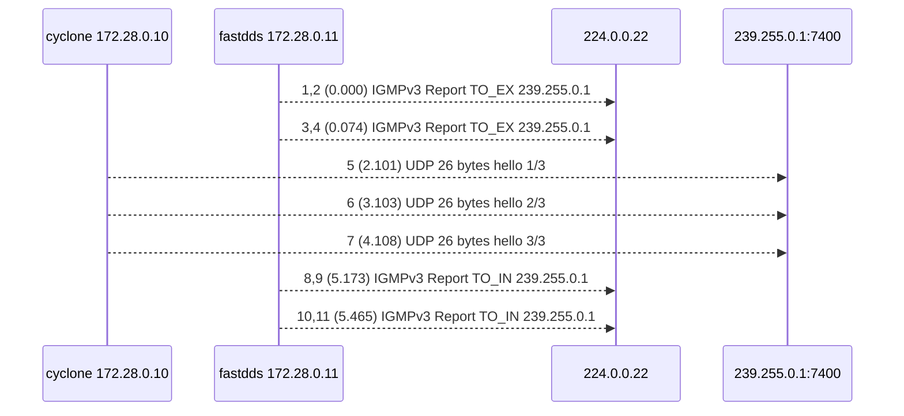
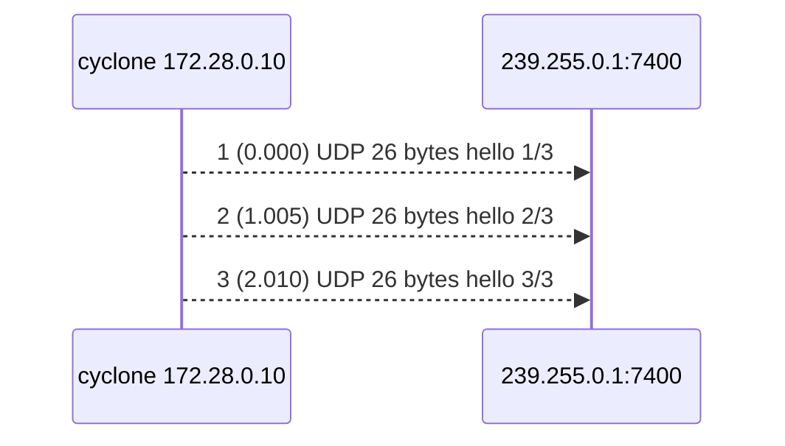

# mcast-check 캡처

DDS 없이 `mcast-check`로 두 벤더 컨테이너 사이에 멀티캐스트를 주고받은 참고 캡처다. chapter2의 lab에서 독자가 직접 만든 캡처와 비교한다.

## 공통 조건
- 2026-11-02, Docker Desktop (Mac arm64). bridge `dds-net`: `multicast_snooping=1`, `multicast_querier=0`.
- 주소: cyclone 172.28.0.10, fastdds 172.28.0.11. 그룹 239.255.0.1, 포트 7400.
- 도구: `tools/mcast-check` (이미지 `mdds/tools`)를 벤더 컨테이너의 네트워크 네임스페이스에 붙여 실행. send는 TTL 1로 1초 간격 3번.
- 캡처: 각 컨테이너 `eth0`, 필터 `igmp or udp port 7400`.
- 다시 만드는 명령 (`docker/`에서): `./capture-mcast-check.ts --force join`, `./capture-mcast-check.ts --force nojoin`

## 만든 순서
`docker/capture-mcast-check.ts`가 아래 순서와 간격으로 명령을 실행한다. chapter2 Lab 2-1의 절차 1-5를 정해진 간격으로 자동 실행하는 것과 같다. 시각은 스크립트가 첫 명령을 실행한 때를 0초로 한 대략의 값이다 (docker 명령 자체에 걸리는 시간은 빼었다). pcap의 시각은 첫 패킷을 0초로 하므로 이 표의 시각과 다르다.

`join`
| 시각 | 절차 (Lab 2-1) | 스크립트가 실행하는 명령 | 캡처에 남는 것 |
|---|---|---|---|
| 0초 | 1. 캡처 시작 | fastdds와 cyclone에서 각각 `docker compose exec -d <컨테이너> tcpdump -i eth0 -U -Z root -w /captures/mcast-check/join.<컨테이너>.pcap 'igmp or udp port 7400'` | |
| 1초 | 2. 받기 시작 | `docker run --init --network container:<fastdds> -d --name mdds-mcast-check-recv mdds/tools mcast-check recv` | Join (pcap 0초), 1초 안에 한 번 더 |
| 3초 | 3. 보내기 | `docker run --init --rm --network container:<cyclone> mdds/tools mcast-check send` (1초 간격 3번, 약 2초 걸림) | hello 3개 (pcap 약 2.1, 3.1, 4.1초) |
| 약 6초 | 4. 받기 끝내기 | 보내기가 끝나고 1초 뒤 `docker kill -s INT mdds-mcast-check-recv` | Leave (pcap 약 5.3초), 1초 안에 한 번 더 |
| 약 9초 | 5. 캡처 끝내기 | 3초 뒤 `docker compose exec <컨테이너> pkill -INT -x tcpdump` | |

`nojoin`: 받기 (1초의 `recv`, 약 6초의 `kill`)가 없고, 캡처는 fastdds에서만 한다. 0초에 캡처를 시작하고, 1초에 보내기 (약 2초 걸림), 보내기가 끝나고 4초 뒤에 캡처를 끝낸다.

`--init`은 mcast-check가 PID 1이 되면 SIGINT로 끝나지 않는 문제를 막는다. 받기를 SIGINT로 끝내야 소켓이 닫히며 Leave가 나간다. 캡처를 끝내기 전에 3초를 기다리는 것은 Leave의 재전송 (1초 안의 무작위 시점)까지 잡기 위해서다.

## 파일
| 시나리오 | 무엇을 | 받는 쪽 | 보내는 쪽 | 캡처한 곳 |
|---|---|---|---|---|
| `join` | 가입한 쪽으로 보내기 | fastdds | cyclone | `join.fastdds.pcap` (받는 쪽), `join.cyclone.pcap` (보내는 쪽) |
| `nojoin` | 아무도 가입하지 않은 채 보내기 | 없음 | cyclone | `nojoin.fastdds.pcap` |

`join.recv.log`, `join.send.log`, `nojoin.send.log`는 mcast-check 출력이다.

## join
흐름 (`join.fastdds.pcap`, 11 프레임): IGMPv3 Join 4개 (2회 x 2), UDP 3개, IGMPv3 Leave 4개 (2회 x 2). 같은 IGMP가 두 개씩인 것은 `-Q out`과 `-Q in`에 하나씩 잡히는 것과 같다 (별도 실행으로 확인). `join.cyclone.pcap` (10 프레임)에는 IGMP가 하나씩, UDP가 두 개씩 있다.

Wireshark 필터: `igmp or udp.port == 7400`. 목적지 MAC은 UDP가 `01:00:5e:7f:00:01`, IGMP가 `01:00:5e:00:00:16`이고, TTL은 모두 1이다.

질문
- DDS 참가자가 보내는 멀티캐스트 (SPDP)도 보낸 쪽 캡처에 두 개씩 보이는가 -> chapter3
- 벤더 DDS가 SPDP에 쓰는 TTL도 1인가 -> chapter4
- 같은 컨테이너에서 여러 참가자가 7400 포트를 함께 쓸 수 있는가 -> chapter8

## nojoin
흐름 (`nojoin.fastdds.pcap`, 3 프레임): UDP 3개. IGMP는 없다. fastdds는 그룹에 가입하지 않았지만 패킷이 `eth0`까지 왔다.

질문
- 물리 스위치 (snooping과 querier가 있는 장비)에서도 가입자 없는 그룹이 모든 포트로 가는가 -> chapter20
