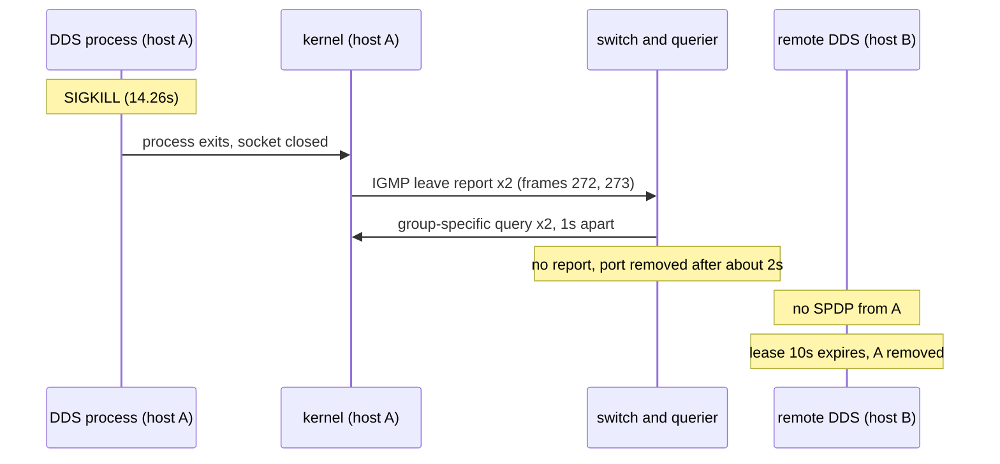
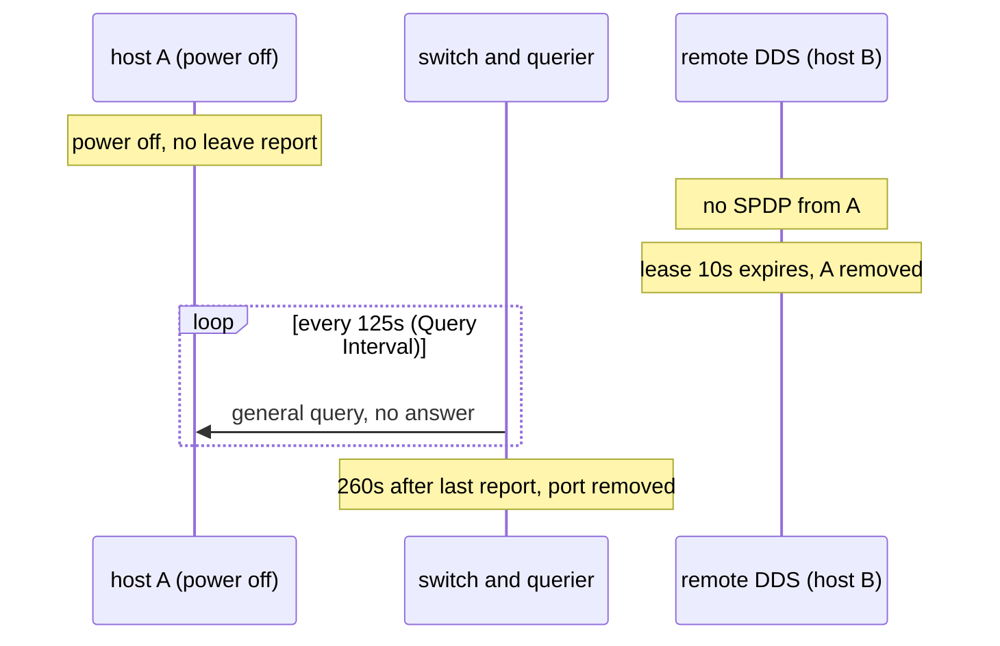

# 조사 노트: DDS 트래픽이 네트워크 장비에 남기는 상태

[roadmap](../roadmap.md) | 함께 보기: [discovery-scaling.md](discovery-scaling.md), [docker-network.md](../../docs/environment/docker-network.md#멀티캐스트가-컨테이너-사이를-넘어가는-원리) | 사용처: 미정 (book에 넣을지는 나중에 결정)

확인일: 2026-10-30. 표기는 [middleware-comparison.md](middleware-comparison.md)와 같다: [확인] / [추정] / [벤더 주장] / [3rd] / (재확인). [추론]은 규격과 관찰에서 저자가 이끌어 낸 것이다. [R1] 같은 번호는 8절 출처 표를 가리킨다.

질문: DDS 디스커버리 (SPDP 멀티캐스트, SEDP와 사용자 데이터 유니캐스트)가 스위치, 라우터, Wi-Fi AP, NAT / 방화벽, 호스트 커널에 어떤 상태를 만들고, 참가자가 정리 없이 사라지면 그 상태가 얼마나 남는가.

---

## 1. 요약
- **장비마다 상태를 만든다.** 스위치는 MAC table과 IGMP snooping table, 라우터와 호스트는 neighbor (ARP) table, NAT / 방화벽은 UDP conntrack (connection tracking) entry, Wi-Fi AP는 단말별 가입 정보와 DTIM 버퍼를 둔다. hub (repeater)는 물리 계층 장치라 상태가 없다. [추정, hub]
- **DDS의 수명과 네트워크 상태의 수명이 다르다.** DDS는 상대가 사라졌음을 lease (Cyclone 10초, Fast DDS 20초)로 알지만, 스위치의 IGMP 가입 정보는 IGMP 기본값으로 260초까지 남을 수 있다. 서로 상대의 정리 시점을 모른다 (2.2절 그림). [추론]
- **프로세스가 죽는 것과 호스트가 사라지는 것은 다르다.** 이 저장소의 lease-expiry 캡처에서 Cyclone 프로세스를 SIGKILL로 죽였는데도 IGMP leave report가 나갔다. 커널이 소켓을 닫으면서 그룹을 떠나는 것으로 보인다 [추정]. 그래서 오래 남는 상태는 주로 호스트 전원이 꺼지거나 링크가 끊길 때 생긴다 (3절 그림). [추론]
- **멀티캐스트 TTL이 벤더마다 다르다.** 이 저장소의 캡처에서 SPDP 멀티캐스트의 IP TTL은 Cyclone DDS가 32, Fast DDS가 1이었다. 문서상 기본값도 같다 (Cyclone 32 [R7], RTI 1 [R8]). 보통의 LAN에서는 라우터가 멀티캐스트를 라우팅하지 않으므로 어느 쪽이든 서브넷을 벗어나지 않는다. [확인, 캡처와 문서]

## 2. 한눈에 보기

### 2.1 어디에 어떤 상태가 남는가
괄호 안은 Linux와 RFC 기본값 기준의 수명이다. 장비마다 다를 수 있다.

```
 +------------------------+                           +------------------------+
 | host A: DDS            |                           | host C: DDS (Wi-Fi)    |
 |  kernel: group join,   |                           |                        |
 |  neighbor (60s)        |                           +-----------+------------+
 +-----------+------------+                                       |
             |                                        +-----------+------------+
             |                                        | Wi-Fi AP               |
             |                                        |  DTIM buffer,          |
             |                                        |  per-station join      |
             |                                        |  (multicast->unicast)  |
             |                                        +-----------+------------+
             |                                                    |
 +-----------+----------------------------------------------------+------------+
 | switch                                                                      |
 |  MAC address table (FDB)  (300s)                                            |
 |  IGMP snooping table      (260s, a few s after leave)                       |
 +-----------+----------------------------------------------------+------------+
             |                                                    |
 +-----------+------------+                           +-----------+------------+
 | host B: DDS            |                           | router / NAT / firewall|
 |  kernel: group join,   |                           |  neighbor (60s)        |
 |  neighbor (60s)        |                           |  conntrack entry       |
 +------------------------+                           |  (30s / 120s)          |
                                                      |  mcast routing: off    |
                                                      +------------------------+

 hub (repeater): no state. every frame goes to every port.
```

### 2.2 수명 비교
참가자가 0초에 사라졌을 때 각 상태가 정리되기까지의 최대 시간 (기본값). DDS 쪽은 상대 참가자의 lease다.

```mermaid
gantt
    title Lifetime after a participant disappears (seconds, defaults)
    dateFormat X
    axisFormat %s
    section DDS
    Cyclone lease 10s           :0, 10
    Fast DDS lease 20s          :0, 20
    section Host and router
    neighbor stale 60s          :0, 60
    section NAT and firewall
    conntrack one-way 30s       :0, 30
    conntrack two-way 120s      :0, 120
    section Switch
    IGMP after leave 2s         :0, 2
    IGMP membership 260s        :0, 260
    MAC table 300s              :0, 300
```



- 근거: DDS lease는 [chapter3 노트의 시나리오 표](../notes/03-first-communication.md#시나리오-표), neighbor는 [R5], conntrack은 [R6], IGMP는 [R3] [R4], MAC table은 [R1].
- IGMP의 2초는 leave를 받은 뒤 querier가 group-specific query를 1초 간격으로 2번 보내고 정리할 때다 [R4]. leave 없이 사라지면 260초 쪽이다.

### 2.3 요약 표

| 장비 | 남는 상태 | 만드는 DDS 트래픽 | 수명 (기본값) | 참가자가 정리 없이 사라지면 |
|---|---|---|---|---|
| hub | 없음 | - | - | 영향 없음 |
| 스위치 | MAC address table (FDB) | 모든 프레임 | 300초 [R1] | entry가 남다가 만료. 영향 작음 |
| 스위치 | IGMP snooping table | 가입할 때의 IGMP report | 260초 [R3], leave 뒤 몇 초 [R4] | 호스트가 사라지면 최대 약 260초 그 포트로 SPDP가 나감. querier가 없으면 장비마다 다름 |
| 라우터 | 멀티캐스트 라우팅 (켰을 때만), neighbor table | 유니캐스트 상대 | neighbor stale 60초 [R5] | 보통 LAN에서는 SPDP가 서브넷을 넘지 않음 |
| NAT / 방화벽 | conntrack entry | 참가자 쌍마다 flow | 30초 / 120초 [R6] | timeout으로 사라짐. locator 안의 사설 주소는 구조적 문제 |
| Wi-Fi AP | 단말 가입 (기능이 있을 때), DTIM 버퍼 | SPDP 멀티캐스트 | 장비마다 다름 | 멀티캐스트 airtime 소모가 계속됨 |
| 호스트 커널 | 그룹 가입, neighbor table, 소켓 버퍼 | 소켓 가입 | 소켓을 닫으면 해제 | 프로세스가 죽으면 커널이 정리. 호스트가 꺼지면 leave가 안 나감 |

## 3. 프로세스가 죽을 때와 호스트가 사라질 때

### 3.1 프로세스가 죽을 때 (lease-expiry 캡처에서 관찰)



- 프레임 번호와 시각은 [캡처 README의 lease-expiry](../../captures/cyclone-fastdds/README.md#lease-expiry)다. leave report는 관찰했고 [확인], 커널이 보낸다는 것은 [추정]이다. querier의 query는 이 환경에 querier가 없어 캡처에 없으며 RFC의 동작이다 [R4].
- 네트워크 쪽은 몇 초 안에 정리되고, DDS 쪽이 lease로 더 늦게 정리된다.

### 3.2 호스트가 사라질 때 (전원 차단, 링크 단절) [추론]



- 이번에는 DDS 쪽이 먼저 정리되고, 스위치는 Group Membership Interval (260초)이 지나야 정리한다 [R3]. 그동안 그 포트로 SPDP 멀티캐스트가 계속 나간다.

## 4. 이 저장소의 캡처에서 본 것
`captures/cyclone-fastdds/` (구독자 컨테이너 eth0에서 캡처, IGMP 포함)

| 관찰 | 값 | 확인 |
|---|---|---|
| IGMPv3 report 수 | 캡처마다 12개. 시작할 때 참가자마다 "Change To Exclude" (join) 2번, 끝날 때 "Change To Include" (leave) 2번. 2번인 것은 RFC 3376 Robustness Variable 기본값 2 [R3] | [확인] |
| SIGKILL 뒤 leave | lease-expiry: 마지막 RTPS 패킷 14.26초, Cyclone 쪽 leave report 14.30초와 15.09초 (프레임 272, 273) | [확인], 원인은 [추정] |
| SPDP 멀티캐스트 TTL | Cyclone (172.28.0.10) 32, Fast DDS (172.28.0.11) 1. reliable-cyclone-pub, lease-expiry 같음 | [확인] |
| 유니캐스트 UDP flow | 참가자 2개 (reliable-cyclone-pub)에서 3개: Cyclone -> Fast DDS 7410 (메타 트래픽), Cyclone -> Fast DDS 7411 (사용자 데이터), Fast DDS -> Cyclone 임의 포트 | [확인] |

- 7410, 7411은 RTPS 2.5 Sec. 9.6.2.1의 기본 포트 공식 (PB 7400 + DG 250 x domainId + d1 10 + PG 2 x participantId, 사용자 데이터는 d3 11)에서 domain 0, participantId 0일 때의 값이다 [R12]. (재확인)
- SIGKILL 뒤 leave를 누가 보내는지는 캡처 README에 "누가 보내나? -> chapter8" 질문으로 남아 있다.

## 5. 장비별 상세
각 장비는 2.3절 표와 같은 네 줄 (남는 상태, 만드는 DDS 트래픽, 수명, 참가자가 사라지면)로 시작하고, 그 아래에 근거를 둔다.

### hub (repeater)
- **남는 상태**: 없음
- **만드는 DDS 트래픽**: -
- **수명**: -
- **참가자가 사라지면**: 영향 없음
- 근거: 받은 신호를 모든 포트로 다시 내보내는 물리 계층 장치다. 멀티캐스트든 유니캐스트든 모든 호스트가 받고, 각 NIC가 목적지 MAC으로 걸러 버린다. [추정, IEEE 802.3 원문 미확인]

### 스위치
- **남는 상태**: MAC address table (FDB), IGMP snooping table
- **만드는 DDS 트래픽**: FDB는 SPDP를 포함한 모든 프레임, snooping table은 SPDP 그룹 (239.255.0.1)에 가입할 때의 IGMP report
- **수명**: FDB 300초 (Linux bridge) [R1], snooping 260초, leave 뒤 몇 초 [R3] [R4]
- **참가자가 사라지면**: 호스트째 사라지면 최대 약 260초 그 포트로 SPDP가 계속 나간다 (3.2절)
- 근거
  - FDB는 프레임의 보낸 쪽 MAC과 들어온 포트를 기록한다. 상용 스위치 기본값은 확인하지 않았다. [확인, 조사 결과]
  - snooping table은 그룹마다 가입한 포트를 기록해 그 포트로만 멀티캐스트를 보낸다 [R2 Sec. 2.1.2]. 239.255.0.1은 항상 모든 포트로 보내는 224.0.0.x 예외 대역이 아니므로 snooping 대상이다. [확인, 조사 결과]
  - RFC 4541은 스위치가 leave 메시지에만 기대지 말고 membership timeout을 구현하라고 하고, 그 값을 설정할 수 있게 하라고 한다 [R2 Sec. 2.1.1]. (재확인)
  - 그 timeout의 기준이 되는 IGMP 기본값: Robustness Variable 2, Query Interval 125초, Query Response Interval 10초. Group Membership Interval은 Robustness x Query Interval + Query Response Interval = 260초 [R3 Sec. 8.1-8.4]. (재확인)
- **querier가 없을 때**: snooping table은 querier의 query에 대한 report로 갱신된다. querier가 없으면 가입할 때의 report 말고는 갱신이 없다. 이때 entry가 만료되어 멀티캐스트가 끊기는 구현과, 반대로 모든 포트로 flooding하는 구현이 있어 장비마다 다르다. [벤더 주장, 상충]
  - Linux bridge 기본값은 `multicast_snooping` 1, `multicast_querier` 0이다 [R1]. 이 저장소의 Docker Desktop bridge도 같은 설정이었고, 아무도 가입하지 않은 그룹의 패킷을 모든 포트로 flooding했다 ([docker-network.md](../../docs/environment/docker-network.md#멀티캐스트가-컨테이너-사이를-넘어가는-원리)). [확인, 관찰]
  - DDS 영향 [추론]: 만료 후 끊기는 구현이면, 처음에는 서로 찾다가 수 분 뒤 SPDP가 끊기는 이상한 증상이 생길 수 있다. flooding하는 구현이면 snooping을 끈 것과 같다.

### 라우터
- **남는 상태**: neighbor (ARP) table, 멀티캐스트 라우팅 상태 ((*,G), (S,G))는 켰을 때만
- **만드는 DDS 트래픽**: 유니캐스트 상대 (SEDP, 사용자 데이터)
- **수명**: neighbor stale 60초 (Linux `gc_stale_time`) [R5]
- **참가자가 사라지면**: neighbor entry가 stale이 되었다가 정리된다. 보통 LAN에서는 SPDP가 서브넷을 넘지 않으므로 멀티캐스트 상태가 없다
- 근거
  - Linux의 `mc_forwarding`은 기본 꺼짐이다 [R5]. 일반 라우터도 멀티캐스트 라우팅을 따로 켜야 한다. [추정, 일반 라우터]
  - TTL은 라우터를 몇 개 지날 수 있는지다. Fast DDS와 RTI의 1은 라우터를 넘지 못한다는 뜻이고, Cyclone의 32는 TTL로는 막지 않는다는 뜻이다. 실제로 넘어가려면 라우터가 멀티캐스트를 라우팅해야 한다. [확인, 캡처와 R7, R8] [추론, 의미]
  - neighbor entry 수 상한 `gc_thresh3` 기본 1024 [R5]. 참가자가 많은 서브넷에서는 이 상한에 닿을 수 있다. [추론]

### NAT / 상태 기반 방화벽
- **남는 상태**: conntrack entry
- **만드는 DDS 트래픽**: 참가자 쌍마다 방향별 메타 트래픽 flow와 사용자 데이터 flow. flow 수가 대략 N x (N - 1)에 비례 [추론]
- **수명**: 한 방향만 본 flow 30초, 양방향 flow 120초 (Linux) [R6]
- **참가자가 사라지면**: entry는 timeout으로 저절로 사라진다
- 근거
  - **conntrack**은 connection tracking의 줄임으로, Linux netfilter가 지나가는 연결 (UDP는 연결이 없으므로 보내는 주소:포트와 받는 주소:포트의 짝, 즉 flow)을 하나씩 기억하는 기능이다. 그 기록 하나가 conntrack entry다. 상태 기반 방화벽은 이 entry로 "먼저 나간 요청에 대한 응답"만 들여보내고, NAT는 주소를 어떻게 바꿨는지를 이 entry에 적어 돌아오는 패킷을 되돌린다. [확인, R6] [추정, 설명]
  - 더 큰 문제는 구조다. SPDP와 SEDP 데이터 안에 "나에게는 이 주소:포트로 보내라"는 locator가 들어 있어, NAT 뒤 참가자의 사설 주소를 상대가 그대로 쓰다가 실패한다. 멀티캐스트도 NAT를 넘지 못한다. [추론, 원문 인용 없음]
  - 같은 Docker user-defined bridge 안의 컨테이너끼리는 L2로 전달된다. bridge-nf-call-iptables가 켜져 있으면 iptables (conntrack)를 거친다. [추정]

### Wi-Fi AP
- **남는 상태**: 절전 단말을 위한 DTIM 버퍼, 단말별 가입 정보 (IGMP snooping 기능이 있을 때)
- **만드는 DDS 트래픽**: SPDP 멀티캐스트
- **수명**: 장비마다 다름
- **참가자가 사라지면**: 받는 단말이 없어도 멀티캐스트 airtime 소모가 계속된다
- 근거
  - 멀티캐스트와 브로드캐스트는 가장 낮은 기본 속도로 보내고, ACK와 재전송이 없으며, 절전 중인 단말을 위해 AP가 모아 두었다가 DTIM beacon 뒤에 보낸다. [벤더 주장, IEEE 802.11 원문 미확인]
  - 일부 AP는 IGMP snooping으로 단말별 가입을 기억해 멀티캐스트를 단말별 유니캐스트로 바꿔 보낸다 (Aruba Dynamic Multicast Optimization [R9], Linux bridge 포트의 `multicast_to_unicast`). 유니캐스트라 재전송이 되지만, 가입 단말 수만큼 복제된다. [벤더 주장]
  - 현장 보고 (정량 근거 아님)
    - "Unconfigured DDS considered harmful to Networks" (2022-05-20) [R10]: 설정하지 않은 ROS 2가 유선과 무선 네트워크를 멀티캐스트로 느리게 만든다는 보고와 토론. 작성자 스스로 나중에 "destructive"는 과장이었다고 했고, 멀티캐스트를 내던 기기를 뽑자 복구되었다고 했다. [확인, 조사 결과]
    - "ROS2 WIFI Multicast Multi Robot and IGMP Snooping" (2022-11-25) [R11]: 드론 여러 대를 Wi-Fi로 붙였을 때 세 번째 드론부터 데이터가 끊겼고, IGMP snooping을 켠 공유기로 바꾸자 대부분 해결되었다는 보고. [확인, 조사 결과]

### 호스트 커널
- **남는 상태**: 인터페이스의 그룹 가입 목록 (`ip maddr`), neighbor table, 소켓 버퍼
- **만드는 DDS 트래픽**: 소켓이 SPDP 그룹에 가입할 때 IGMP report를 보낸다
- **수명**: 소켓을 닫으면 가입이 해제된다
- **참가자가 사라지면**: 프로세스가 죽으면 커널이 정리하고 leave report를 보낸다 (3.1절). 호스트가 꺼지면 leave가 나가지 않는다 (3.2절)
- 근거
  - 소켓이 닫히면 가입이 해제되고, 그 그룹을 쓰는 다른 소켓이 없으면 leave report를 보낸다. [추정, man page 미확인] 4절의 SIGKILL 관찰과 맞는다.
  - 소켓 하나가 가입할 수 있는 그룹 수 상한 `igmp_max_memberships` 기본 20 [R5]. [확인, 조사 결과]

## 6. book에 넣는다면 (결정은 나중에)
- chapter2 (멀티캐스트)의 lab: IGMP join과 leave report를 캡처에서 찾는 것, querier가 없는 Docker bridge가 모든 포트로 flooding하는 것 (`captures/mcast-check/nojoin.fastdds.pcap`)은 chapter2 Lab 2-1, 2-2에 반영했다. SIGKILL 뒤에도 leave가 나가는 것은 반영하지 않았다 (DDS 프로세스를 다루는 chapter4나 9의 후보).
- chapter4 (같은 규격 다른 구현): SPDP 멀티캐스트 TTL이 벤더마다 다르다 (32 / 1).
- chapter9 (SPDP): lease와 네트워크 장비 timeout의 수명 차이 (2.2절과 3절 그림).

## 7. 확인하지 못한 것
- 프로세스가 죽을 때 커널이 leave report를 보내는 경로 (Linux 소스나 man page로 확인).
- IEEE 802.11의 group addressed frame과 DTIM 규칙 원문.
- querier가 없을 때 상용 스위치들의 동작과, 벤더가 querier를 두라고 권하는 공식 문구.
- Fast DDS 문서상의 멀티캐스트 TTL 기본값 (캡처로는 1을 관찰).

## 8. 출처

| 번호 | 문서 | 확인 수준 |
|---|---|---|
| R1 | Linux kernel, Ethernet Bridging: https://www.kernel.org/doc/html/latest/networking/bridge.html | [확인, 조사 결과] |
| R2 | RFC 4541, IGMP and MLD Snooping Switches: https://www.rfc-editor.org/rfc/rfc4541.txt | (재확인) |
| R3 | RFC 3376, IGMPv3: https://www.rfc-editor.org/rfc/rfc3376.txt | (재확인) |
| R4 | RFC 2236, IGMPv2: https://www.rfc-editor.org/rfc/rfc2236.txt | [확인, 조사 결과] |
| R5 | Linux kernel, IP sysctl: https://www.kernel.org/doc/html/latest/networking/ip-sysctl.html | [확인, 조사 결과] |
| R6 | Linux kernel, Netfilter conntrack sysctl: https://www.kernel.org/doc/html/latest/networking/nf_conntrack-sysctl.html | [확인, 조사 결과] |
| R7 | Cyclone DDS configuration reference (`General/MulticastTimeToLive`): https://cyclonedds.io/docs/cyclonedds/latest/config/config_file_reference.html | [확인, 조사 결과] |
| R8 | RTI, How do I change multicast TTL: https://community.rti.com/kb/how-do-i-change-multicast-time-live-ttl | [확인, 조사 결과] |
| R9 | Aruba, Dynamic Multicast Optimization: https://arubanetworking.hpe.com/techdocs/aos/aos10/design/bc-mc/dyn-mc-optimisation/ | [벤더 주장] |
| R10 | ROS Discourse, Unconfigured DDS considered harmful to Networks: https://discourse.openrobotics.org/t/unconfigured-dds-considered-harmful-to-networks/25689 | [확인, 조사 결과] |
| R11 | ROS Discourse, ROS2 WIFI Multicast Multi Robot and IGMP Snooping: https://discourse.openrobotics.org/t/ros2-wifi-multicast-multi-robot-and-igmp-snooping/28516 | [확인, 조사 결과] |
| R12 | DDSI-RTPS 2.5 Sec. 9.6.2.1 (`omg-specs/ddsi-rtps-2.5.pdf`) | (재확인) |
