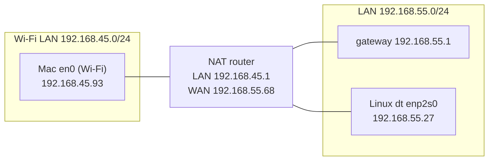

# 조사 노트: Linux 시험 호스트 (192.168.55.27)와 Mac 사이의 네트워크

[roadmap](../roadmap.md) | 함께 보기: [docker-network.md](../../docs/environment/docker-network.md), [discovery-network-state.md](discovery-network-state.md) | 사용처: 미정 (book에 넣을지는 나중에 결정)

확인일: 2026-11-01. 표기: [확인]은 아래 명령의 출력으로 확인한 것, [추정]은 출력에서 저자가 이끌어 낸 것이다.

질문: 작업용 Mac과 Linux 호스트 192.168.55.27 (ssh 별칭 `dt`)을 연동해 멀티캐스트와 DDS를 시험하려면, 두 호스트 사이의 네트워크가 어떻게 되어 있는가. 특히 멀티캐스트가 오가는지, querier가 있는지.

---

## 1. 요약
- **두 호스트는 다른 서브넷에 있고, 사이에 NAT 공유기가 있다.** Mac은 Wi-Fi (192.168.45.0/24)에 있고, 그 공유기 (192.168.45.1)의 바깥 주소 192.168.55.68이 Linux와 같은 LAN (192.168.55.0/24)에 있다. Linux에서 본 Mac의 주소는 192.168.55.68이다. [확인]
- **멀티캐스트는 어느 방향으로도 넘어가지 않는다.** TTL 1과 32로 239.255.0.1:7400에 보내 보았고, 양쪽 모두 0개를 받았다. [확인]
- **유니캐스트는 Mac -> Linux만 된다.** Mac에서 Linux의 UDP 7410으로 보낸 패킷은 도착했다 (출발지가 192.168.55.68로 바뀌어). Linux -> Mac은 Linux가 192.168.45.0/24로 가는 경로를 모르고 (기본 게이트웨이 192.168.55.1로 간다), NAT가 먼저 열지 않은 수신을 막으므로 되지 않는다. [확인, Mac -> Linux] [추정, Linux -> Mac]
- **두 네트워크 모두 IGMP querier가 있다.** Mac 쪽 Wi-Fi 네트워크는 IGMPv1/v2 General Query가 125초 간격으로 왔다. Linux 쪽 LAN은 커널이 IGMPv2 querier를 감지한 상태 (`/proc/net/igmp`의 `V2`)이고, Query로 보이는 응답 타이머가 125초 간격으로 걸렸다. [확인]
- **그래서 지금 구성 그대로는 Mac과 Linux 사이에 DDS 디스커버리가 되지 않는다.** SPDP 멀티캐스트가 넘어가지 않고, 유니캐스트도 한 방향뿐이다. 연동하려면 Mac을 Linux와 같은 LAN에 두어야 한다 (4절). [추정]

## 2. 구성

선은 같은 L2 네트워크 안의 연결이다. NAT router의 WAN 포트와 Linux는 같은 LAN에 있지만, 그 LAN 안에서 스위치를 어떻게 거치는지는 확인하지 않았다.

| 항목 | Mac | Linux (dt) |
|---|---|---|
| OS | macOS (Darwin 27.0.0) | Ubuntu 24.04.4 LTS, 커널 7.0.0-34-generic, x86_64 |
| 인터페이스 | en0 Wi-Fi 192.168.45.93/24 | enp2s0 (r8169, 1000Mb/s Full) 192.168.55.27/24 (DHCP) |
| 기본 게이트웨이 | 192.168.45.1 (MAC 0c:96:cd:09:85:07) | 192.168.55.1 (MAC 04:09:a5:21:5d:d9) |
| IGMP | 기본 버전 3 (`net.inet.igmp.default_version`) | enp2s0이 IGMPv2 호환 모드 (querier가 v2) |
| 방화벽 | 꺼짐 (`socketfilterfw --getglobalstate`) | UFW 켜짐, 기본 정책 INPUT DROP. 규칙 파일은 root만 읽을 수 있어 내용 미확인 |
| Docker | Docker Desktop | Docker Engine 29.1.3, 사용자 `daniel`이 `docker` 그룹. 이미지 없음, 기본 네트워크만 있음 |
| 권한 | - | `sudo`에 암호 필요 (비대화형으로는 쓸 수 없음) |

## 3. 조사 과정과 결과
모두 Mac에서 실행했다. Linux 쪽은 `ssh dt`로 실행했다. root 권한이 필요한 캡처 (tcpdump)는 쓰지 않고, 일반 사용자가 읽을 수 있는 정보로 판단했다.

### 3.1 경로와 NAT
- `ping 192.168.55.27`: 응답 TTL 63, 왕복 약 4-5 ms. Linux의 기본 TTL 64에서 하나 줄었으므로 라우터 하나를 거친다. [확인]
- `traceroute -n 192.168.55.27`: 1 hop 192.168.45.1, 2 hop 192.168.55.27. [확인]
- Linux에서 `echo $SSH_CLIENT`: `192.168.55.68 ...`. Mac의 주소 (192.168.45.93)가 아니라 공유기의 바깥 주소로 보인다. 192.168.45.1은 NAT 공유기다. [확인]
- Linux에서 `ip route get 192.168.45.93`: `via 192.168.55.1`. Linux는 Mac의 네트워크로 가는 경로를 192.168.55.1 (NAT 공유기가 아님)로 보낸다. [확인]

### 3.2 멀티캐스트
시험 스크립트는 Python 표준 라이브러리만 쓴다 (239.255.0.1:7400, `IP_ADD_MEMBERSHIP`, `IP_MULTICAST_TTL`, `IP_MULTICAST_IF`). 받는 쪽은 8초 동안 기다렸다.

| 보내는 쪽 | 받는 쪽 | TTL 1 | TTL 32 |
|---|---|---|---|
| Linux (enp2s0) | Mac (en0) | 0 / 3 | 0 / 3 |
| Mac (en0) | Linux (enp2s0) | 0 / 3 | 0 / 3 |
| Mac | Mac 자신 (같은 호스트) | 받음 | - |
| Linux | Linux 자신 (같은 호스트) | 받음 | - |

- 같은 호스트 시험으로 스크립트와 각 호스트의 수신 설정이 동작함을 확인했다. [확인]
- TTL 32로도 넘어가지 않으므로, 공유기가 멀티캐스트를 라우팅하지 않는다. [확인]
- Mac -> Linux 방향은 UFW가 막았을 가능성도 남는다. 다만 공유기를 넘지 못하므로 결과는 같다. [추정]
- Mac 쪽에서 같은 호스트 시험의 패킷이 두 번씩 들어왔다 (2개 보내고 4개 받음). 원인은 조사하지 않았다.

### 3.3 유니캐스트
- Mac에서 Linux의 UDP 7410으로 3개 보냄 -> Linux가 받음, 출발지 `192.168.55.68`. UFW 기본 정책이 INPUT DROP인데 받았으므로, 이 패킷을 허용하는 규칙이 있다 (규칙 내용은 미확인). [확인]
- Linux -> Mac은 시험하지 않았다. 3.1의 경로와 NAT 때문에 Linux가 먼저 보내는 패킷은 Mac에 닿지 않는다. [추정]

### 3.4 querier
- **Mac 쪽 (Wi-Fi LAN):** `netstat -s -p igmp`의 `general queries received`를 1초마다 300초 동안 읽었다. 시작 후 55초와 180초에 1씩 늘었다 (간격 125초). 누적값은 `4245 V1/V2 membership queries received`, `0 V3 membership queries received`. 이 네트워크의 querier는 IGMPv1 또는 v2로 125초마다 General Query를 보낸다. [확인]
- **Linux 쪽 (LAN):** `/proc/net/igmp`에서 enp2s0의 querier 버전이 `V2`다. lo와 docker0은 `V3`이다. Linux 커널은 IGMPv2 Query를 받으면 그 인터페이스를 v2 호환 모드로 바꾸므로, 이 LAN에 IGMPv2 querier가 있다. [확인]
- **Linux 쪽 간격:** `/proc/net/igmp`를 0.1초마다 300초 동안 읽어, enp2s0의 그룹에 응답 타이머 (`Timer`가 `1:`로 시작)가 걸리는 순간을 기록했다. 34.5초, 53.3초, 109.1초, 234.2초. 마지막 간격이 125초다. [확인]
  - 앞의 짧은 간격들은 이 Linux가 시험 직전 (약 3분 전)에 부팅되어 생긴 것으로 보인다. 부팅 직후의 가입 Report 재전송도 같은 타이머를 쓰므로, 모든 타이머가 Query 때문인지는 이 방법으로 가를 수 없다. [추정]
- querier의 주소는 확인하지 않았다. Query 패킷을 보려면 root 권한의 캡처가 필요하다. 각 LAN의 게이트웨이 (192.168.45.1, 192.168.55.1)일 가능성이 크다. [추정]

## 4. 연동 시험에 주는 의미
- **Mac과 Linux 사이 DDS 디스커버리는 지금 구성으로는 되지 않는다.** SPDP 멀티캐스트가 공유기를 넘지 못한다. 유니캐스트 peer를 설정해도 Linux -> Mac 방향이 NAT에 막힌다. [추정]
- **Mac의 Docker Desktop 컨테이너는 원래 LAN과 멀티캐스트를 주고받지 못한다.** 컨테이너 트래픽은 Docker Desktop VM 안에 머문다 ([docker-network.md](../../docs/environment/docker-network.md#멀티캐스트가-컨테이너-사이를-넘어가는-원리)). Mac과 연동하려면 Mac에서 DDS를 컨테이너 밖 (네이티브)으로 실행해야 한다.
- **연동하려면 Mac을 192.168.55.0/24에 둔다.** 예: Mac을 유선으로 그 LAN에 연결하거나, 그 LAN의 Wi-Fi에 연결한다. 그러면 NAT 없이 같은 서브넷이 되어 TTL 1 멀티캐스트도 오간다. [추정, 미시험]
- **querier가 있는 환경의 시험은 Linux만으로도 할 수 있다.** Linux의 LAN에는 IGMPv2 querier가 있다. chapter2 노트의 "확인할 것" (querier가 있을 때 Lab 2-2의 결과)을 시험할 후보다. 다만 Linux의 Docker 기본 bridge는 LAN과 다른 L2라서 LAN querier의 Query가 닿지 않는다. LAN의 querier와 스위치를 시험하려면 컨테이너를 macvlan 네트워크나 `--network host`로 실행해 LAN에 직접 붙여야 한다. [추정]
- **querier가 IGMPv2다.** 그 LAN의 호스트는 v2 호환 모드로 Report를 보낸다. chapter2에서 본 IGMPv3 Report (224.0.0.22, TO_EX / TO_IN)와 달리, 호스트는 들은 General Query의 버전에 맞춰 v2 호환 모드로 동작하고 (RFC 3376 Sec. 7.2.1), v2 Report는 그룹 주소로, 탈퇴는 Leave Group 메시지로 224.0.0.2에 보낸다 (RFC 2236 Sec. 3, 9). 캡처를 비교할 때 이 차이를 고려한다. [추정, 캡처 미확인]

## 5. 확인하지 못한 것
- UFW 규칙의 내용 (`sudo ufw status verbose`가 필요하다).
- Query를 보내는 장치의 주소와 Query의 내용 (root 권한 캡처가 필요하다. `docker` 그룹 권한으로 `--network host` 컨테이너에서 tcpdump를 실행할 수도 있지만, 이미지가 없어 받아야 한다).
- 192.168.55.0/24 LAN의 스위치가 IGMP snooping을 하는지.
- Mac을 192.168.55.0/24에 직접 연결했을 때의 멀티캐스트 송수신.
