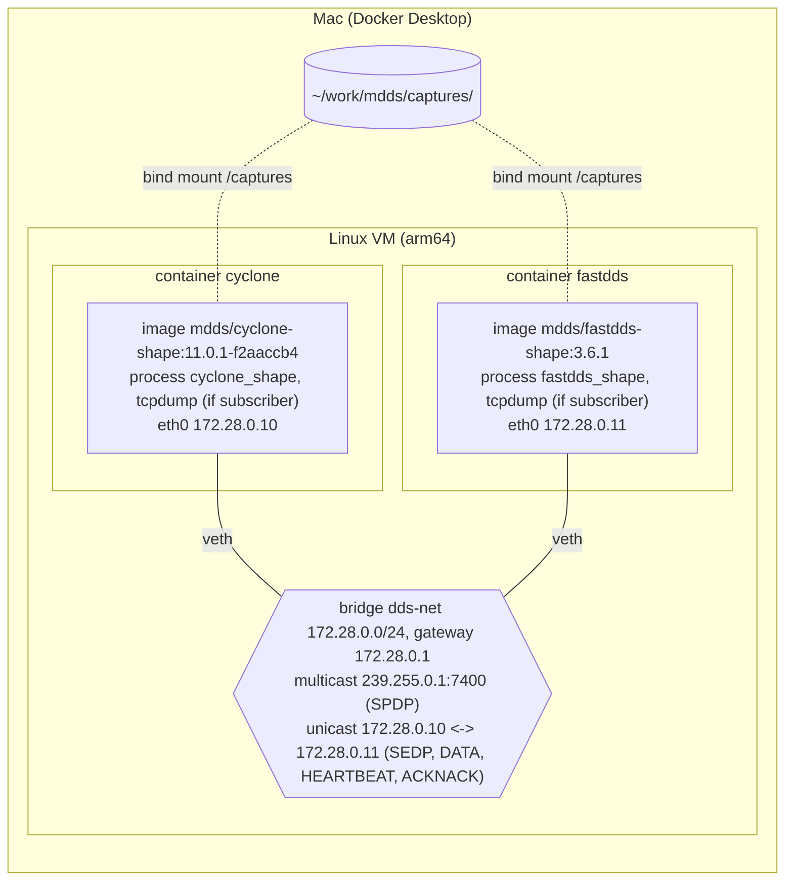

# Docker 실행 호스트와 네트워크

[roadmap](../../docs-for-agent/roadmap.md) | 사용법: [docker/README.md](../../docker/README.md) | 이미지 빌드: [vendor-build.md](vendor-build.md)

Cyclone DDS와 Fast DDS를 컨테이너로 띄우고 서로 통신시키는 환경의 설계와 원리를 정리한다. chapter 1에서 만들었고, 이후 캡처를 더 만들 때 (chapter 7, chapter 13), mdds를 세 번째 참가자로 붙여 상호운용을 시험할 때 (chapter 9, chapter 11, chapter 14 이후) 계속 쓴다. 명령어 위주의 사용법은 `docker/README.md`에 있다.

## 실행 호스트: Mac (Docker Desktop)

### 왜 Mac인가
- shape_main과 두 벤더 라이브러리를 소스에서 빌드하므로 아키텍처 제약이 없다. 같은 Dockerfile이 Apple Silicon에서 arm64로 네이티브 빌드된다.
- 편집, 빌드, 캡처, Wireshark 분석이 한 곳에서 끝난다. 별도 머신이면 ssh와 rsync 단계가 생긴다.
- 대가: Docker Desktop은 Linux VM 안에서 Docker Engine을 돌리므로 bridge도 VM 안에 있다. Mac에서는 컨테이너 사이 트래픽이 보이지 않고, VM 안 bridge가 멀티캐스트를 전달하는지는 직접 시험해야 했다. 2026-10-28 Docker Desktop (Mac arm64)에서 전달됨을 확인했다 (아래 "검증 명령").
- 아래 네트워크 설계는 어느 호스트에서나 같다. 바뀌는 것은 "누가 Docker 데몬을 돌리느냐"뿐이다.

### 구성도

점선은 바인드 마운트 (컨테이너의 `/captures`에 쓴 캡처가 Mac의 `captures/`에 바로 생긴다), 실선은 네트워크 연결 (각 컨테이너의 veth와 bridge `dds-net`)이다.

- **Docker container**: 이미지로 띄운 실행 인스턴스다. 벤더마다 하나씩, 이미지도 따로다. 각 컨테이너는 자기 네트워크 네임스페이스 (`eth0` 하나)를 가지므로 DDS 입장에서는 서로 다른 호스트 두 대다.
- **tcpdump**: 두 컨테이너에 모두 있고, 캡처는 구독자 쪽 컨테이너에서 한다 (아래 "어느 쪽에서 캡처해도 RTPS는 전부 보인다").
- **bridge 구간 (VM 안)**: 두 컨테이너의 `eth0`은 veth 쌍으로 bridge에 꽂혀 있다. SPDP 멀티캐스트와 유니캐스트가 모두 이 안에서만 돈다. Mac의 네트워크 인터페이스에는 DDS 패킷이 나오지 않는다. 바깥으로 나가는 것은 이미지 빌드 때의 GitHub clone, apt, Gradle 다운로드뿐이다.
- **캡처 경로**: 구독자 컨테이너 안의 tcpdump -> `/captures/<누가-누구>/` (바인드 마운트) -> Mac의 `~/work/mdds/captures/<누가-누구>/` -> Wireshark. 예: cyclone-fastdds 캡처는 `/captures/cyclone-fastdds/` -> `captures/cyclone-fastdds/`.

### 주의
- `~/work/mdds`가 Docker Desktop의 파일 공유 목록 (기본: `/Users`) 안에 있어야 바인드 마운트가 된다.
- 첫 빌드는 Fast DDS C++ 빌드 때문에 메모리를 많이 쓴다. 메모리 16 GB를 권장하고, 8 GB면 `--build-arg JOBS=4`로 병렬 수를 줄인다 ([vendor-build.md](vendor-build.md#빌드-결과)).
- 컨테이너 안 tcpdump는 root로 파일을 쓰지만, Docker Desktop의 파일 공유를 거치면 Mac에서는 Mac 사용자 소유로 보인다 (첫 캡처에서 확인. 따로 chown할 필요 없다).
- 호스트에서 bridge를 직접 캡처할 수 없다 (VM 안에 있다). 캡처는 항상 컨테이너 안 tcpdump로 한다.

### 선택: 별도 x86_64 Linux 머신
Mac 대신 Linux 머신의 Docker Engine을 써도 Dockerfile과 compose는 그대로다. 다른 점만 적는다.
- Docker Engine과 compose 플러그인을 설치하고 (`https://docs.docker.com/engine/install/ubuntu/`), 사용자를 `docker` 그룹에 넣는다. 저장소는 원격 git에서 clone하거나 Mac에서 `rsync -a`로 보낸다.
- ssh로 들어가 `~/work/mdds/docker`에서 같은 명령을 친다. 캡처는 머신에서 커밋하거나 `rsync -av <머신>:~/work/mdds/captures/ captures/`로 Mac에 가져온다. 한 시나리오는 한 곳에서만 커밋한다.
- pcap 파일은 머신에서 root 소유가 된다 (지울 때 `sudo`).
- Linux에서는 bridge가 호스트 커널에 바로 있어서, 디버깅 보조로 호스트에서 `br-<id>` 인터페이스를 캡처할 수 있다 (`docker network inspect dds-net`의 Id 앞 12자). 공식 절차는 어느 호스트에서나 "컨테이너 안 tcpdump"로 통일한다.
- `docker context`로 Mac에서 원격 데몬을 조작하는 방식은 쓰지 않는다. compose가 바인드 마운트 경로를 Mac 쪽 절대 경로로 풀어 보내기 때문이다.

## 네트워크 구성

### 주소 배정
| 위치 | 주소 | 비고 |
|---|---|---|
| bridge `dds-net` | 172.28.0.0/24 | 사용자 정의 bridge |
| gateway | 172.28.0.1 | VM 안. DDS 참가자 아님 |
| `cyclone` | 172.28.0.10 | 유니캐스트 포트는 임의 (아래 참고) |
| `fastdds` | 172.28.0.11 | 유니캐스트 7410 / 7411 |
| 벤더 컨테이너 추가분 | 172.28.0.12 - .19 | 예: ROS 2 이미지 (chapter 12) |
| mdds 컨테이너 | 172.28.0.20 부터 | chapter 9에서 처음 붙인다 (예정) |
| 멀티캐스트 | 239.255.0.1:7400 | SPDP (도메인 0). bridge 안에서만 |

캡처를 읽을 때 주소만 보고 어느 구현인지 알 수 있게 고정한다. 컨테이너를 다시 만들어도 주소가 같아서 캡처끼리 비교하기 쉽다.

### 설계 결정
1. **사용자 정의 bridge 네트워크를 쓴다.** 기본 `bridge`(docker0)와 달리 컨테이너 이름으로 서로를 찾을 수 있고 (`ping fastdds`), 다른 프로젝트의 컨테이너와 격리되며, compose에서 IP를 고정할 수 있다. 멀티캐스트는 같은 bridge 안에서만 돈다.
2. **포트를 publish하지 않는다 (`ports:` 없음).** 통신은 컨테이너끼리만 한다. 호스트는 이 네트워크에 참여하지 않으며, `-p 7400:7400` 같은 설정은 쓸모가 없고 오해만 만든다.
3. **`network_mode: host`를 쓰지 않는다.** 두 컨테이너가 호스트 네임스페이스를 공유하면 "한 호스트 안의 두 프로세스"가 되어 participantId가 0, 1로 갈리고 포트도 달라진다. 두 호스트 사이 통신이라는 관찰 목적과 멀어진다.
4. **캡처는 컨테이너 안에서 한다.** 호스트가 Linux든 Mac이든 같은 절차로 재현되게 하기 위해서다.
5. **이미지와 컨테이너를 벤더마다 나눈다.** "컨테이너 = 벤더"가 되어 헷갈리지 않고, 한쪽만 다시 빌드할 수 있다. 대가로 베이스 이미지와 shape_main 소스 커밋을 두 Dockerfile에 같은 값으로 유지해야 한다.

### 검토한 다른 방식
일반적인 Docker 동작에 근거한 비교다. Mac에서 직접 시험하지 않은 항목은 [미확인]으로 둔다.

| 방식 | 두 호스트처럼 보임 | 멀티캐스트 | 판단 |
|---|---|---|---|
| 사용자 정의 bridge | O | O | **채택** |
| 기본 bridge (docker0) | O | O | DNS 없음, IP 고정 불가, 다른 컨테이너와 섞임. 이점 없음 |
| host (`network_mode: host`) | X | O (실제 NIC로 샘) | participantId와 포트가 갈림. Docker Desktop에서는 4.34부터 선택 기능이고 Mac이 아니라 VM에 붙음 [미확인] |
| 네임스페이스 공유 (`network_mode: "service:x"`) | X | - | IP 하나를 공유. 통신용이 아니라 캡처 전용 사이드카를 붙일 때 쓸 만함 |
| macvlan / ipvlan L2 | O | O | 컨테이너가 LAN의 실제 장비처럼 보임. 실제 장비와 시험할 때 후보 (Linux 호스트). Docker Desktop에서는 VM 안에 갇힘 [미확인]. 호스트 자신과 통신 불가, NIC promiscuous 모드 필요 |
| ipvlan L3 | O | X | 라우팅이라 멀티캐스트가 넘어가지 않음 |
| overlay (Swarm) | O | X | 여러 머신용. 기본 드라이버가 멀티캐스트를 지원하지 않아 SPDP 기본 발견이 안 됨 |
| IPC 공유 (`ipc: "service:x"`) | - | - | 공유 메모리 전송. 벤더마다 형식이 달라 Cyclone과 Fast DDS 사이에는 쓸 수 없고, 패킷도 없다 |

- 지금은 컨테이너마다 IPC 네임스페이스가 달라서 Fast DDS의 공유 메모리 전송이 자연스럽게 막히고 UDP만 쓰인다.
- mdds를 실제 LAN의 다른 장비와 시험하게 되면 Linux 호스트에서 macvlan을 검토한다.

### compose 설계
파일은 [docker/compose.yaml](../../docker/compose.yaml). 요점만 적는다.
- 프로젝트 이름 `mdds`, 네트워크 이름 `dds-net`을 고정한다 (네트워크 `name:`이 없으면 compose가 프로젝트 이름을 붙여 `mdds_dds-net`이 된다).
- 서비스 이름과 `hostname`을 같게 고정한다. 호스트 이름은 일부 벤더가 참가자 정보에 실어 보낸다.
- `init: true`: PID 1이 고아 프로세스를 거둬 좀비가 `pgrep`에 잡히지 않게 한다.
- `cap_add: [NET_RAW]`: tcpdump용. 기본 권한에 포함되지만 의도를 남긴다.
- 바인드 마운트 `../captures:/captures`. captures 전체를 붙이며, 스크립트가 `/captures/<누가-누구>/` 아래에 쓴다 (예: `/captures/cyclone-fastdds/`). 그 디렉터리는 호스트에서 미리 `mkdir -p`로 만든다. Linux 호스트에서 컨테이너가 만들면 root 소유가 된다.
- 컨테이너는 이미지의 `CMD ["sleep", "infinity"]`로 떠 있고, 실제 명령은 `docker compose exec`로 실행한다. 그래야 **캡처를 먼저 켜고 나서 DDS를 시작**할 수 있어 첫 IGMP 가입과 첫 SPDP 패킷부터 잡힌다. 발행자 프로세스만 죽이고 컨테이너는 살려 둘 수도 있다.

## 멀티캐스트가 컨테이너 사이를 넘어가는 원리
원리와 캡처 읽는 법은 [chapter 2](../../book/02-multicast/README.md)에 있다. 여기에는 이 환경의 사실만 둔다.
- 사용자 정의 bridge 네트워크는 Docker 호스트 커널 (Mac이면 Docker Desktop VM 안)의 Linux bridge다. 각 컨테이너의 `eth0`은 veth 쌍으로 이 bridge의 포트에 꽂혀 있다.
- **이 환경의 bridge는 가입과 무관하게 멀티캐스트를 모든 스위치 포트로 flooding한다.** `dds-net`의 bridge는 `multicast_snooping=1`, `multicast_querier=0`이다 (2026-10-31, Docker Desktop Mac arm64). Linux bridge는 querier가 없으면 가입 기록을 전달에 쓰지 않는다. 그래서 전달 여부는 bridge가 아니라 받는 쪽 커널의 가입 여부로 갈린다. 원리는 [chapter 2의 3.3절](../../book/02-multicast/README.md#33-스위치가-멀티캐스트를-전달하는-방식).
  - 읽는 명령 (`docker/`에서). 첫 줄은 bridge 이름 (`br-` 뒤에 네트워크 id 앞 12자)을 구한다. bridge의 설정 파일은 Docker 호스트 (Mac이면 Docker Desktop VM)에 있으므로, `--network host` 컨테이너로 읽는다. Linux 호스트에서는 컨테이너 없이 `cat`으로 읽어도 된다.
    ```bash
    BR=br-$(docker network inspect dds-net -f '{{.Id}}' | cut -c1-12)
    docker run --rm --network host mdds/tools sh -c "cat /sys/class/net/$BR/bridge/multicast_snooping /sys/class/net/$BR/bridge/multicast_querier"
    ```
- querier가 있는 Linux 호스트에서는 가입자가 있는 그룹을 가입자가 있는 스위치 포트 (와 router 포트)로만 보낸다. 가입자가 없는 그룹은 여전히 flooding한다. 물리 스위치는 제품마다 다르다.
- SPDP 멀티캐스트의 IP TTL은 벤더마다 다르다 (캡처에서 Fast DDS 1, Cyclone DDS 32). 같은 L2 세그먼트라 어느 값이든 문제없다. 장비에 남는 상태는 [discovery-network-state.md](../../docs-for-agent/research/discovery-network-state.md).
- 자기가 보낸 멀티캐스트 (IGMP report 포함)는 커널의 multicast loopback으로 같은 컨테이너의 수신 방향에도 잡힌다. 그래서 보낸 쪽 캡처에는 같은 패킷이 두 개씩 보인다 (`tcpdump -Q out`과 `-Q in`에 하나씩). 멀티캐스트 패킷 수는 받는 쪽 캡처로 센다.
- 다른 bridge 네트워크, 호스트의 물리 NIC 바깥, (Mac의 경우) VM 바깥으로는 넘어가지 않는다. 그래서 캡처는 반드시 같은 네트워크 안에서 한다.
- 참고 캡처: `captures/mcast-check/` ([README](../../captures/mcast-check/README.md)).

## RTPS 트래픽이 이 네트워크에서 흐르는 방식
- **참가자 발견 (SPDP)**: 각 컨테이너가 239.255.0.1:7400 (도메인 0)으로 주기적으로 멀티캐스트한다. 주기는 Cyclone 약 8초 (lease 10초의 80%), Fast DDS 3초 (lease 20초).
- **인터페이스 선택 문제가 없다.** 컨테이너에는 `lo`와 `eth0`뿐이라 DDS 구현이 어느 인터페이스로 멀티캐스트할지 고민할 일이 없다. Mac에서 직접 띄우면 en0, bridge100, utun 등 여러 인터페이스 때문에 자주 꼬인다.
- **유니캐스트 (SEDP, 사용자 데이터, HEARTBEAT / ACKNACK)**: SPDP 안에 각 컨테이너가 자기 eth0 주소와 유니캐스트 포트를 로케이터로 광고한다. 같은 bridge라 NAT 없이 직접 도달한다.
  - Fast DDS는 규격 기본 공식대로 7410 (메타트래픽), 7411 (사용자 데이터)을 쓴다.
  - Cyclone은 멀티캐스트 발견을 쓸 때 `Discovery/ParticipantIndex`가 `none`과 같아져 **유니캐스트 포트를 임의로** 고른다. 메타트래픽과 사용자 데이터가 같은 포트다 (캡처로 확인, 실행마다 다름). SPDP의 PID_METATRAFFIC_UNICAST_LOCATOR / PID_DEFAULT_UNICAST_LOCATOR 값으로 본다.
- **공유 메모리 로케이터**: Fast DDS는 SPDP의 사용자 데이터 로케이터에 벤더 전용 kind 0x13 로케이터를 하나 더 싣는다 (캡처로 확인. 공유 메모리용으로 추정). 컨테이너가 달라 공유 메모리를 쓸 수 없으므로 실제 통신은 UDP로만 한다.
- **어느 쪽에서 캡처해도 RTPS는 전부 보인다.** 참가자가 둘뿐이라 한 컨테이너의 `eth0`에서 캡처하면 양방향 유니캐스트와 양쪽 멀티캐스트가 모두 잡힌다. 기본은 **구독자 쪽**에서 캡처한다 (발행자 프로세스를 죽이는 시나리오에서도 캡처가 살아 있어야 하므로). 상대 컨테이너의 IGMPv3 join report도 보인다 (위 "캡처로 본 것"). 단 자기 쪽이 보낸 멀티캐스트는 두 개씩 잡히므로 (loopback), 멀티캐스트 패킷 수를 셀 때는 받는 쪽 캡처를 기준으로 한다.

## 검증 명령
DDS를 띄우기 전에 네트워크만 확인한다. 실패하면 원인이 네트워크에 있다고 확정할 수 있다. 명령은 `docker/`에서 친다.

도구는 `mcast-check` (소스 `tools/mcast-check/`, 이미지 `mdds/tools`)다. 받는 쪽은 DDS 참가자가 SPDP를 받을 때와 같은 일 (7400 bind -> 239.255.0.1 가입 -> 수신)을 하고, 보내는 쪽은 그룹 주소로 보내기만 한다.
```
docker compose build tools                  # 처음 한 번, 또는 도구를 고친 뒤
docker compose exec cyclone ping -c1 fastdds

# 터미널 1: fastdds 컨테이너의 eth0 에서 수신 (Ctrl+C로 끝낸다)
./mcast-check.sh fastdds recv
#   joined 239.255.0.1 on 172.28.0.11, listening on port 7400 (Ctrl+C to stop)

# 터미널 2: 가입 확인, 그리고 cyclone 컨테이너의 eth0 에서 송신
docker compose exec fastdds ip maddr show eth0          # 239.255.0.1 이 보여야 한다
./mcast-check.sh cyclone send
```
터미널 1에 `26 bytes from 172.28.0.10:<포트>: hello 1/3 from 172.28.0.10`이 세 번 찍히면 bridge가 멀티캐스트를 전달하는 것이다.

캡처까지 함께 확인하는 절차는 [chapter 2 Lab 2-1](../../book/02-multicast/README.md#21-lab-2-1-멀티캐스트-보내고-받기)에 있다. 참고 캡처는 `docker/capture-mcast-check.ts join` (또는 `nojoin`)으로 다시 만든다.

### 도구를 벤더 컨테이너 밖에서 돌리는 방법
`mcast-check.sh`는 `docker run --network container:<벤더 컨테이너 id>`로 도구 컨테이너를 띄운다. 도구 컨테이너는 따로 있지만 벤더 컨테이너의 네트워크 네임스페이스를 빌려 쓰므로 같은 `eth0`, 같은 IP에서 돈다 (위 "검토한 다른 방식"의 네임스페이스 공유).
- 벤더 이미지를 고치거나 다시 빌드하지 않고, 벤더 컨테이너와 똑같은 네트워크 조건에서 시험한다.
- `--init`을 붙인다. 도구가 PID 1이 되면 SIGINT 기본 동작이 무시되어 Ctrl+C로 끝나지 않는다.
- 표준 라이브러리만 써서 `SO_REUSEADDR`를 걸지 않는다. 같은 컨테이너에서 DDS가 이미 7400을 쓰고 있으면 `recv`의 bind가 실패한다. DDS를 띄우기 전에 쓴다.
- 대안: 벤더 이미지에 있는 `socat`으로도 같은 시험을 할 수 있다. `socat -u UDP4-RECV:7400,ip-add-membership=239.255.0.1:172.28.0.11,reuseaddr STDOUT` (받기), `echo hello | socat -u STDIN UDP4-DATAGRAM:239.255.0.1:7400` (보내기).

## 문제와 대응
| 증상 | 원인 후보 | 대응 |
|---|---|---|
| `mcast-check` 멀티캐스트가 안 넘어감 | bridge가 멀티캐스트를 전달하지 않음 | (1) `ip maddr`와 tcpdump의 igmp로 가입은 됐는지 확인. (2) Linux 머신: `cat /sys/class/net/br-<id>/bridge/multicast_snooping` 확인, 1이면 `echo 0 \| sudo tee` 로 0으로 바꿔 시험. (3) Mac: Docker Desktop 버전과 네트워킹 설정 확인. (4) 대안 A: 컨테이너 하나에서 두 프로세스를 띄운다 (loopback 멀티캐스트는 항상 된다. 단 "한 호스트"가 되어 participantId가 갈린다). (5) 대안 B (Mac): OrbStack이나 Lima 같은 다른 Linux VM 환경 |
| `mcast-check recv`가 `Address already in use`로 실패. 벤더 컨테이너 안에는 7400을 쓰는 프로세스가 없음 | 끝내지 않은 이전 `mcast-check recv` 도구 컨테이너가 같은 네트워크 네임스페이스에서 7400을 잡고 있음 (벤더 컨테이너의 `ps`에는 보이지 않는다) | `docker ps --filter ancestor=mdds/tools`로 찾아 `docker stop`. 그동안 `ip maddr`에는 239.255.0.1이 계속 보인다 |
| 통신은 되는데 캡처가 비어 있음 | 캡처가 늦게 시작됨, 인터페이스 이름이 eth0가 아님, tcpdump가 파일에 못 씀 | `ip addr`로 인터페이스 확인. 캡처를 DDS보다 먼저 켠다. `tcpdump -Z root`를 확인한다 |
| 유니캐스트 목적지가 엉뚱한 IP | 컨테이너에 인터페이스가 여러 개 | `docker network inspect`로 확인. compose에서 네트워크를 하나만 붙인다 |
| Cyclone 유니캐스트 포트가 7410이 아님 | 정상. Cyclone은 멀티캐스트 발견 시 임의 포트 | SPDP 로케이터 값으로 확인 |
