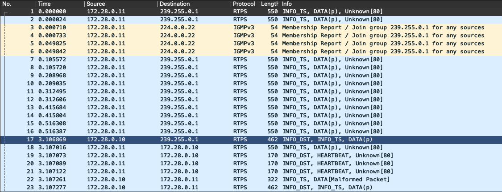
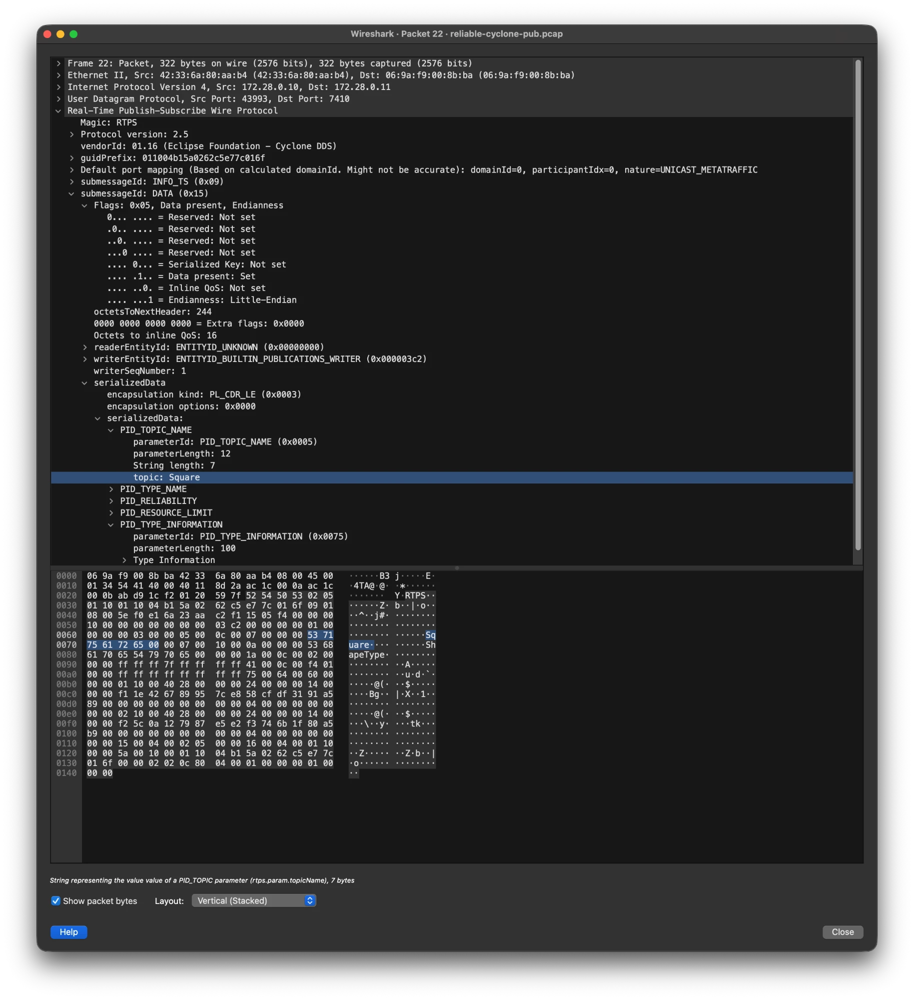

# Wireshark로 RTPS 캡처 읽기

[roadmap](../../docs-for-agent/roadmap.md) | 캡처 파일: [captures/cyclone-fastdds/README.md](../../captures/cyclone-fastdds/README.md) | 네트워크: [docker-network.md](docker-network.md)

이 책의 캡처 (`captures/`)를 Wireshark로 열 때 알아 둘 표시 방식과 자주 쓰는 조작을 정리한다. chapter 3에서 처음 쓰고, 캡처를 읽는 모든 chapter가 같은 방법을 쓴다. 화면과 문구는 Wireshark 4.6.9 기준이고, 버전이 다르면 Info 열의 문구가 조금 다를 수 있다.

## 패킷 목록: Info 열은 서브메시지 목록이다

RTPS 메시지 하나는 헤더 뒤에 서브메시지 여러 개가 이어진 것이고 ([용어 정리](../../book/glossary.md#프로토콜)), Wireshark는 Info 열에 그 이름을 쉼표로 나열한다 (예: `INFO_TS, DATA, HEARTBEAT`). 아래 그림은 참고 캡처 `reliable-cyclone-pub.pcap`을 표시 필터 `rtps || igmp`로 연 처음 23개 프레임이다.

서브메시지의 역할은 다음과 같다. 번호와 플래그의 뜻은 chapter 7과 10에서 다룬다.

| 서브메시지 | 보내는 쪽 | 역할 |
|---|---|---|
| `DATA` | writer | 샘플 하나. 디스커버리 정보도 이것으로 나간다 (아래) |
| `HEARTBEAT` | writer | 자기가 가진 샘플의 번호 범위를 알린다. reliable 통신의 확인용 |
| `ACKNACK` | reader | 받은 것과 빠진 것을 답한다. reliable 통신의 확인용 |
| `INFO_TS`, `INFO_DST` | 둘 다 | 뒤따르는 서브메시지에 시각과 목적지 정보를 붙이는 보조 서브메시지 |

## 디스커버리도 DATA다

참가자 정보와 writer / reader 정보도 사용자 데이터와 같은 DATA 서브메시지로 나간다 (내장 엔드포인트, RTPS 2.5 Sec. 8.5.2). Wireshark는 어느 종류의 writer가 보냈는지에 따라 DATA 뒤에 표시를 붙인다. 규격에는 DATA 하나뿐이고 이 표시는 Wireshark의 것이다.

| Info 열 | 보낸 writer (entityId) | 뜻 |
|---|---|---|
| `DATA(p)` | SPDP writer (`0x000100c2`) | 참가자 정보 (나는 누구이고 어디로 보내면 된다) |
| `DATA(w)` | SEDP writer 정보 writer (`0x000003c2`) | 내 writer 하나의 정보 (토픽, 타입, QoS) |
| `DATA(r)` | SEDP reader 정보 writer (`0x000004c2`) | 내 reader 하나의 정보 |
| `DATA(m)` | 참가자 메시지 writer (`0x000200c2`) | 내 writer들이 살아 있다는 알림 (liveliness) |
| `DATA` | 사용자 writer | 사용자 데이터 |
| `[UD]` 붙음 | 위의 writer | 그 항목이 사라진다는 알림. 참가자 정보에 붙으면 참가자가, writer 정보에 붙으면 그 writer가 사라진다는 뜻이다. `U`와 `D`는 inline QoS의 `PID_STATUS_INFO`에 Unregistered와 Disposed 플래그가 켜진 것이다 (Sec. 9.6.4.9) |

## 정상인 두 가지 이상한 표시

- Fast DDS가 보낸 모든 메시지 끝에는 `Unknown[80]`이 붙는다. Fast DDS가 붙이는 벤더 전용 서브메시지로, Wireshark가 모르는 번호라 이렇게 표시한다 ([용어 정리](../../book/glossary.md#프로토콜)).
- Cyclone이 보낸 writer 정보는 `DATA(w)`가 아니라 `DATA[Malformed Packet]`로 표시된다. Wireshark 4.6.9가 그 안의 `PID_TYPE_INFORMATION`을 해석하다 멈추기 때문이고, 그 앞의 항목 (토픽 이름, 타입 이름, QoS)은 정상으로 읽힌다. Fast DDS는 이 메시지를 받아 매칭했고 사용자 데이터가 이어졌으므로 통신에는 문제가 없다.

## 상세 창: 서브메시지 안을 본다

패킷을 고르면 그 내용이 상세 창에 트리로 나온다. `Real-Time Publish-Subscribe Wire Protocol`을 펼치면 헤더 (프로토콜 버전, vendorId, guidPrefix)와 서브메시지가 나온다. 아래 그림은 `reliable-cyclone-pub.pcap`의 프레임 22 (Cyclone의 writer 정보)를 `DATA`, `serializedData`, `PID_TOPIC_NAME` 순서로 펼친 것이다.

자주 찾는 항목은 다음과 같다.

| 찾는 것 | 상세 창의 위치 |
|---|---|
| 보낸 writer | `DATA`, `HEARTBEAT` 아래의 `writerEntityId` |
| 샘플 번호 | `DATA` 아래의 `writerSeqNumber` |
| 토픽, 타입, QoS (writer / reader 정보) | `DATA`, `serializedData` 아래의 `PID_TOPIC_NAME`, `PID_TYPE_NAME`, `PID_RELIABILITY` 등 |
| 참가자가 받는 주소와 포트 (참가자 정보) | `DATA`, `serializedData` 아래의 `PID_METATRAFFIC_UNICAST_LOCATOR`, `PID_DEFAULT_UNICAST_LOCATOR` |

## 표시 필터

| 필터 | 뜻 |
|---|---|
| `rtps` | RTPS 메시지만 |
| `rtps \|\| igmp` | RTPS와 IGMP. `\|\|`는 "또는" |
| `rtps.sm.wrEntityId == 0x00000202` | 서브메시지 안의 writerEntityId가 이 값인 메시지. ACKNACK도 상대 writer의 entityId를 담으므로 함께 걸린다 |
| `rtps && !(rtps.sm.wrEntityId == 0x00000202)` | 그 writer와 관계없는 RTPS 메시지. `&&`는 "그리고", `!`는 "아닌" |
| `... && ip.src == 172.28.0.10` | 보낸 쪽 주소로 나눈다 |

필터 필드의 이름은 [Wireshark Display Filter Reference: RTPS](https://www.wireshark.org/docs/dfref/r/rtps.html)에 있다. 프레임 번호로 바로 가려면 Go > Go to Packet을 쓴다.

## 프레임 수와 바이트 세기

필터를 입력한 뒤 Statistics > Capture File Properties를 열면 Displayed 열에 프레임 수와 바이트가 나온다. 필터를 바꾸면 창을 다시 연다. 바이트는 Ethernet, IP, UDP 헤더 (42바이트)를 포함한 프레임 길이다.

구독자 컨테이너에서 캡처한 파일에서는 그 컨테이너가 보낸 멀티캐스트가 나가는 것과 돌아온 것 두 개씩 보인다 ([docker-network.md](docker-network.md#멀티캐스트가-컨테이너-사이를-넘어가는-원리)). 복사본이 잡히지 않는 호스트에서 직접 만든 캡처에는 한 번씩만 보이므로, 세는 값도 그만큼 다르다.
