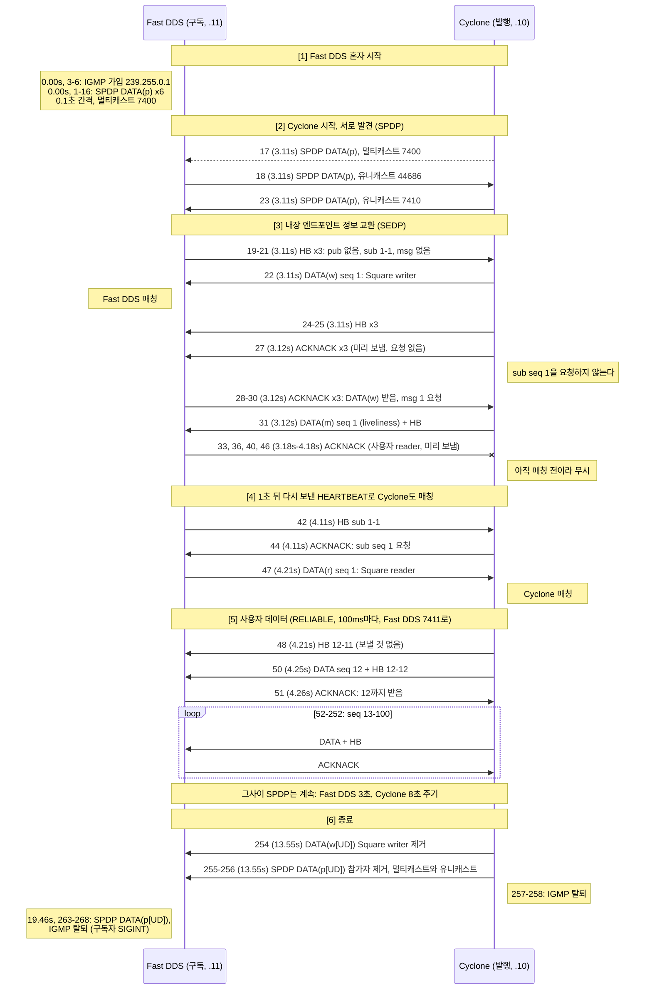
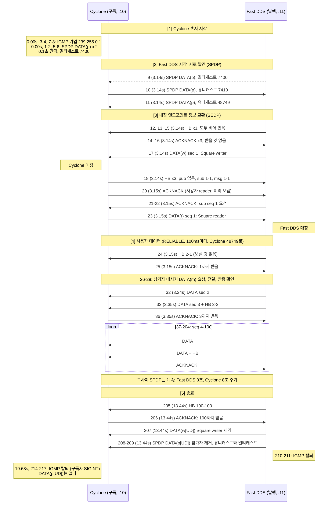

# Phase 00 캡처

[Phase 00](../../../docs/phases/phase-00-setup.md) | [시나리오 표](../../../docs/phases/phase-00-setup.md#시나리오-표) | [docker-network.md](../../../docs/environment/docker-network.md)

Cyclone DDS와 Fast DDS의 shape_main을 통신시켜 잡은 패킷과 로그다. 이후 단계에서 파서와 상태 머신을 검증하는 정답 데이터로 쓴다.

## 공통 조건
- 벤더와 빌드 소스: Cyclone DDS master `f2aaccb4` (11.0.1), Fast DDS 3.6.1, shape_main 소스 omg-dds/dds-rtps `526dc56`. 자세한 버전 표는 [docker/README.md](../../../docker/README.md#빌드-소스와-버전).
- 주소: cyclone 172.28.0.10, fastdds 172.28.0.11 (bridge `dds-net`).
- 캡처는 구독자 컨테이너의 `eth0`에서 `tcpdump "udp or igmp"`로 한다. 자기가 보낸 멀티캐스트는 loopback 복사본 때문에 두 번씩 잡힌다 ([docker-network.md](../../../docs/environment/docker-network.md#멀티캐스트가-컨테이너-사이를-넘어가는-원리)).
- 다시 만들기: `docker/`에서 `./phase00-capture.ts <이름>` (기존 파일이 있으면 `--force`). 다시 만들면 프레임 번호와 임의 포트가 바뀌므로 아래 표도 고친다.
- Wireshark 4.6.9 기준. 필터 `rtps`.

## 파일
| 파일 | 내용 |
|---|---|
| `mcast-check.{fastdds,cyclone,nojoin}.pcap` | Step 4 네트워크 검증. DDS 없이 멀티캐스트만. [docker-network.md "검증 명령"](../../../docs/environment/docker-network.md#검증-명령) |
| `rel-cyclone-pub.*` | Cyclone 발행 -> Fast DDS 구독, RELIABLE. 캡처는 fastdds |
| `rel-fastdds-pub.*` | Fast DDS 발행 -> Cyclone 구독, RELIABLE. 캡처는 cyclone |
| `be-cyclone-pub.*` | Cyclone 발행 -> Fast DDS 구독, BEST_EFFORT. 캡처는 fastdds |
| `be-fastdds-pub.*` | Fast DDS 발행 -> Cyclone 구독, BEST_EFFORT. 캡처는 cyclone |
| `dispose-on-exit.*` | Cyclone 발행, 끝날 때 인스턴스 dispose (`PID_STATUS_INFO` Disposed). 캡처는 fastdds |
| `lease-expiry.*` | Cyclone 발행자를 SIGKILL. 참가자 제거 메시지 없이 lease 만료로 사라진다. 캡처는 fastdds |
| `large-sample.*` | Cyclone 발행, 샘플 약 100KB x 30회. DATA_FRAG (조각 1344바이트), HEARTBEAT_FRAG. 캡처는 fastdds |
| `xcdr2.*` | Cyclone 발행, XCDR2 (`D_CDR2_LE`, PID_DATA_REPRESENTATION XCDR2). 캡처는 fastdds |

## rel-cyclone-pub
```
fastdds: fastdds_shape -S -d 0 -t Square -x 1 -r
cyclone: cyclone_shape -P -d 0 -t Square -x 1 -r -c BLUE --write-period 100 --num-iterations 100
```

### 흐름
프레임 268개는 세 묶음이다: 사용자 데이터 184개 (DATA + HEARTBEAT와 그 ACKNACK가 100ms마다 반복), 디스커버리 72개, IGMP 12개. 반복을 걷어 내면 아래 6단계가 남는다. 메시지마다 앞에 프레임 번호와 시각 (캡처 시작 기준)을 붙였다. 실선은 유니캐스트, 점선은 멀티캐스트, 끝이 x인 화살표는 받는 쪽이 무시한 메시지다.



- 기호: `HB (a-b)`는 HEARTBEAT의 firstAvailableSeqNumber a와 lastSeqNumber b다. a > b면 writer에 보낼 샘플이 없다는 뜻이다. ACKNACK의 "n까지 받음"은 bitmapBase n+1, numBits 0이다 (RTPS 2.5 Sec. 8.3.8.6 Heartbeat, Sec. 8.3.8.1 AckNack, Sec. 9.4.2.6).
- 엔드포인트 (writerEntityId): SPDP `0x000100c2`, SEDP pub `0x000003c2` (DATA(w)), SEDP sub `0x000004c2` (DATA(r)), 참가자 메시지 `0x000200c2` (DATA(m), msg), 사용자 writer `0x00000202` (Cyclone의 Square). Fast DDS의 사용자 reader는 `0x00000107`이다 (RTPS 2.5 Sec. 9.3.1.3, 표 9.2).
- 포트: 7400은 멀티캐스트 메타트래픽, 7410/7411은 Fast DDS의 유니캐스트 메타트래픽과 사용자 데이터, 44686은 Cyclone의 유니캐스트 (둘 다). Cyclone이 보내는 출발 포트 43993은 받는 포트와 다르다.
- 1-16의 SPDP와 IGMP가 두 개씩인 것은 자기가 보낸 멀티캐스트의 loopback 복사본이다 ([공통 조건](#공통-조건)).

### 이 캡처에서 볼 것
- **사용자 seq가 12부터 시작하는 이유.** Cyclone은 3.11초부터 100ms마다 썼지만 4.21초 (47)에야 Fast DDS의 reader를 알았다. 그사이 쓴 seq 1-11은 VOLATILE이라 늦게 온 reader에게 보내지 않는다 (48의 HB 12-11). 1.1초가 걸린 것은 Cyclone이 첫 HEARTBEAT (21, sub 1-1)에 답하지 않았기 때문이다. 27의 ACKNACK는 seq 1을 요청하지 않았고, Fast DDS가 1초 뒤 HEARTBEAT를 다시 보내서야 (42) 요청했다 (44). 21은 Fast DDS의 SPDP (18) 바로 뒤에 도착해서, Cyclone이 아직 상대 참가자를 등록하기 전이라 버린 것으로 보인다 [추정].
- **미리 보내는 ACKNACK (pre-emptive).** 27 (Cyclone)과 33 (Fast DDS)은 HEARTBEAT를 받기 전에 writer를 발견하자마자 보낸 ACKNACK다. 규격은 최적화로 허용하되 writer가 답할 의무는 없다고 한다 (RTPS 2.5 Sec. 8.4.2.3). Fast DDS의 33은 bitmapBase가 0인데, 규격은 bitmapBase >= 1을 요구한다 (RTPS 2.5 Sec. 9.4.2.6). Cyclone은 이것을 받고도 문제없이 동작했다.
- **매칭은 양쪽이 따로 한다.** Fast DDS는 22에서 매칭했고 Cyclone은 47에서 매칭했다. 그사이 Fast DDS reader의 ACKNACK (33, 36, 40, 46)는 Cyclone이 아직 모르는 reader에서 온 것이라 무시된다.
- **HEARTBEAT를 DATA에 얹어 보낸다 (piggyback).** 50부터 Cyclone은 메시지 하나에 DATA와 HEARTBEAT를 함께 넣고, Fast DDS는 매번 Final 플래그를 켠 ACKNACK로 답한다 (RTPS 2.5 Sec. 8.4.15.4).
- **종료 순서.** 발행자는 SEDP로 writer 제거 (`DATA(w[UD])`, status_info Unregistered + Disposed)를 먼저 알리고 SPDP로 참가자 제거를 알린다. 구독 로그 끝의 `NOT_ALIVE_NO_WRITERS_INSTANCE_STATE`가 이 결과다.

### 요약
| 항목 | 값 |
|---|---|
| 사용자 DATA seq | 12-100 (89건 모두 전달, GAP 없음) |
| 구독 로그 샘플 수 | 84. 나머지는 구독자 history (KEEP_LAST)에서 덮어써진 것이다 |

### Wireshark에서 나눠 보기
- 디스커버리만 (72개): `rtps && !(rtps.sm.wrEntityId == 0x00000202)`
- 사용자 데이터만 (184개): `rtps.sm.wrEntityId == 0x00000202`

## rel-fastdds-pub
```
cyclone: cyclone_shape -S -d 0 -t Square -x 1 -r
fastdds: fastdds_shape -P -d 0 -t Square -x 1 -r -c BLUE --write-period 100 --num-iterations 100
```

### 흐름
프레임 217개: 사용자 데이터 153개, 디스커버리 52개, IGMP 12개. 캡처는 구독자인 Cyclone 쪽이라 이번에는 Cyclone이 보낸 멀티캐스트가 두 개씩 잡힌다. 그림의 표기는 rel-cyclone-pub과 같다.



- 기호와 엔드포인트 ID는 [rel-cyclone-pub](#흐름)과 같다. 다만 사용자 엔드포인트는 Fast DDS의 writer `0x00000102`, Cyclone의 reader `0x00000207`이다.
- 포트: Cyclone은 메타트래픽과 사용자 데이터를 모두 48749로 받는다. Fast DDS는 7410 (메타트래픽), 7411 (사용자 데이터)로 받는다.
- 12-16은 HB와 ACKNACK가 섞여 오갔다 (HB 12, 13, 15와 ACKNACK 14, 16). 18의 HB는 받는 reader를 정하지 않은 HB 세 개를 한 메시지에 넣었다.

### 이 캡처에서 볼 것
- **이번에는 10ms 만에 양쪽이 매칭했다.** Fast DDS가 writer를 만들자마자 SEDP DATA(w) (17)를 HEARTBEAT 없이 바로 보냈고, Cyclone은 18의 HB로 자기 reader 정보 (sub 1-1)를 알렸다. Fast DDS가 곧바로 요청하고 (21) Cyclone이 보냈다 (23). [rel-cyclone-pub](#이-캡처에서-볼-것)에서 1.1초 걸린 것과 비교하면, 그쪽은 첫 HB가 버려진 것이 원인이었다.
- **그래도 seq 1은 전달되지 않았다.** Fast DDS는 writer를 만든 직후 (17, 3.141초) 첫 샘플을 썼고, Cyclone의 reader를 안 것은 23 (3.151초)이다. 24의 HB가 2-1, 곧 "seq 1까지 썼지만 이 reader에게 줄 것은 없다"를 알린다. VOLATILE이라 매칭 전에 쓴 샘플은 늦게 온 reader에게 주지 않는다.
- **HEARTBEAT를 얹는 빈도가 벤더마다 다르다.** Cyclone은 DATA마다 HB를 붙였지만 (rel-cyclone-pub), Fast DDS는 두 번에 한 번 붙인다 (33, 42, 47, ...). ACKNACK도 그만큼 적다. 규격은 빈도를 정하지 않는다 (RTPS 2.5 Sec. 8.4.15.4).
- **Fast DDS는 사용자 DATA에도 INFO_DST를 붙인다.** 받는 참가자를 지정한 유니캐스트라는 뜻이다. Cyclone은 사용자 DATA에 INFO_DST를 붙이지 않았다 (rel-cyclone-pub의 50).
- **Cyclone은 종료할 때 SPDP `DATA(p[UD])`를 보내지 않았다.** rel-cyclone-pub에서는 Fast DDS가 아직 살아 있을 때 Cyclone이 보냈다. 이번에는 상대가 이미 떠난 뒤라 보낼 곳이 없었던 것으로 보인다 [추정]. 마지막 프레임은 IGMP 탈퇴다.

### 요약
| 항목 | 값 |
|---|---|
| 사용자 DATA seq | 2-100 (99건 모두 전달, GAP 없음) |
| 구독 로그 샘플 수 | 99 |

### Wireshark에서 나눠 보기
- 디스커버리만 (52개): `rtps && !(rtps.sm.wrEntityId == 0x00000102)`
- 사용자 데이터만 (153개): `rtps.sm.wrEntityId == 0x00000102`

## 두 벤더의 차이 (지금까지 확인한 것)
| 항목 | Cyclone DDS | Fast DDS |
|---|---|---|
| vendorId | 0x0110 (Eclipse) | 0x010f (eProsima) |
| RTPS 헤더 프로토콜 버전 | 2.5 | 2.2 |
| SPDP lease duration | 10초 | 20초 |
| SPDP 멀티캐스트 주기 | 시작 때 2번 (0.1초 간격), 이후 8초 | 시작 때 6번 (0.1초 간격), 이후 3초 |
| 유니캐스트 포트 | 임의 (캡처마다 다름. 33690, 44686, 41822, 48749). 메타트래픽과 사용자 데이터가 같은 포트 | 7410 (메타트래픽), 7411 (사용자 데이터). 규격 기본 공식대로 |
| SPDP의 멀티캐스트 로케이터 | 메타트래픽 239.255.0.1:7400, 사용자 데이터 239.255.0.1:7401 | 광고하지 않음 |
| SPDP의 그 밖의 로케이터 | 없음 | kind 0x13 (벤더 전용, 공유 메모리로 추정)의 사용자 데이터 로케이터 |
| 벤더 전용 PID (SPDP) | 0x8007: 길이 52, 문자열 `cyclone/11.0.1/Linux/Linux`를 포함. 0x8019: 길이 4 | 0x8000: 제품 버전 `03 06 01 00` (3.6.1.0). 0x8007: 길이 4, 값 1 |
| 벤더 전용 서브메시지 | 없음 | 모든 메시지 끝에 0x80 (길이 56). 통계 모듈 (`StatisticsSubmessageData`)이 붙인다 |
| SEDP의 PID_TYPE_INFORMATION | 있음 | 없음 |
| 사용자 DATA에 HEARTBEAT를 얹는 빈도 | DATA마다 | DATA 두 번에 한 번 |
| 사용자 DATA 앞의 INFO_DST | 없음 | 있음 |
| SPDP를 상대 유니캐스트 주소로도 보냄 | 예. 새 참가자를 발견하면 1초 간격으로 4번, 이후 8초 주기에 맞춰 | 예. 3초 주기의 멀티캐스트마다 함께 |

- **같은 벤더 전용 PID 번호가 벤더마다 뜻이 다르다.** 0x8007이 Cyclone에서는 버전 문자열, Fast DDS에서는 4바이트 값이다. 벤더 전용 PID와 서브메시지는 메시지 헤더의 vendorId를 보고 해석하고, 모르면 건너뛴다 (RTPS 2.5 Sec. 8.3.4.1 규칙 3, Sec. 9.6.2.2.1). mdds 파서가 지켜야 할 규칙이고, 이 캡처가 그 시험 데이터다.
- Fast DDS의 0x80 서브메시지 근거: Fast DDS 실행 파일에 `StatisticsSubmessageData`, `add_statistics_sent_submessage` 기호가 있다. 내용 배치는 바이트로 본 것이다: 목적지 로케이터 (24), 시각 (8), 메시지 순번 (8), 누적 바이트 수 (8), 0 (8). [필드 이름은 추정]
- **Wireshark가 Cyclone의 SEDP DATA를 Malformed로 표시한다** (rel-cyclone-pub 22, rel-fastdds-pub 23). `PID_TYPE_INFORMATION` (XCDR2로 인코딩된 XTypes TypeInformation)의 해석에서 깨진다. Fast DDS는 이 SEDP로 정상 매칭했으므로 Wireshark 해석기 쪽 문제로 본다 [추정]. Phase 12 (XTypes)에서 직접 해석해 확인한다.
- Fast DDS의 RTPS 헤더 버전 2.2는 SPDP의 `PID_PROTOCOL_VERSION`도 2.2다. Cyclone 2.5와 문제없이 통신한다.
